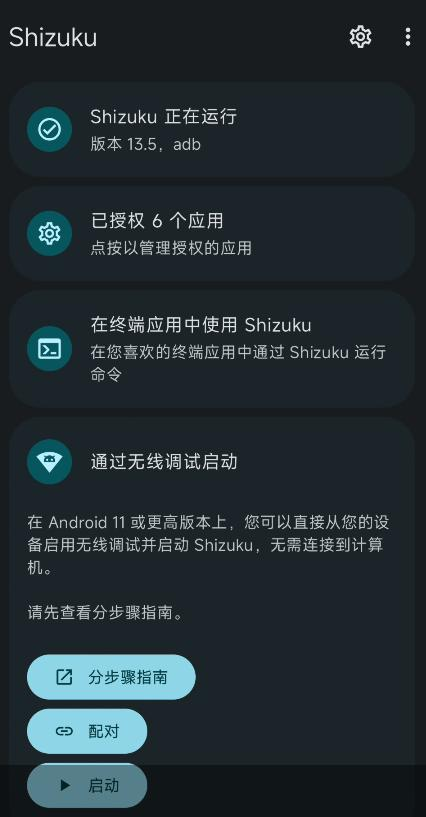
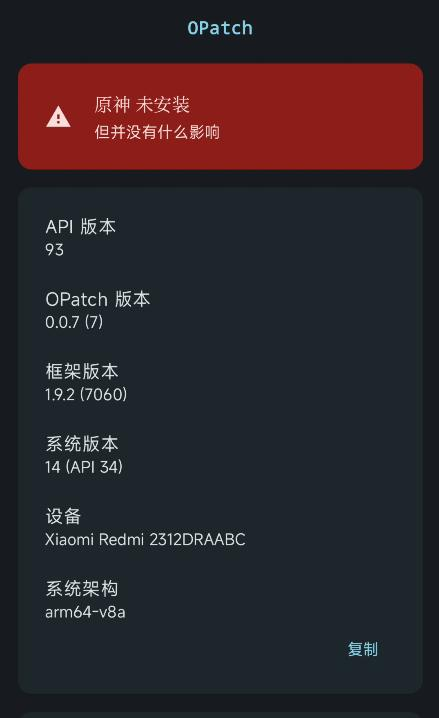

## 引子
入了只安卓机，手痒痒，给他狠狠的解bl，狠狠的root，狠狠的安装框架，狠狠的装上各种模块 🥵
本想大干一场，搜索了一下现在的搞机教程，发现十分方便。
## 正文
### 获取权限
之前的superSU、magisk等不适用于现在的手机了。现在都用`shizuku`，甚至不需要解锁，只需要能开启adb就可以。

### 框架
古早时候使用xposed，后来有了lsposed，这两款软件都需要root，不能搭配shizuku使用
现在是船新版本`lspatch`或是改版`opatch(原神)`，类似于之前使用过的太极，需要使用框架基于原应用重新生成一个集成了框架的新app

## 常用软件
### viphook
集成了n多模块，详细说明了每个应用的适用版本，好用
### 润二月
代替wx用，微信8.0.48可用
### 签名助手
对应用伪装签名
### wx
wx功能很多，但因倒卖问题作者开启了捐赠，需要捐赠才能够使用
### skip
跳广告
### appops
修改应用权限等功能
### libchecker
查看应用，apk信息，搭配签名助手使用
### 雹
冰箱，空调狗等软件的替代品
## 可能会存在的问题
### shizuku经常掉
使用无线调试会遇到这个问题，但是俺没有解决方案
### 签名问题
通过lsp或op修补过的软件签名会发生改变，如果软件发现签名不一致可能会出现软件打不开，无法被调用的问题。
使用签名助手伪造签名