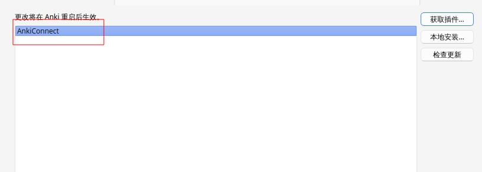
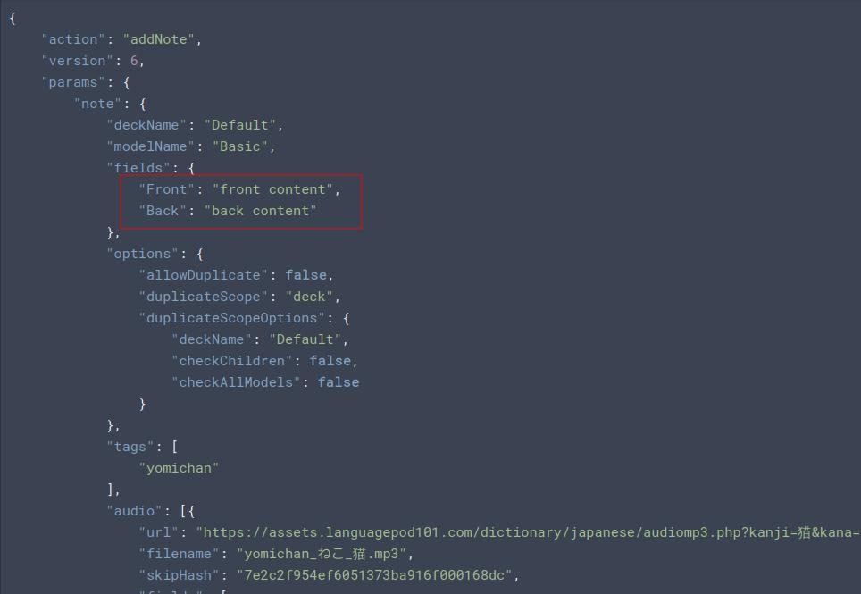
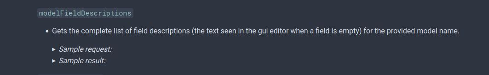
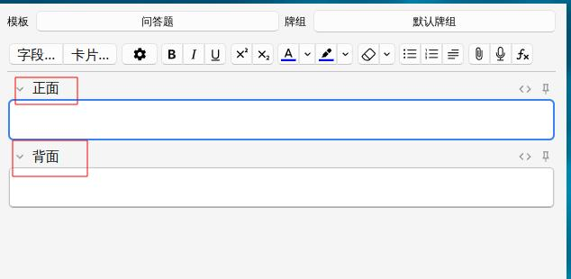

## 引子
在使用anki时每次都要手动添加，用鼠标操作属实麻烦。对于俺这个新手来说，新建一个note大部分选项都是省缺值，俺只在乎note的正反面的内容和存到了那个deck。本文将介绍使用anki插件+python实现在cli中为anki添加笔记
## 插件安装
安装ankiconnect
工具->插件->获取插件->输入代码`2055492159`
安装后要重启

如果想要编辑插件配置的可以在插件管理中双击进行编辑
插件默认只允许本地访问，所以不用担心安全问题
## python代码编写
俺只写了一个demo，跟官方文档没差多少
工具(类)
```python
import json
import urllib.request
anki_connect_url = 'http://127.0.0.1:8765'
def request(action, **params):
return {'action': action, 'params': params, 'version': 6}
def invoke(action, **params):
requestJson = json.dumps(request(action, **params)).encode('utf-8')
response = json.load(urllib.request.urlopen(urllib.request.Request(anki_connect_url, requestJson)))
if len(response) != 2:
raise Exception('response has an unexpected number of fields')
if 'error' not in response:
raise Exception('response is missing required error field')
if 'result' not in response:
raise Exception('response is missing required result field')
if response['error'] is not None:
raise Exception(response['error'])
return response['result']
```
代码
```python
import util
default_deck_name = "我的牌组"
default_model_name = "问答题"
default_tags = []
def build_fields(f, b):
return {
"正面": f,
"背面": b,
}
def build_note_by_default(f, b):
return build_note(default_deck_name, default_model_name, build_fields(f, b), default_tags)
def build_note(deck_name, model_name, fields, tags=None):
if tags is None:
tags = []
return {
"deckName": deck_name,
"modelName": model_name,
"fields": fields,
"tags": tags,
"options": {
"allowDuplicate": False,
"duplicateScope": "deck",
"duplicateScopeOptions": {
"deckName": deck_name,
"checkChildren": False,
"checkAllModels": False
}
}
}
def add_note(note):
return util.invoke("addNote", note=note)
def add_notes(notes):
return util.invoke("addNotes", notes=notes)
response = add_note(build_note_by_default("正面内容", "背面内容"))
print(response)
```
## 踩坑
### 中文环境下跑addNote报错
跑`addNote`接口时报错`cannot create note because it is empty`
百思不得其解，翻了翻接口找到了`canAddNotesWithErrorDetail`，本以为detail会有更详细的输出，然并卵。仍旧是报错`cannot create note because it is empty`。
偶然间将fields字段中的内容注释掉，又跑了一遍发现仍旧是这个问题。

那就清晰了，怀疑模板有问题。于是俺又去翻了翻接口，找到了`modelFieldDescriptions`。用于查看模板字段描述，输出为两个空。根据接口表述那么该值为gui中添加笔记时显示的字段。


emmmmm，竟然是中文。尝试将fields中的字段名改为正面和背面后，接口跑通了。
## 参考
[FooSoft Productions Anki-Connect](https://foosoft.net/projects/anki-connect/)