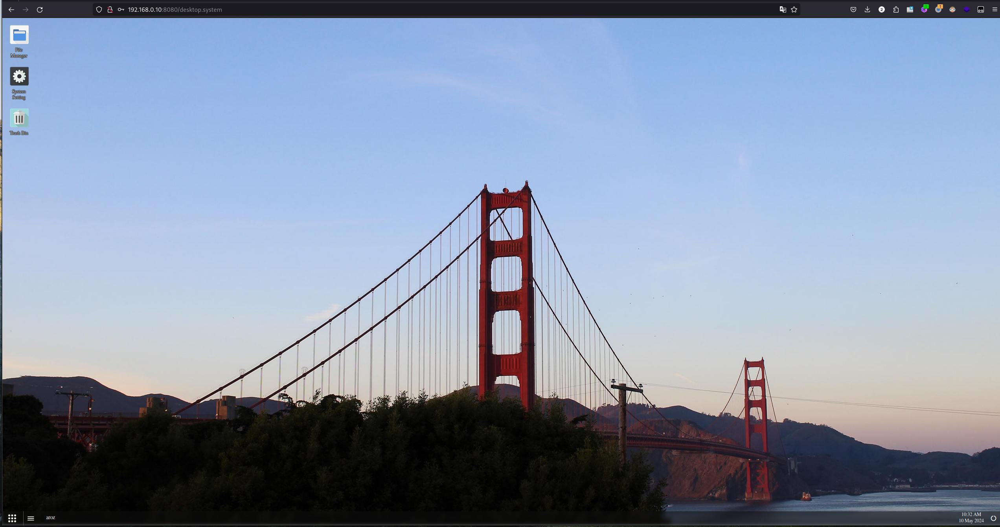

## 引子
最近在看《自由软件，自由社会》一书。发现自己家里的群晖emmmm，然后着手去寻找一个替代品。俺找到了arozos
## 安装
俺从本想从一台centos安装，但是俺发现其安装脚本仅适用与debain系列的操作系统。于是俺又重新安装了一个ubuntu server
安装很简单只需行命令即可
```shell
wget -O install.sh https://raw.githubusercontent.com/tobychui/arozos/master/installer/install.sh && bash install.sh
```
然后使用
```shell
systemctl start arozos
```
访问配置的端口号就能使用辣

### 踩坑
使用root用户安装后生成的service有问题，手动修改后可正常启动
## 后记
处理一些简单的文本倒是不错。处理起来office全家桶就不太行了。
俺找了一圈，没有找到跨平台的照片同步功能，俺也不想折腾了。
总结，把玩一下还是可以的，日用就算了。
## 参考
[arozos](https://github.com/tobychui/arozos)
id:: 663d80b6-07b9-417d-93e0-1ad02f07a292
