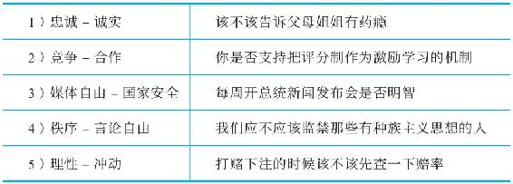
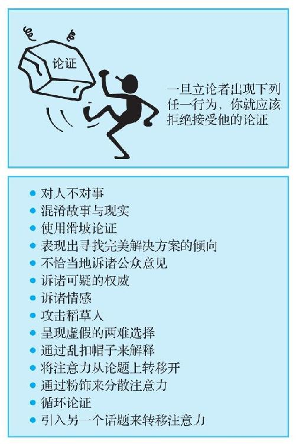
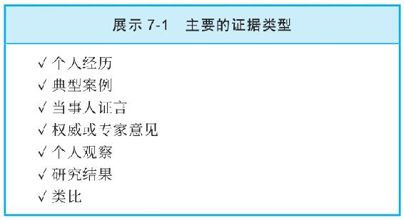
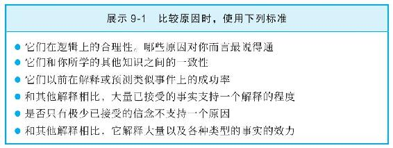
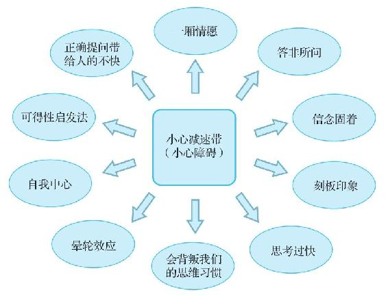

## 关于本书
id:: 67f68be9-784a-4d4d-a2de-180b38369d57
### 为什么要读
改变自己的思维方式，让自己更方便的了解世界。
### 概要
本书教我们如何成为一个批判性思维者，根据批判性思维者的思维来进行提问。让我们更好的理解问题、了解世界。
### 读后感
读后受益匪浅，系统的学习了论证相关的知识，寻找论题、结论、理由。如何判断论证的有效性。更多的是让我拓宽了知识面，在阅读中也发现了自己的一些不足。
如果让我推荐这本书，我的理由可能是：
几乎每一个章节都提供了案例，让你有实践的机会，不至于纸上谈兵。
### 注意
本文大部分为对本书的摘抄，其中包含了一些我自己的碎碎念。也总结了一些内容，我总结的内容一定会有问题，有时候是为了总结而总结，就会导致出现问题。将本文发表出去更多的是想推荐一下这本书。
格式约定：
使用注释块的文本均为摘抄
使用`[[]]`圈起来的文字是我后面可能会写的东西
除**关于本书**外，所有的h2标题均为书中的章节名
每个章节都会有一个为**小结**的h3标题，该小结是我添加的
### 其他
总结像批判性思维者那样写作和发言
总结批判性思维者对一个论题的思考
作者推荐好好讲道理:反击谬误的逻辑学训练
## 正确提问的益处和方法
世界是嘈杂、混乱的，我们要有"批判性思维"。
不盲目相信权威。
> 批判性思维会教你很多技能和态度，让你理性地找到对自己有意义的答案并为此感到自豪。批判性思维鼓励你倾听他人，向别人学习，同时掂量别人所说的话，看看它们的分量如何。如此，你将了解到我们必须要依赖他人，但又不能来者不拒，必须做出选择。由此，批判性思维会解放你的身心，让你有能力成为自己迈向未来道路上的指导者。
激发批评性思维
> 我们在本书中使用的批判性思维（critical thinking）这一术语，指由以下三个维度激活的评估技能：
1）意识到一整套环环相扣的批判性问题；
2）有能力在适当时机以适当方式提出并回答这些问题；
3）有积极主动地使用这些批判性问题的强烈渴望。
本书的目标就是激发你朝这三个维度全面发展。
海绵式思维与淘金式思维
海绵式思维
广撒网，啥都看，但无法提供任何判断方法。
淘金式思维
在学习过程中不断提问，互动式参与。
两者可以互补，淘金的前提是有丰富的知识储备，这些知识储备可能会需要修正。
> 别人话中的不合理之处并不会自动跳到你的眼前。作为读者或听众，你必须要积极主动地去查究才行。要做到这一点，你就需要不断地提问。最好的查缺补漏方法就是批判性地提问。这些问题的一个巨大好处是，即使你对当前讨论的问题知识有限，你仍然可以打破砂锅问到底
> 批判性思维可以用来捍卫自己的信念，也可以用来对自己初始的信念加以评价和修正。
弱势批判性思维与强势批判性思维
> 弱势批判性思维是利用批判性思维来捍卫自己当前的信念。强势批判性思维是利用批判性思维来评价所有的断言和信念，尤其是对自己的信念加以评价。
> 如果你利用批判性思维来捍卫自己当前的信念，你就在使用弱势批判性思维。
这意味着你会先入为主的认为自己的观点是正确的，往往一件事可能是多面性的。
> 弱势批判性思维的目的就是坚决抵制和驳倒那些不同的观点和论证。将把那些意见和你不一样的人驳得哑口无言、乖乖认输作为批判性思维的最终目标，会毁掉批判性思维潜在的人道和进步性的特征。
> 强势批判性思维要求我们对所有的主张都提出批判性问题，包括对我们自己的主张。只有强迫自己批判性地看待初始信念，我们才能保证自己不自欺欺人和人云亦云。
可以摇摆不定，即一遍一遍推翻自己之前的观点。直至接近真相
> 只有当某个观点是我们千挑万选出来的——我们理解并且仔细评估过其他的观点，最终选择了这个观点，我们才会对所持的这个观点感到自豪。
最终目的是让学习过程变得简单。
价值观
> 价值观指的是人们认为较有价值的观念（常常不曾言明）。它们树立了一定的行为准则，我们据此来衡量人类行为的品质高下。
> 然我们时常要求自己必须耐心倾听那些和我们价值观倾向不同的人的观点，但是价值观所带来的最常见的社会联系是相似性。那些把个人责任当成重要价值观的人，必然会去寻找同样相信“更好的个人选择可以解决人类的大多数问题”的人为伴，和他们惺惺相惜。可见，我们许多最有价值的社会交往或学习经历都始于与拥有类似价值观的人之间的交流。鉴于此，我们面对的一个巨大挑战，就是尽量去理解那些价值观倾向和我们不同的人的论证方式。
帮助你成为批判性思维者的价值观:
自主决断
好奇心
谦恭有礼
发自内心地尊重严密的论证(保持中立)
> 你可以基于自己的观点自信行事，对自己的结论不要犹豫不定，但也要留有一点余地，让自己时不时地反省一下：我有没有可能是错的呢？
让对话继续下去
> 最重要的是，当你使用批判性思维的各种技能时，一定要让别人明白你抱着学习的态度。此外，你要让他们相信你的本意是好的，如果你和他们的意见有分歧，不管这些分歧多么重大和严肃，都不必发展成口诛笔伐来收场。
❗：要有情商，你们在讨论，而不是在骂街
营造出和谐的讨论氛围
### 像批判性思维者那样写作和发言
在演讲和写作中识别和使用语气；
避免“过度依赖”专家。
> 作为批判性思维者，我们当然希望自己在阐述论点时，能做到平允公正、深思熟虑。在我们试图说服别人相信我们的观点是正确的时，我们不希望写出推理不当的论文或大声喊叫未经检验的观点。我们也不希望只是鹦鹉学舌地重复别人的论点，无论它论证得多么完美无瑕。
### 小结
本章节教你使用批判性思维，以及如何通过批判性思维不断完善自己。
批判性思维的意义：让学习更简单。
帮助你成为批判性思维者的价值观
使用批判性思维时要注意的东西：
让对话继续下去
营造出和谐的讨论氛围
## 论题和结论是什么
学习目标：
区分论题的类型
发现论题找到结论
将论题和结论应用到写作中
### 描述性论题和规定性论题
描述性论题
> 对它们的回答无一例外地都要描述某一事物过去、现在或将来客观是什么样的。
规定性型论题
> 这些论题都属于伦理或道德范畴，它们提出的都是关于什么是对、什么是错、什么该有、什么不该有、什么是好、什么是坏的问题。它们需要的是规定性的答案。因此，我们将这些论题称为“规定性论题”
对于为什么要区分论题，作者给出了答案。以个人经验来判断，这确实是有道理的，只不过我不会归纳总结这些类型
> 记住这两种不同的论题是很有用的，因为你最终做出的判断和评价的类型，将取决于你要回答的论题的类型。
### 寻找论题
> 在识别论题的时候，千万不要以为存在且只存在一种正确的陈述论题的方法。一旦你找到整篇文章或整个发言都在论述的问题，以及该问题和该文章（或该发言）间的联系，你就已经找到了一个引发了争论的论题。只要确定你所谓的论题符合“论题”的界定标准即可。
寻找论题的方法
直接在文中寻找
根据结论找论题
### 寻找结论
结论就是作者想表述的内容，想要证明的东西
> 寻找结论，其实就是寻找写作者或发言者希望你相信的一个陈述或一系列陈述。他希望你相信他在其他陈述的基础上所得出的结论。简言之，有说服力的交流或论证的基本结构是：甲之所以成立是因为乙。“甲”指结论，“乙”指结论的支撑材料。这个结构代表了推论的过程。
> 结论是推论出来的，它们来源于论证。结论是需要其他观点来支撑的观点。
> 没有证据支撑的断言称为纯观点
### 小结
本章节告诉我们如何群分描述性论题和规定型论题，最重要的是寻找论题和结论。
## 理由是什么
学习目标
认识论证中理由和证据的作用
理解论证的属性
区别理由和结论
> 所谓理由，就是用来支撑或证明结论的信念、隐喻和其他陈述。这些陈述是结论可信度的基础，是结论成立背后的逻辑。证据则是支持断言的另一个基础，它由一系列事实组成，这些事实有助于使听众或读者相信你的理由是可靠的。
> 论证有两个明显的必要组成部分，一个结论及支撑它的理由。两者当中如果有一个我们找不到，也就意味着我们失去了评价这一论证的机会。我们自然无法对找不到的东西做出评价。
### 为什么相信这个结论
> 你已经找到了结论，现在你想知道为什么这个结论有道理。如果一个陈述回答不了**“为什么写作者或发言者相信这个结论？”**这个问题，那么它就不属于理由。一个陈述（或一系列陈述）必须被立论者用作结论的支撑或依据，才能起到理由的作用。
> 在确定论证结构的时候，你应该把每一个被论证提出者拿来支持其结论的想法都当成理由，即使你并不相信它真的能为结论提供支持。在批判性思维的这一阶段，你正在设法找出论证之所在。因为你想对提供论证的人尽量公平，所以你要利用施惠原则。如果写作者或发言者相信他正在摆事实、讲道理以支持自己的结论，那么我们至少应该考虑一下他的论证过程。之后还有大把的时间来细细评价这个论证。
### 通过提示词寻找理由
提示词有很多，中文语境和英文语境可能有些区别，下面列出俺自己平时总结的提示词
...的原因是因为...
根据...所以证明...
### 让理由和结论一目了然
寻找理由和结论的方法可以通过自己的经历慢慢总结
> 一旦你找到理由，随着阅读或倾听的不断深入，你就需要一遍又一遍地重温这些理由。结论能不能站住脚主要取决于给出的相应理由扎不扎实。薄弱的理由必然导致薄弱的论证！
找到理由后要不断重新审视这些理由
> 操控型论证就是指以一个结论开始的论证。然后提供论证者选择理由和证据，它们发挥着特定的作用。这种作用并不在于这些证据具有很强的真实性，而在于它们有助于听众或读者在脑海中勾勒出一个故事，使这个故事朝着预先确定的结论行进。
不要带着结论去寻找理由
> 我们都知道，我们倾向于匆匆下结论。要设法避免“逆向逻辑”或“反向论证”，在这种论证中，理由不过是一记马后炮，会随着你的结论而不断变化。理想的做法是，将理由和证据作为模具，结论据此得以成型和修饰。
### ⭐像批判性思维者那样写作和发言
在我们自己的写作和发言中，什么是一个好的论题？什么是一个好的结论？
清晰而有趣的问题；
重点突出、阐述明确的结论；
有理由和证据支撑的结论，而且大多数人会觉得理由和证据有说服力；
回应论题的结论；
容易让读者或听众找到的结论。
如何找到论题？如何确定论题？
为什么要找论题？
很多时候写文章需要一个论题，比如为什么要使用vim？
确定一个清楚陈述的论题将有助于我们得出一个清楚陈述的结论。
把论题当成一个问题来思考，你就能集中精力，以通俗易懂的形式让读者或听众明白，你是被某一个问题所困扰，与其他问题无关。
如何论证？
> 我们一旦确定了希望论证的结论，就要确保这一结论切合主题，陈述明确，并且易于找到。读者或听众应该能够毫不费力地识别出我们的论点。
> 对论题的回应（即我们的结论）不仅要回答我们提出的问题，还要有强有力的理由和证据作为支撑。
要实现清晰晓畅(让大多数人觉得理由和证据有说服力)，得具有几个要素：
指示词；
经过研究并聚焦主旨的话题；
明确支撑结论的理由；
文章合理的结构和清晰的布局。
如何组织论证？
> 首先，要确保我们的确对所选主题言之有物，而且要言之凿凿，能够满足任务的要求。动手写作之前，我们可以通过头脑风暴法或自由写作法来评估我们对这个主题的知识储备。这个过程也可以帮助我们认真思考论题，而不是脑海中刚闪现过第一个念头，就匆匆上阵。不能仅仅因为我们对某一主题见解强烈，就认为我们可以很好地论证它。请记住，一个论点，一个好的论点，需要强有力的理由和证据。
> 其次，我们可以事先做研究。其实我们不愿意使用强烈的措辞，但在这种情况下似乎这样的措辞是恰如其分的：我们必须做好研究。一旦我们认为找到了一个很好的论题，并确定了结论是什么，我们就应该查看为得到这个结论所需要的证据和支撑。人们很容易认为自己已经知之甚多，而忽略了研究的步骤。但是我们当中能称得上即将论述的话题方面专家的人少之又少。事实上，在很多情况下，就算我们对某个话题有见解，这些见解可能也不是通过推理得出的。如果我们找不到强有力的理由，或者我们能找到的理由是毫无说服力的，甚或是道听途说得来的，我们就需要回到论题起点，得出不同的结论。
> 一旦我们有了一个论题，有了支撑结论的强有力的理由，我们就必须搭建一个条理明晰、结构合理的框架，使读者对我们论证充分的结论一目了然。切记，一篇文章主要由支撑结论的理由和证据所组成。如果我们没有几个令人信服的、强有力的理由来支撑我们的论点，如果这些理由没有按照逻辑关系组织起来，那么我们的写作或发言就很难进行下去，读者或听众也很难理解我们的论点。
**组织一篇文章的的方法，一般规则**
> 把论点放在引言里，用指示词突出，并在文章的结尾部分重复一下这个论点，稍微修改一下论点的措辞。
> 确保每条理由都能回答“为什么”这个问题。前文中我们曾经指出，身为读者的我们应该不停地问“为什么写作者或发言者相信那个观点”，而作为写作者或发言者，我们可以对自己的作品提出这样的问题：为什么我们相信自己的论点？如果我们所陈述的理由无法回答这个问题，我们就应该舍弃它，或者我们需要更充分地展开陈述，这样理由就能回答这个问题了。
> 使用指示词来介绍我们的理由和证据（本章的前面提供了一个列表）。
> 可以把论题、结论和理由看作论点的骨架。骨架越坚固，论据越有力。
### 小结
本小结重点是理由，如何判断一个理由。通过结论问为什么读者让我们相信？
作者教我们如何像批判性思维者那样写作和发言，从论题、结论、理由三个方面。
后面作者提供了一个组织一篇文章的一般规则。
俺的一个小题目：
论题为：为什么要选择GNULinux作为主力操作系统
## 哪些词语意思不明确
学习目标
意识到大多数字词有多重含义。
说明在批判性地评价一个论点之前，发现字词意图表达的精确意思的重要性。
展示如何说明模糊性亟待澄清。
> 虽然找到结论和理由为你提供了基本清晰的论证结构，但你还需要进一步检查这些部分的确切含义，然后才能对呈现在你面前的观点做出公正的回应。这时你就要特别注意语言的细枝末节。
> 准确辨认出关键词或短语的确切含义，是你在决定是否同意别人观点时的一个必要步骤。如果你没有仔细核对起决定性作用的关键词或短语的意思，那么也许你回应的观点根本就不是写作者想要表达的内容。
### 让人捉摸不透的多义词
> 我们在读书、听讲的时候，一定要不断推动自己去寻找那些意思不明确的词或短语，否则就可能对发言者或写作者要表达的内容不得要领。我们说一个词语或短语意思不明确，是指它的意思在我们所考察的论证的上下文语境里让人捉摸不透，需要有进一步的解释，我们才能判断论证是否恰当。
由于作者是英文语境，所以多义词很常见，但在中文中俺一时间竟想不到有啥多义词。在更多时候中文由于上下文的不同，某些词语的意思就会发生改变。
本段是为了让你知道为什么要去关注不明确的词语。
### 找准关键词
> 要确定哪些关键词或短语意思不清楚，第一步就要以表述出来的论题为线索，来寻找可能的关键词。这里所说的关键词或短语，是指在论题的语境里有不止一层潜在含义的词或短语。在你决定是否同意发言者的论证之前，你觉得首先得让他澄清这些词的含义。
> 确定哪些词或短语意思不清楚的第二步是要找到在对写作者的理由能否支撑其结论的判断中，哪些词或短语起到关键作用。也就是说，要找出论证结构中的关键词。找到这些关键词后，你就能判断它们的意思是否含糊不清。
重点关注结论和理由这些重要的地方中的关键词。
> 在寻找关键词或短语时还有个好帮手，那就是牢记下面这个原则：一个词或短语越抽象，人们就越有可能对其做出多重解读。
> 为了避免在使用“抽象”这个术语时意思不明确，我们这样来给它下定义：一个词所指代的对象离特定、具体的事例越遥远，它也就越抽象。因此，像“平等”“责任”“色情”和“侵犯”这些词，就要比“同样有机会获得生活必需品”“直接引发某个事件”“男女生殖器图片”和“故意伤害他人身体”这些短语抽象得多。后面这些短语提供了更加具体的图像，所以表意更明确。
> 你还可以通过反串（reverse role-playing）来找出潜在的重要又有歧义的词或短语。问问自己，如果你采取和写作者相反的立场，那么你会不会选择用不同的方式来定义某些词或短语？如果是这样，你就找到了一处可能存在的歧义。
反串，也就是说站在作者的对立面去思考。
本段是为了让你找到不明确的词语。
### 检查有没有歧义
> 接下来要做的就是重点关注每个词或短语，问问自己：“我知不知道它的意思？”要回答这个重要问题，你需要克服几个主要障碍。
> 第一个障碍是你自认为理解的和写作者想表达的是同一个意思。因此，在开始寻找之前，你就要避免这种和写作者心心相印的想法。你要养成不断提问的习惯，不停地问“你这样说是什么意思”而不是“我就知道你是这个意思”。第二个障碍是认为词语只存在一个明显的定义。很多词语都不是这样。因此，别忘了问自己：“这些词语或短语是否可能有不同的意思？”
了解词语的含义，你是不是真的明白了这个词语在上下文下要表达的意思，是否存在歧义。
> 前面一段需要你全神贯注地加以细读。它详细说明了使用这个关于歧义的批判性问题的具体步骤。在按照这个步骤来做之后，你就可以向自己或其他人说明，为什么这个论证过程还需进一步完善。虽然你也想相信别人说的话，但作为一个批判性思维者，你就是不肯轻易同意他的论证过程，直到他将影响论证过程的那些意思不明确的地方解释清楚才行。
### 判定歧义
> 你要不断地问：“写作者这样说是什么意思？”尤其要注意写作者对抽象词语的使用。
> 如果你没有要求写作者将这些含义模糊的词语解释清楚，就贸然接受他的论证，那你根本就不理解你选择相信的到底是什么东西。
### 根据上下文找出真正含义
> 写作者和发言者很少会给关键词下定义。因此，想理解一个模糊不清的陈述到底是什么意思，通常唯一可以依靠的线索就是这些词语的上下文语境。这里所说的语境，意思是指写作者或发言者的背景、这一词语在某一争论中的习惯用法，以及位于歧义词前后的其他词语和陈述，这些因素合在一起为潜在的关键词或短语的意思提供了线索。
> 聚焦歧义现象的批判性问题为你奠定了不偏不倚的基础，让你可以理直气壮地不同意某些论证。如果你与想要说服你的人对论证过程中用到的关键词的意思在理解上存在分歧，那么你首先要解决这些分歧，然后才能接受他提供的论证。
警惕存在歧义的关键字和短语。
### 字典里的定义不一定适合文章里的情境
> 到哪儿去找你需要的定义呢？一个很明显又很重要的来源就是在线字典。但是，字典上的定义常常包含了同义替换、举例说明或是使用标准的不完全说明。在具体文章中，这些定义往往难以确切界定词语的使用方法。在这种情况下，你就需要从文章的上下文语境中找出这个词的潜在含义，或者从你对文章主题的其他了解里发掘出它的意思。
### 谁想说服你，谁就要负责解释清楚
> 在你设法找出并澄清歧义以后，如果你对某些关键观点的准确含义还是拿不准，那又该怎么办呢？接下来该采取什么合理步骤？对于任何一个理由，如果其中包含了歧义，让人无法判断能否接受，那我们建议你干脆忽略它。作为一个积极主动的学习者，你有责任提出各种问题来澄清歧义。但是，你的责任到此为止。写作者和发言者才是努力要说服你接受某些观点的人。身为说客，他有责任回答你对可能存在的歧义的各种疑问。
找到歧义时，但是很多时候自己无法搞懂时就不要搞懂了，不要在这上面浪费时间，应该让想要说服你的人来为你解答。
### 像批判性思维者那样写作和发言
> 在这一部分，我们将关注写作过程中词和短语表意清晰的重要性。如果我们语焉不详，词不达意，那么没有人可以有效地回应我们所写或所说的内容。我们的意图必须通顺流畅、准确无误地传递给我们所面对的受众。
> 为了降低模棱两可的词或短语影响到我们的正常交流的可能性，我们可以做以下几点：
在论题和结论中找到关键词或短语，并定义和/或解释它们。
在理由中找到关键词或短语，并定义和/或解释它们。
识别核心论点中的抽象词，一个词越抽象，我们就越有必要澄清它。
问一问：“那些与我持不同意见的人，可能会如何用不同方式来定义这些术语以支持他们自己的论点？”
> 如果整篇文章都充斥着定义，那么我们就没有空间写其他东西了！并非如此，在澄清我们的语言时，我们有其他选择，并不只有细致入微地（也许是单调乏味地）对所有的关键词都进行定义这一种方式。一种常见的方法就是利用论证本身来明确我们要表达的意思。
> 另外，请记住，我们只需要定义那些对我们的论证具有核心意义的词语，这些词语可能是模棱两可或是抽象的。我们不需要定义我们使用的每一个词或短语。
> 我们可以进而采用其他一些辅助手段来确定我们仍需要澄清的关键词或短语。首先，我们可以请其他人来阅读我们所写的内容，最好是请那些对主题知之甚少，并与我们写作或发言的受众有相似之处的人。让他指出他可能不理解的词。陌生的读者通常是识别模棱两可的关键词的最佳人选，因为他们不熟悉我们的论证。
> 最后，人们很容易认为，定义和解释词语的过程会令人感到无聊，甚至枯燥乏味：这是一项查阅和抄写字典的乏味任务。请试着把这样的练习看作厘清自己思路的一个令人兴奋的机会。对于结论而言，文字犹如砺石，思想好比锋刃，两相砥砺将使思想更加锋利，长相砥砺，会生发出更加深思熟虑的论证。
也许这就是教别人会加深自己理解的逻辑吧。
### 小结
本章节告诉了我们如何寻找不明确的词语，以及应该如何去明确这些词语。这对判断理由的合理性非常重要。
## 价值观假设和描述性假设是什么
学习目标
解释找出隐含在论证中的假设的重要性。
识别论证中的价值观假设。
区别价值观假设与描述性假设之间的异同。
理解典型的价值观冲突。
运用线索找出描述性结论。
> 任何一个想说服你相信某个立场的人，都会尽量拿出与其立场相一致的理由。换句话说，理由和结论相辅相成，构成一个完整的说法。因此，乍一看，几乎每个论证都显得“言之有理”，其外表结构看起来都显得完美无缺。但是表面的、明说出来的理由并不是唯一用来证明或支撑其结论的观点。有些内在的、没有说出来的想法提供了一个不可见的结构，使可见的结构说得通。
> 在所有的论证中，都有一些写作者认为理所当然的特定信念。通常情况下写作者不会将这些信念明说出来。就像你必须挖掘词语所指的含意一样，你也必须通过阅读字里行间的内容来找到假设。这些信念是论证结构中无形的重要纽带，是将整个论证连接在一起的黏合剂。它们回答了一个非常重要的问题：“必须持有什么样的观点才能将理由和结论从逻辑上联系起来？”这些纽带的必要性很明显。没有了这些纽带，在成千上万不同的观点中，人们又怎么能判断哪些才有资格充当理由？只有获得了这些纽带以后，你才能真正理解一个论证。
> 本章对于你成为一个批判性思维者特别有帮助，因为它帮助你关注整个论证的方方面面，而不仅仅关注那些比较吸引人的特征。提供论证的人可能想要对你隐藏一部分内容，而你的思维却在抓紧时机，补足论证的这些组成部分。
> 批判性思维者相信，自己做主、遇事好奇、通情达理等价值观是人类最重要的目标。批判性思维的最终结果就是要求一个人虚怀若谷地接纳各种观点，理性而又有理有据地评判这些观点，然后在理性判断的基础上决定接受哪些观点或采取哪些行动。我们相信你赞同这种对人生的刻画，并因此想成为一个批判性思维者。
俺想要成为一个批判性思维者的很大一部分原因就是，俺想要自己的事情自己做，自己去探索世界。
> 当你努力理解一个人的时候，你面临的任务在很多方面都像没有亲眼看到魔术师的表演诀窍，就自己动手去复制那个魔术。你眼看着手帕被放进了帽子里，出来的却是一只兔子，而你压根就不知道魔术师暗地里玩的是什么把戏。要理解这个魔术，你就得搞清楚魔术师暗地里的那些把戏。同样，在论证中，你也要找到那些暗藏的把戏。实际上，这些把戏就是没有明说出来的观点或信念。我们把这些没有明说出来的想法称为假设（assumptions）。要全面理解一个论证，你就得找出这些假设。
> 假设具有下面这些特征：
1）隐藏或没有明说出来（大多数情况下如此）；
2）论证者认为是理所当然的；
3）对决定结论有较大的影响；
4）可能具有欺骗性。
### 到哪儿去找假设
> 一个论证的表面结构由理由和结论两部分组成。你需要关心的只有影响到论证结构的质量的假设。因此，你可以限定寻找假设的范围，只在你已经学会怎样找到的论证结构中去寻找这些假设。
> 具体来说，你可以在两个地方寻找假设。其一，在理由和结论之间，寻找理由要证明结论所必不可少的假设（连接假设）；其二，在理由中，寻找理由成立所必不可少的假设。
### 价值观冲突和价值观假设
> 只有把这些价值观假设添加到论证过程中，各种理由才能从逻辑上支持结论。
> 我们这里所谓的价值观假设，是指一种想当然的看法，认为某些相互对立的价值观中的一个比另一个更重要。当写作者对社会论争采取了一种立场，他们通常都会选择一种价值观而排斥另一种价值观，因为他们有自己的价值倾向（value priority）或者说价值偏好（value preference），这些倾向就是他们的价值观假设。要找出这些价值倾向，你需要较好地把握价值观的含义
### 两种价值观冲突时选择哪一个
> 再看一次价值观的定义，你就会发现，从定义来看，大多数价值观都在每个人罗列的清单上。因为很多价值观都是大家共同拥有的，所以价值观本身并不能做理解的有力向导。能让你对一个规定性问题做出与别人不一样回答的，是你对所持的特定价值观的相对认同度。
> 一个人常常不会明说对特定价值观的偏好，但是这个价值偏好一定会对他的结论产生重大影响，同时也会影响他为这一结论辩护的方式。这些没有明说的对于价值倾向的主张所起的就是价值观假设的作用。有些人称这些假设为价值判断（value judgment）。认识到人们对产生冲突的价值观或多种价值观的相对支持程度，你就既能进一步理解阅读的材料，又能为最终评价这些规定性论证打下坚实的基础。
> 所谓价值观假设，就是在特定情形下没有明说出来的偏好一种价值观超过另一种的倾向。我们把价值倾向和价值偏好作为同义词使用。
> 当你在一个论证中发现了一个人的价值偏好时，不应该期待这个人在讨论不同的争议话题时还会持有相同的价值倾向。离开了讨论的问题，一个人也就不再持有同样的价值倾向。与论争相关的语境和事实问题也会极大影响我们对某个价值偏好的忠诚度。我们持有的价值偏好只会坚持到一定的程度。
一个人对不同的论题可能有不同的价值观。
> 换言之，价值观假设会随着情境的改变而改变，它们在一种情况下适用，可一旦规定性论题的具体条件发生改变，我们就有可能出现非常不同的价值倾向。
### 典型的价值观冲突
> 如果你能意识到典型的价值观冲突，你就能更快地认出一个写作者在得出特定结论时做出的价值观假设。我们列举了一些伦理道德论题上常见的价值观冲突，而且提供了可能出现这些价值观冲突的论争例证。在识别重要的价值观假设时，你可以把这些列举出的价值观冲突作为出发点。
典型的价值观冲突

### 把立论者的背景作为寻找价值观假设的线索
> 我们已经说过，要找到价值观假设，一个比较好的起点就是检查一下作者的背景。尽量找出像写作者或发言者这样的人通常持有的价值偏好，越多越好。他是公司高管、工会领导、共和党官员、医生，还是公寓的一个租客？这样的人最希望保护的是什么利益？追求自身利益本身自然没什么错，但是这样的追求常会限制一个作者所能包容的价值观假设。
分析这个人在其所处的环境下抛出这个结论可能的目的。
> 在你调查发言者或写作者的背景以作为判断他的价值观假设的线索时，所得到的只不过是个线索而已，并且和其他线索一样，有可能会产生误导，你需要小心谨慎地对它加以利用。
我们先入为主的假设了，这种人应该会有这种价值观。实际上理论者背景并不一定决定其价值观，分析时也是其可能的目的，并不明确，所以要谨慎。
### 把可能发生的后果作为寻找价值观假设的线索
> 在规定性论证中，对某个论题采取的每一种立场都会指向不同的结果或后果。每个潜在的后果都有一定的可能性会发生，每个后果都会在一定程度上让人觉得可以接受或难以接受。
根据结果导向去判断其价值观
### 寻找价值观假设的其他方法
反串，换向思考
> 个人以特定的方式行事的权利和这种行事方式给集体福祉带来的影响之间的冲突。很多论证隐含的立场都和这个几乎无处不在的价值观冲突有关。
### 了解其他人的价值倾向的价值
> 认识到别人的价值观假设及其价值偏好的根据，最大的好处就是让我们更能理解人们所持立场的来龙去脉。
> 在你发现一个价值观假设后，你该拿它怎么办呢？首先，回想一下每个批判性问题的目的：使你最终能够评价论证！你知道，有思想的人都会有不同的价值观假设，你有权质疑为什么他人会做出特定的价值观假设。因此，作为一个批判性思维者，你可以向他人指出这一点，即任何一个进行论证的人，都有必要提供一些解释，说明为什么你应该接受这个论证中暗含的特定价值观假设。
用于评价或纠正论点。
### 价值观与相对性
你想有什么样子的价值观是由你决定的，但是有些时候你的价值观偏向可能有问题，试问为什么要偏好这些价值观，我是不是有问题？
> 选择价值偏好需要进行论证。这种论证可能有凭有据、考虑周详并且细致入微，也可能草率马虎、固执己见。因此，价值偏好需要有一定的理由，这样，批判性思维者才能加以考虑。一个价值偏好需要有支持它的理由和证据，恰如所有其他的结论都需要理由和证据一样。
### 找出描述性假设
> 但是你并不知道他对世界的本质及世人的本性是怎样认识的。比如说，世人一般都是懒惰的还是喜欢追逐成就的，是喜欢合作还是喜欢竞争，是由生理结构控制还是由成长环境控制，是自私自利还是无私奉献，是理性还是异想天开？他的外显论证取决于他的价值观，同时也取决于上述这般的想法。这些没有说出来的想法就属于描述性假设，它们同样是一个论证必要的隐藏构成因素。
> 所谓描述性假设，是指对这个世界过去、现在或未来是什么样的信念；而规定性假设或者说价值观假设，你应该还记得，是指对这个世界应该是什么样的信念。
### 描述性假设举例说明
> 一个理由能否证实结论，或者说是否与结论有关，主要取决于我们能否找到那些没有明说出来的观点，把理由和结论从逻辑上联系起来。如果这些没有明说出来的观点是描述性的，我们就称之为描述性假设。
> 我们可以把这种描述性假设称为定义性假设（definitional assumption），我们想当然地认定一个词的意思，而这个词可能有不止一层含义。因此，我们要寻找的一类非常重要的描述性假设就是定义性假设，即我们想当然地认定一个可能有多重意思的词代表其中的一个意思。
> 描述性假设就是一种关于世界过去、现在和将来是怎么样的没有明说的信念。
> 你在寻找价值观假设的时候，其实就是在找立论者自认为理所当然的那些想法，这些想法让他的理由能支撑相应的结论。因为写作者和发言者常常意识不到自己的这些假设，所以他们自觉的信念往往和你确认为潜在假设的想法大不一样。
### 常见的描述性假设
> 描述性假设既多如牛毛，又格外重要。它们是任何一个论证都不可缺少的组成部分。它们是“先行者”或预先的假设，是提供论证的人没有明说以和我们分享的信念。它们无处不在并有着巨大的力量，但是作为读者或聆听者的你必须通过挖掘才能找到它们。同样要记住，描述性假设常常存在谬误。
> 找到描述性假设并借助它们评价其所支撑的论证，这是一种非常有用的技能，要培养这种技能，一个有效的方法就是让自己对一些较为常见的描述性假设变得特别敏感。这些假设在我们的思维里特别常见，一旦你学会如何寻找它们，就会开始理解它们影响我们思维的力量。而一旦你变得善于识别它们的影响力，就会更加迫不及待地让识别这些关键假设的能力成为你批判性思维的一个常规组成部分。
常见的描述性假设
发生在人们身上的事主要都是人们自己选择的结果。
发言者或写作者是个典型人物。
这个世界是公正的。
因为以前发生过这样的事，所以今后它还会发生。
我的世界就是这个宇宙的中心。
### 找到假设的线索
> 在寻找假设时，你的任务是通过填补缺失的纽带来重建论证的过程。你需要补充一些观点，让立论者的论证显得“有道理”。一旦有了一幅完整论证的画面，囊括看得见和看不见的所有因素，你就能在判断这个论证的强弱时更加游刃有余。
线索
不断思考结论和理由之间存在的鸿沟。
寻找支撑理由的那些没有明说的想法。
让自己站在写作者或发言者的立场上。
让自己站在反对者的立场上。
### 像批判性思维者那样写作和发言
> 我们都会把自己的价值观和假设带入论证中。若不仔细考量，我们常常意识不到自己的观点背后的价值观和假设。（即便仔细考量，我们仍难免有所遗漏。）
> 在我们一生大部分时间里，这些因素会引导我们做出决定、形成信念，这一过程不一定运用到批判性思维能力。可见，我们当中许多人都没有认真思考过我们所持立场背后的价值观，也没有反思过哪些价值观对我们而言更重要。更复杂的是，我们其实拥有相同的价值观，区别不在于我们所秉持的价值观，而在于我们对价值观的排序。
> 确定我们自己的价值偏好的第一步是退后一步，思考不同的价值观，它们可能导致对于一个问题得出不同的结论。每个问题都可能有多种答案，我们要确定哪个答案最符合我们的信念。
重新建立价值观?
> 我们的工作是找出我们最偏好的价值观，或者我们是否支持所有的价值观。公共安全、家长式作风、健康以及财政责任，我们更看重哪一个？哪些在我们看来更重要？是否有一些价值观能够引起共鸣，而另一些不能？思考一下结论和支持结论的理由的多种可能性，可以让我们确定自己的价值观假设，我们可以选择最能反映我们信念的结论和理由。
> 尽管我们意识到在某个论证中自己更偏好哪一种价值观，并颇感舒畅惬意，但是论证的语境可能会导致我们改变价值观。我们可能因为个人权利辩护而反对禁止醉酒者上街，但在关于毒品的争论中，我们可能会对这种价值观感到不安。每一个论证及其语境将决定我们对价值观进行排序的方式。所以，仅仅对我们的价值观进行排序、整理是不够的，我们需要做好准备在各种不同的论证中评估它们。
> 识别出支撑我们结论的价值观，让我们有机会看到我们是如何看待世界的。如果我们把家长式作风看得比个人责任更重要，那我们很有可能会把这个世界看成一个人们在可以自行其是的时候，不会行对社会或对自己最有利之事的地方。这种潜在的价值观假设使我们更倾向于选择干预，由那些有能力的人去阻止个人伤害自己或伤害他人。当我们更深入地挖掘自己的价值偏好时，我们会对自己有更多的了解。
> 在我们确定了一个结论和支持这个结论的理由背后的价值观，并确定了自己在这个论题上的立场之后，我们还必须小心地找出描述性假设，它们是我们可能会在论证中做出的假设。请记住，描述性假设是我们对世界过去、现在和将来所持有的信念。
> 为了在我们的写作或发言中识别这些假设，我们必须问自己：“在把这个理由和这个结论联系起来时，我们认为什么是理所当然的？”我们还必须问：“即使我们的理由可信，结论是否仍有可能不可信？”
> 如果我们不同意描述性假设，这个论证就无法自圆其说。因此，在我们决定在写作或发言中支持某个结论之前，我们必须弄清楚我们到底对世界做了什么样的假设。
> 在我们自己的写作和发言中，与读者或听众分享我们潜在的价值观和描述性假设可能有所帮助。如果我们觉得提醒读者或听众，帮助他们了解我们结论背后的价值观可能有助于说服他们接受我们的结论，那么明确指出它们是非常有益处的。
> 你遇到的话题可能非常棘手且复杂，所以对识别价值观和描述性假设的过程加以总结也许非常有用，你可以将此过程融入自己的写作或发言中：
检查所提出论题的潜在结论背后的价值观假设。
选择最符合我们价值观的结论。
在选择了一个结论之后，我们需要确定支持该结论的潜在理由背后的价值观假设。
选择与我们所选中结论，以及与当前语境中我们所偏好的价值观假设一致的理由。
如果无法找到与我们所选择的结论背后的价值观假设一致的理由，那么我们就得回到所有潜在的结论中，重新进行评判。
### 小结
本章节介绍了价值观假设和描述性假设，这些假设都是写作者没有告诉你的内容，需要自己去摸索这其中的东西。
~~最后介绍了如何慢慢形成价值观的方法。即在某个价值观下的结论无法与其理由相符，这是要重新审视一下价值观。~~
> 写了依托shift，咋整吧
## 论证中有没有谬误
学习目标
练习通过评判假设发现谬误。
熟悉几个重要的逻辑谬误。
> 批判性阅读和聆听的主要目标，就是判断结论是不是强有力，或者判断它的价值是大还是小。
批判性问题：
论题和结论是什么？
理由是什么？
哪些词或短语意思不明确？
价值观假设和描述性假设是什么？
> 回答上面的四个问题是评价过程的一个必要开端，接下来我们探讨的问题，需要我们对论证的价值大小或质量高低做出更加直接和明晰的判断。现在我们的任务是将破铜烂铁和真金白银区分开来。我们要分辨出最好的理由，即那些我们要特别认真对待的理由。
> 在评价过程的这个阶段，你的第一步就是要检查一下论证结构，判断交流者的论证是否依赖于错误的或高度存疑的假设，或交流者是否在通过逻辑上的谬误或其他带有欺骗性的论证形式来糊弄你。
> 逻辑谬误指的是某些草率的假设，这些假设屡见不鲜，为了帮助你快速记忆，我们给它们起了名字。换句话说，本章只是前一章对描述性和规定性假设的讨论的一个附加部分。
> 所谓谬误，就是论证中的欺骗手段，交流者有可能利用这个欺骗手段来说服你接受他的结论。
### 用提问的方法找出论证中的谬误
> 只要你问对了问题，就能找到论证谬误，即使你叫不出它们的名字也没关系。
> 我们采用强调自我提问的策略，而不要求你死记硬背各种谬误的名字。不过，我们相信，了解一些最常见的谬误的名字，可以让你对它们变得更敏感，也可以让你在和那些熟悉这些名称的人讨论你对错误论证的反应时，在表达上少走一些弯路。因此，我们在帮你识别那些具有欺骗性的论证过程时，会向你介绍一些谬误的名称，我们还鼓励你学会本章结束部分描述的那些最常见的谬误的名称。
### 从假设中寻找谬误
> 叙述谬误：错误地假设因为我们能讲出一个貌似可以解释一系列正在发生的事实的故事，所以我们已认识到事实和现象之间的全部联系。
> 滑坡谬误：假设采取某种做法会引发一连串不可控的不利事件，而实际上有现成的程序可用来防止此类连锁事件的发生。
> 追求完美解决方案谬误：错误地认为如果尝试某种解决方案后还有遗留问题未解决，那么这种解决方案根本就不该采用。
### 其他常见的论证谬误
> 诉诸公众谬误：试图通过引述很多人都持有这一观点，以证明某个断言有道理。错误地以为很多人支持的事就是可取的。
> 诉诸可疑权威谬误：引用某一权威的话来证明结论，而该权威对这一论题并没有特别的专门知识。
> 诉诸感情谬误：使用带有强烈感情色彩的语言来分散读者或听众的注意力，让他们忽视相关的理由和证据。常被用来加以利用的情感有：恐惧、希望、爱国主义、怜悯和同情。
> 稻草人谬误：歪曲对方的观点，使其容易受到攻击，进而攻击事实上根本就不存在的观点。
> 虚假的两难选择谬误：在现实中存在两种以上的选择时，却假想只有两种选择。
> 乱扣帽子谬误：错误地以为因为你给某个特定事件或行为起了个名字，所以你合理解释了这一事件。
> 计划谬误：人们或者机构倾向于低估他们完成一项工作所需的时间，尽管有很多过去的经验显示他们曾一直低估完成某件事所需要的时间。
### 警惕分散注意力的干扰
> 那些设法让人接受他的断言的人常会发现，只要他们不让听众太过仔细地审视相关的理由，他们就可以捍卫这一断言。他们使用分散注意力的策略来防止别人细细审视。在你寻找谬误的时候，会发现下面这个方法很有帮助：当立论者所使用的论证主要是为了转移你的注意力，让你不再关注最相关的理由时，你就要特别警惕。
> 粉饰谬误：使用模糊、引发人们强烈情感认同的描述品行的词语，使我们倾向于同意某件事而不去细查其理由。
> 转移话题谬误：插入一个不相干的话题，以将人们的注意力从原来的论题上转移开，通过将注意力从当前的论证转移到另一个论题上以赢得论证。这个例子中的谬误顺序如下：1）甲主题正被讨论；2）将乙主题引入，它好像和甲主题有关，实际上两者并不相干；3）甲主题被置之不理。
### 愚弄人的循环论证
> 有时候，你可能看到一个结论自己支持自己，只不过措辞有所改变，以愚弄那些单纯无知的人！
> 循环论证谬误：在论证过程中假设自己的结论成立的论证。
> 当你找到一个谬误时，你也就找到了一个合理的根据以拒绝接受立论者的那部分论证。但是秉持着建设性的批判性思维精神，你还是需要考虑立论者提出的每一个不属于谬误的理由。可惜的是，一本书或一篇文章的作者并不能亲自过来与你进行深入探讨。在口头论辩中，在对方出现谬误时，你如果想要深入交谈下去，最有效的措施就是问一问犯了逻辑谬误的对方，有没有更好的理由来证实他的结论。例如，如果出现一个转移话题谬误发生，你就可以问对方是否可以回到原来的那个论题。
### 谬误小结

### 小结
本章节目的是让你在理由中寻找不合理的点，同时介绍了很多谬误，如何寻找谬误。
## 证据的效力：个人经历、典型案例、当事人证言和专家陈述
学习目标
深刻理解事实和见解的区别，以此作为评价证据来源的一种方式。
了解证据的其他来源及其作为结论的证据的价值。
### 事实还是见解
> 当证据接近事实而远离纯粹的见解时，它就具有说服力。换句话说，我们希望我们的结论基于关于世界的确凿陈述，而非某种见解，或对于什么真实、什么可靠的异想天开的猜测。证据来自对事实的系统收集和组织。
> 我们所有人都会经历同样一件事的概率是衡量一个特定事实有多确定和可靠的标准。换句话说，事实的力量有强弱之分，其可能性有大小之分。事实比是非对错更复杂，但这绝不是说它们不重要。强有力的论证是建立在强有力的事实之上的。
> 一个见解可能是一场富有成效的对话的第一步，但在缺乏合乎逻辑、严密周详的理由和证据的情况下，它仅仅只是一个见解。
### 我们需要可靠的证据
> 支撑一个断言的证据数量越多、质量越高，我们就越可以信赖这个断言，同时也越可以称这样的断言为“事实”。
> 我们要知道哪个事实断言最可靠。怎么确定事实断言的可靠程度呢？我们会问以下这样的问题
你的证据是什么？
你怎么知道它是真的？
证据在哪里？
你为什么相信它？
你确信它是真的吗？
你能证明吗？
> 任何一个想让你认真考虑其观点的立论者，都会毫不犹豫地回答你的这些问题。他们知道自己有实质性的证据来支撑这些断言，因此，他们也想告诉你这些证据，希望你能逐渐认同他们的结论。
### 证据的来源
> 在以下三种情况下，我们最倾向于认可事实断言：
当这个断言看起来是无可置疑的常识时，比如“举重有助于增肌”这个断言；
当这个断言是从无懈可击的论证中得出的结论时；
当这个断言得到有证据支持的理由充分的支撑时。
> 要确定证据充分与否，我们需要提出这样的问题：“这个证据的效力怎么样？”要回答这个问题，我们首先要问：“我们所说的证据到底是什么意思？”
> 所谓证据，就是立论者告知的明确信息，用来支撑或证明一个事实断言的可靠性。在规定性论证中，需要有证据来证明属于事实断言的那些理由；在描述性论证中，需要有证据来直接证明一个描述性的结论。
> 我们要一直在脑海深处铭记，没有哪一种证据可以像灌篮那样一锤定音、一劳永逸。你总是在找更好的证据，不可能找到完美的证据。

### 以个人经历作为证据可靠吗
> 个人经历常会导致我们犯下“以偏概全谬误”
> 以偏概全谬误：一个人仅根据群体中极小部分人的经历就得出有关整个群体的结论。
答案是不靠谱
### 以典型案例作为证据可靠吗
> 对我们而言，典型案例常常很有说服力，因为它们如此具体生动而又情节感人，很容易在我们的脑海里产生画面。
### 以当事人证言作为证据可靠吗
> 多数情况下，我们对这类当事人证言无须过多关注，除非我们能找出它们背后更多相关的专门知识、利益纠葛、价值观和偏见。
### 以专家意见作为证据可靠吗
> 你每天都会遇到诉诸各种类型的专家意见的论证，你别无选择，只有依赖他们，因为面对纷繁复杂的生活，我们只能在某几个方面有所作为，要深入探究其他方面的信息，我们既没有时间，也没有足够的知识储备。
> 专家常常也会犯错误，并且他们内部也常常意见不统一。
> 当立论者引述专家意见的时候，我们需要问一些批判性问题。我们要问一问：“我们为什么要相信这个专家？”说得更具体一点，我们应该对专家追问下面这些问题。
> 我们所说的抱有偏见或心存歧视，意思是我们在寻找证据之前，就先对事情的好坏有了强烈的个人感受，以致干扰了我们公正地评价证据的能力。因为几乎在我们所有的判断中都会有很多让我们产生偏差的因素，所以我们很难期望一个专家完全不带任何偏见。不过，我们从某些专家那里可以比从其他专家那里少得到一些偏见，并且尝试通过搜寻关于专家在这个主题上个人利益的信息来确定这类偏见。例如，如果一个专家从他提倡的某些行动中获得较大的经济利益时，我们就要特别当心。
> 我们不能仅仅因为怀疑专家的个人利益有可能影响到他的公正性，就断然抛弃一个断言。我们可以采取的有效步骤是检查一下，看看那些持不同观点、不同预期、不同价值观和有不同利益的各路专家是否同意他的断言。因此，问一问这个问题会有好处：“这个专家是不是因为经常做出可靠的断言而名声在外？”
> 你需要寻找一些标志，证明那些证言和专家说法是值得相信的，而不是假冒的。
> 在发现将直觉、个人经历、典型案例、当事人证言和专家意见用作证据所存在的问题后，你就有了正当理由以评判是否接受基于这样的证据得出的结论。知道这些问题让你有了防护，可以抵御一些虚假的论证。但你还是要公平对待人们提出的、希望你考虑的论点。所以，对给你提供一些经不起推敲的证据的人，问问他们能不能多提供一些扎实的证据，这样做很有意义，要给所有论证充分展示的机会。
### 小结
本章教我们那些是可靠的证据和如何判断证据的效力,并从个人经历、典型案例、当事人证言和专家陈述几个作为证据的点逐个剖析那些更有说服力，那些可能存在谬误。
## 证据的效力：个人观察和调查研究
学习目标
了解以个人观察作为证据来源的作用和危险。
理解使用调查研究作为证据的相关问题。
### 以个人观察作为证据可靠吗
> 我们对亲眼所见的事情会感觉信心十足。因此，我们倾向于依赖目击证人的证词，并将之视作证据。但是，因为很多原因，个人观察常常被证明是不可信赖的证据。
> 观察者不像镜子，并不能给我们提供“纯粹”的观察。我们所“见”、所说的都是经过一系列价值观、偏见、态度、以往经历、过去接受过的训练以及期待过滤后剩下的东西。我们看到和听到的都是我们愿意看到和听到的东西，对于一次经历，我们挑选和记住的，都是和以往的经历和背景最一致的那些侧面。此外，在很多情况下，会有各种严重障碍阻碍我们看清楚发生的一切，例如注意力不集中、观察的事件快速进行，以及压力重重的环境等。
实际情况是:不完全可靠,影响个人观察的因素有很多,只能做参考
### 有偏差的调查和问卷
> 要让受访者对调查的回答有意义，这些回答就必须是实话实说。也就是说，口头报告必须反映心中真实的信念和态度。可是，由于种种原因，人们常常要掩盖真相。例如，他们可能会提供自己认为应该提供的答案，而不是反映内心真实想法的答案。他们可能会对问卷调查或其中问题的类型心怀敌意。或者他们可能在做出回答前未经过深思熟虑。
大多数情况人们不愿意说出自己最真实的想法,所谓~~荡妇羞耻~~,这种心理应该叫做从众心理.或是叫做社会赞许偏差.荡妇羞耻是指:社会对女性性行为的污名化，导致女性因恐惧被评判而压抑真实需求.
> 你不能想当然地以为调查得到的回答能准确反映出调查对象的真实态度。
> 很多民意调查中的问题在措辞上显得模棱两可，对这样的问题可以做出多重解读。事实上，不同的人很可能在回答不同的问题！
问题不明确,导致大家理解有偏差,从而导致调查和问卷不够准确
> 你应该时刻记住问一下这个问题：“这个调查的问题是如何表述的？”通常情况下，一个问题表述得越具体详尽，不同人群就越有可能对其做出相同的解读。
> 调查本身所包含的很多偏差让它们变得更加可疑。其中两个最重要的偏差是措辞偏差（biased wording）和语境偏差（biased context）。调查问题中的措辞偏差是个常见的问题，对提出一个问题的方式稍加改变，就会对回答方式产生重大的影响。
> 调查和问卷数据必须不断接受检视，以确保不存在偏差。要小心查看提问问题的遣词用字！
调查范围也是一个值得关注的问题,不同的人群对不同的问题的看法可能存在偏向性,如果调查范围不够广泛,过于片面,就会导致幸存者偏差
> 语境对回答所产生的影响也可能非同寻常。对于同样的问题，在不同的民意调查中回答也可能有所不同，主要取决于问卷是如何呈现的，以及问题是如何嵌入调查中的。
> 另一个重要的语境因素就是问卷的长度。在比较长的调查当中，人们对后面问题的回答可能与对前面问题的回答截然不同，这只是因为他们做题做烦了。
> 人们对于调查的回答方式会受到许多未知因素的影响，例如讨好访谈者的需要，或者对问题的不同解读，那么我们是否应该将调查证据当成有效力的证据？对这个问题，人们有激烈的争论，我们的回答是“应该”，只要我们足够小心，不要在调查证据范围之外去过多概括。有些调查的声誉优于其他的调查。调查的质量越高，你就可以越放心地受它的结论影响。
> 仔细检查调查的程序，然后再接受调查的结果。一旦你确定程序的质量，就可以选择做出自己的合理概括，这个概括会考虑到你发现的所有偏差。哪怕是有偏差的调查也可能会承载大量的信息，但是你需要知道偏见之所在，防止自己过度被调查结果说服。
高质量的调查是可信的.即使是有偏差的调查也有其存在的意义,只是对于某些问题的说服力会变差
### 以研究报告作为证据可靠吗
> 我们的社会越来越依赖于科学方法，将其作为重要指导，帮助人们判定事实真相，因为这个世界上各种事件之间的关系错综复杂，人类对于这些事件的观察和理论很容易出错。科学方法力求避免我们在观察世界时以及我们的直觉和常识中带有的很多内在偏见对我们获取真相造成影响。
研究报告的特点:
它追求的信息是以公开证实过的数据的形式出现的——也就是说，它的数据是在一定条件下获取的，其他有资质的人根据同样的条件，可以展开类似的观察并获得同样的结果。
控制——即使用特别的程序来减少观察和研究成果诠释中出现的错误。
语言的精确性
> 我们可以更加信赖这些科学研究的结果，因为这些结果已经得到复制（即重复）。
> 可惜的是，在真实社会中实施控制通常比在物理世界中困难得多，因此，要将科学方法成功应用到解决很多复杂的人类行为问题上是很难的。
> 科学研究是我们获得证据的一个优质的来源，因为科学研究强调可重复性、控制和精确性。
>研究被用于论证一个问题这一事实并不必然意味着研究证据是可靠的证据，或者对于这个证据含义的解释准确无误。如同诉诸任何来源的证据一样，取材于科学研究的证据也需要我们谨慎对待。同时，对于有些问题，尤其是那些关注人类行为的问题，哪怕有最好的证据，我们也只能尝试性地进行回答。因此，对于研究而言，我们还要提出很多重要的问题，这样才能决定它们的结论可靠性到底如何。
当立论者以研究作为证据来源时，你应该记住以下几点：
研究的质量有高有低，差别很大。
研究成果常常会互相矛盾。
研究中引用了低质量研究,而且没有加以验证,导致互相矛盾
研究发现并不能证明结论，充其量只能支持结论。
如同我们大家一样，研究人员也有自己的期待、态度、价值观、训练和需求，这使他们所问的问题、做研究的方法、解释研究发现的方式都烙上偏见的印记。
发言者和写作者常常歪曲或者简化研究结论。
研究人员也是人,不保证是否存在鱼龙混杂的人(混文凭,水研究论文)
研究的“事实”会随着时间的流逝而发生改变，尤其是关于人类行为的断言。
不同研究的人为程度有很大差异。
对经济效益、社会地位、人身安全和其他因素的需求可能会影响到研究的结果。
> 尽管研究证据有很多优点，但我们要避免过早拥抱研究结论。不过，你也不能仅仅因为有一丝疑虑，就武断地抛弃一个建立在科学基础上的结论。“确定性”通常是个不可企及的目标，但并不是所有的结论都同样不确定，我们应该时刻准备去拥抱其中一些结论，而抛弃其他结论。因此，当我们客观地评价研究断言和信念的时候，请小心，不要犯这样的论证错误：在一些结论中强求确定性，其实这些结论中虽然存在一定的不确定性，但并不足以否定这一结论。
> 强求确定性谬误：认为一个研究结论如果不是百分百确定，就应该被抛弃。
### 样本能够代表总体吗
> 我们选取样本的方式对判断我们能在多大范围内进行概括至关重要。能否从研究发现中进行概括，主要取决于科研人员所研究的事件或人群的样本数量、覆盖范围和选取的随机性。选取事件或人群进行研究的过程叫作“抽样”（sampling）。
对于样本我们需要考虑的因素:
样本必须足够大，以支撑进行概括或得出结论。
对于研究者将要从中得出结论的所有事件的类型，样本必须覆盖足够的广度，或者说样本应具有足够的多样性。
样本的随机性越大越好。
满足以上因素的样本大体上是可以代表总体的
### 测量方法可靠吗
> 因为研究结果只能根据你使用的测量方法来加以概括，所以当我们批判地评价一项研究时，我们需要问：“研究者怎样测量所关注的概念，这种测量是否令人满意。”
> 确定一种测量方法是否让人满意的过程可能会包含非常技术性的判断，这超出了本书的讨论范围。但是，只要你识别出研究使用的测量方法，设法想象自己处在被测量者的位置，并记住测量结果只能根据测量方法进行概括，你就能认识到研究结果的局限性。把你自己放在某个参加研究的人的位置，常常能让你获得有益的见解。
> 请经常对遇到的科学研究提出这个问题：测量方法是否让人满意？同时还要问“有没有其他方法可以用来测量这个概念，如果有，它们是否可能提供不同的结果？”
> 请经常对遇到的科学研究提出这个问题：测量方法是否让人满意？同时还要问“有没有其他方法可以用来测量这个概念，如果有，它们是否可能提供不同的结果？”
### 专家观点什么时候最可信
在专家的专业性相当可疑的这种大环境下，专家的观点什么时候最可信呢？我们给出以下建议:
你已避免用“系统1思维”来判断专家的意见。
你已让思维领先，情感随后。
它通过了你学会的这一系列批判性问题的盘问。
它包含了有限定性的表述。
它并非适用于一切情况，认识到它在适用范围方面存在的局限，例如这个结论适用的人有什么特点。它不会过度概括。
它是在研究的大背景里提出来的，证据绝非凭空而来，并且它的发现并不适用于每个人。
它经受住了其他对相关领域颇有研究的专家的批判性审查。
你已找到了对研究断言进行深入分析的讨论资源，例如杂志、书籍、期刊、网站和博客等，它们都鼓励充分的批判性讨论。
> 想要深入评价所有专家的观点是不可能的。一个专家观点对你的生活中越重要，你就越要对可获得的证据做深入的研究。
> 互联网研究从根本上改变了我们大部分人收集证据的方式，让我们获得的信息呈现几何级数的增长。这种信息的唾手可得需要我们付出什么代价？我们不得不仔细考虑收集到的证据，面对这座证据的宝库时保持高度的怀疑精神。记住这些建议，它们可以帮助你解决这些随互联网研究而来的特殊难题。
> 我们督促你判断一下各种潜在的相关偏见或利益冲突。为了权衡一个专家观点的分量，我们首先得知道那个人的身份和可能存在的偏见。
> 当论证里包含互联网资源的时候，调查资料来源的可信度就显得尤为重要。互联网常常被人比作大开发前的美国西部荒原。小镇上根本就没有治安官来确保只有真实而公正的声明会由负责任的人发布出来。现在，互联网变得相对不受管束。随便什么人都能建一个网站或者博客。
> 哪怕你判断出一个网上的写作者是可信的，你也应该多提一些问题。因为网上并没有一个治安官，可疑或虚假的证据很容易得到发布。
> 为了和这样的问题做斗争，我们就要避免写出没有注明具体来源的证据。花点时间去查看一下资料的原始来源。当某一篇文章的片段被贴出来或被人引用，贴出文章片段的作者也许自己就误解了原作者的意思，或者将此消息剥离了原来的语境加以使用。
互联网数据高度不可信,应该时刻保持谨慎态度
### 像批判性思维者那样写作和发言
1）证据是立论者为支持一项主张而提供的明确信息。
2）所有说服力强的论证都需要高质量的证据。高质量的证据具有相关性、充分性和代表性。
3）假设也需要证据支持。
4）几乎没有证据是完美的，我们希望找到有更好证据的论证。
5）大多数个人证据，无论是证词、案例研究还是直觉，都需要额外的支持才能令人信服。
6）科学证据最有可能是较好的证据。
> 当我们评估其他人的证据质量时，我们可以很好地将他们的个人经历或他人的案例历史排除出证据之列。然而，当面对我们自己或与我们亲近的人的经历时，我们更倾向于相信这些个人的证据是高质量的，即使我们已经拒绝接受来自他人的同类证据的价值。我们必须对这种倾向保持警觉。如果我们的经验和直觉相比于其他人更加成熟、敏锐，那可就太棒了，但遗憾的是，没有证据证明这是真的。我们必须找到有说服力的证据来支持我们的主张，这些证据绝不能仅限于我们的个人经验、我们朋友的经验或我们的直觉。
个人经历一定要附带理由,不然很难让人信服
> 我们大多数人都不是我们要在大学里写作和发言的学科的专家。所以，我们倾向于严重依赖那些我们认为是专家的人。这种倾向导致我们严重依赖研究和权威。虽然我们有时可以从研究和权威人士那里找到高质量的证据，但情况并不总是如此，甚至通常都不是如此。
面对权威也要保持警惕
> ，如果能找到科学研究，那么做得好的科学研究是最可靠的。但“做得好”这一限定值得反复推敲。科学研究中也有欺骗性的、结构紊乱的研究，浮夸的主张，更不用说高度可疑的资金来源了。而且，正如我们所指出的，找到与其他发现相矛盾的研究结果是相当容易的。不过，作为写作者和发言者，我们可以使用一些工具来克服科学研究的部分局限性。
> 除了研究，我们很可能会求助于那些我们认为是某个领域的专家权威的人来支持我们的主张。想要不被貌似某个领域的专家权威的人劝服是很困难的。但是，在互联网时代，分辨清楚谁是专家权威变得越来越难了。任何人都可以声称自己是权威。
> 可悲的是，我们的文化对那些改变观点的人没有广博的宽容心，我们总是称他们为“墙头草”或“伪君子”，而没有认识到，当新的证据出现时，改变我们的观点不仅是自然而然的事情，而且是负责任、有担当的表现。
> 求助于专家的另一个局限是，我们倾向于相信那些和我们同声相应、意气相倾的专家。作为写作者和发言者，我们必须特别警惕这种倾向。为了使自己免受偏见的影响，我们必须寻找与自己观点相悖的证据，就像我们热切寻找支持我们观点的证据一样。
> 一旦我们确定了我们的证据来自某个领域有思想深度的专家或权威，而且他的结论没有重大弱点，我们就可以将此作为证据。显然，我们应该对证据的接受建立高标准。
> 找到高质量的证据，自然皆大欢喜，但现实情况是，很多时候很难找到真正的研究报告，也很难确定写报告的人是不是真的专家。我们可能不得不退而求其次。在很多写作或发言的情境中，我们可能无法确保找到了最好或最可靠的证据来源。因此，重要的是找到使用起来感觉舒服、放心的门户网站，从它们那里获得的资料源可能比其他的更可靠。
> 在收集研究资料时，我们可以使用的其他过滤方法包括避开个人网页或博客，除非我们熟知并尊重作者的背景。
> 对于写作者和发言者来说，证据可能是一个困难的领域。我们怎么知道我们的证据是否足够好呢？我们如何处理论证中的模棱两可、含糊不清呢？正如我们之前提到的，几乎没有什么事情是我们可以绝对确定的，所以在我们尽可能地将批判性思维技巧运用到我们的写作和发言中之后，我们就很幸运地拥有了另一种对我们有所帮助的策略。对反驳论证进行研究能够让我们避免很多愚蠢的争论。
> 在我们的写作和发言中，我们有机会思考一些相互矛盾的研究或不同的发现，并有说服力地论证为什么我们最终放弃了其他观点，选择了某一个结论和理由。我们选择的观点可能是我们论证中最有说服力的部分之一，因为我们预见到读者的批评，有效地向他们展示为什么用来批评我们论证的观点不够有力。如果做得足够好，文章或发言的这一部分会变得铿锵有力。
不要吝啬将自己的思考写在文章中
> 你可能可以提出一个主张、定义模糊的术语、提供理由、检验假设、进入证据部分，却无法找到可靠的证据来支持你的主张。对于写作者来说，这种可能出现的情况会让人突然感觉十分沮丧：我们相信并准备为之辩护的东西，竟没有足够好的证据支持。我们就是绞尽脑汁也无济于事！对此，我们会做什么呢？尽管没有足够的证据来支持论证，但很多学生想继续试图用贫瘠脆弱的证据来证明他们的论点，通常他们会用很多个人的事例和证言来作为证据，因为他们不想放弃他们到目前为止所完成的所有工作，也不想放弃他们想在结论中体现的信念。
不要认为无法证明自己的论点以导致一篇文章不能够写出是一件沮丧的事情,你能做出不因固执于当前结论而乱写文章就很不错了.说明学习不够深入,还需继续
> 事实上，研究表明，面对大量背道而驰的证据，我们中的许多人都想要坚持自己的观点。所以，如果这是你认为你会做的，那么你并非唯一会这么做的人。但是，你可以想象，这样的反应不是一个批判性思维者应做出的行为。在提高写作技能的同时，我们也在检验自己的观点和信念。一些观点和信念经不起真火的淬炼，这不足为奇。没有关系，观点和信念形成过程的一部分就是抛弃那些无效的东西。大多数人希望自己持有经得起检验和推敲的信念。所以，不管你对一个结论的感受有多强烈，或者你多么喜欢你的理由，如果没有足够好的证据来支持你的观点，最好的选择就是把它当成一次学习经历，然后重整行装再出发。
### 小结
本篇着重关注个人观察、调查、研究报告、专家观点的可靠性以及如何提出问题来让我们去判断其可靠性。
最后提出了像批判性思维者一样写作和发言需要注意的内容，即引用这些证据时应该格外关注的东西（如何证明其可靠性），当没有足够的证据来支持自己的观点时，应该避免发布观点，而是将其视作一份学习经历。
## 有没有替代原因
学习目标
提高对替代原因普遍性的认识。
强化对如何发现替代原因的理解。
培养对混淆相关性和因果关系这一现象的频发和危险的敏感意识。
了解在讨论替代原因时，如何与他人有效互动。
> 试图弄明白一件事情的起因。我们只有理解引发某个现象的因果模式，才能选择一个明智的办法来避免问题的发生，或者促进某个特别正面的结果的出现。
事实上这个是错误的，没有那么多的因果关系
id:: 68005d6d-3b42-4270-9950-93c9616606e0
> 在使用证据证明一件事引发另一件事时常见的一个难题，即替代原因（rival causes）的难题。
> 通常情况下，专家不会把这些替代原因透露给你，因为他们不想让你分心，从而显得他们那些断言不那么确凿无疑，所以你得自己去发掘出这些替代原因。这样做特别有助于你判断“证据的效力怎么样”。有些事件存在着各种各样言之成理的替代原因，这就大大削弱了我们对写作者提供的原因的信心。
> 所谓替代原因，即言之成理的替代解释，它能够说明为什么特定的结果会发生。
### 可能存在替代原因
> 当你有足够的理由相信写作者或发言者在使用证据支持他对某件事的起因的一个断言时，你就需要寻找一些替代原因。“原因”（cause）这个词的意思是“引起，让某件事发生，或影响”。立论者可以用很多种不同的方式指出因果思维。
> 这些因果思维的线索应该能帮助你在立论者做一个因果断言时辨认出来。一旦注意到这样的断言，你就一定要警惕存在替代原因的可能性。
### 替代原因的说服力
> 找出替代原因有助于我们更好地对自己遇到的关于因果关系的结论进行回应，遇到这类结论的情况主要有三种：1）我们日常的人际交往；2）以往或现在的世界大事；3）科学研究的结果。
### 寻找替代原因
> 寻找替代原因就像做一名出色的侦探。当你发现可能存在替代原因的种种情况，你就要问一下自己这些问题：
我能不能想到这个证据的其他解读方式？
还有什么别的因素可能会引发这个行动或者导致这些发现？
如果我从另一个角度来看这个事件，那么我可能会把哪些因素当成重要的原因？
如果这个解读是不正确的，还有什么别的解读可以说得通？
### 唯一的原因，还是原因之一
> 人们常犯的一个错误就是想找出一件事的简单、唯一的原因，而事实上这个“原因”是许多共同起作用的原因结合在一起的产物，即这些原因共同起作用，创造了事件发生所需要的整体环境。
> 在涉及人类特征或活动的情况下，多个原因共同起作用比单一原因起作用的情况出现得更加频繁。最好的因果解释常常结合了多种原因，只有这些原因共同作用才能导致某件事的发生。
> 我们在寻找替代原因时，必须要记住：我们找出的任何一个单独的原因，都极有可能是导致事件发生的原因之一，而不是其唯一的原因。
> 对很多事件来说，除了多种原因共同起作用的可能性，我们还需要认识到，不同的人做出同样一个行为的原因可能完全不同。一个人的抑郁症可能主要由某种生理功能障碍引发，而另一个人的抑郁症则可能主要由一件压力很大的生活事件（例如痛失爱子）引发。我们必须要警惕过度概括。常常最合适的问题并不是什么原因引发了抑郁症，而是什么原因引发了这个人的抑郁症。不同的抑郁症病例，不同的大屠杀事件，常常有不同的诱因。
> 如果人们不能考虑到原因的复杂性，他们就犯了“过度简化因果关系谬误”
> 过度简化因果关系谬误：依赖并不足以解释整个事件的因果因素来解释一个事件，或者过分强调这些因素中的一个或多个因素的作用。
> 在某种意义上，几乎所有的因果解释都是过度简化，因此，面对他人提供的并不包含某件事的每一种可能原因的解释，你也得公平对待。不过，因果性的结论应该包括足够多的因果因素，以说服你相信它们并不是过度简化，或者写作者应该向你说明，他在结论中强调的因果因素仅仅是很多可能的促成原因之一，即只是一个原因，而不是唯一的原因。
### 警惕“确认偏误”
> 同时，在你努力找到各种原因时，要警惕专家和你都具有的一个倾向——沉浸在“确认偏误”（confirmation bias）当中，只努力寻找并依赖和我们的信念相一致的证据。
### 混淆相关性和因果关系
> 我们生来就有一种倾向：把相互之间有关系的事件，或者一起发生的事件，“看”成彼此之间有因果关系的事件。也就是说，我们会得出如下结论：因为特征甲（如吃的能量棒[1]的数量）与特征乙（如在一场体育比赛中的表现）之间有关系，我们就说甲导致了乙。
> 如果我们这样思考问题，那么我们常常会大错特错。为什么？通常情况下有多种假设可以解释为什么甲乙两者同时发生。实际上，至少有四种不同的假设可以解释任何一种这样的关系。知道这些假设是什么可以帮助我们找到替代原因。
现在有甲和乙,甲和乙可能的关系:
甲是乙的原因
乙是甲的原因
甲和乙直接有丙导致了甲和乙有联系
甲和乙相互影响
> 相关性或关联性并不能证明因果关系！
> 大多用来证明因果关系的证据都仅仅建立在相关性或关联性的基础之上。当你发现一个写作者指出某两者之间有联系，以此来支持他的一种假设，一定记住要问一问：“有没有可以解释这种联系的其他原因？”
> 混淆因果关系和相关性这一现象可以理解，但非常危险。虽然原因确实先于结果出现，但先于结果出现的还有很多种其他因素，其中很多都不是引发结果的原因。
> 常见的因果论证谬误：“因果混淆谬误”和“忽略共同原因谬误”
> 因果混淆谬误：将事件的起因和结果相混淆，或未能认识到两件事之间可能是相互影响的关系。
> 忽略共同原因谬误：未能认识到两件事之间之所以有联系，是因为第三种因素在起作用。
### 混淆“在此之后”与“因此”
> 我们常常按照这样的模式解释事件：因为乙事件发生在甲事件之后，所以甲事件引发了乙事件。这样的论证之所以会发生，是因为人类都有一种强烈的倾向，愿意相信如果两件事前后紧随着发生，那么第一件事肯定导致了第二件事。
> 如果我们错误地得出结论说第一件事引起第二件事，因为它发生在前，我们就犯了“事后归因谬误”
> 事后归因谬误：假设乙事件是由甲事件所引发的，仅仅因为乙在时间上紧随甲之后发生。
> 一件事紧接在另一件事之后发生这一发现本身并不能证明两者之间有因果关系，这可能只是一个巧合。当你看到这种论证方式的时候，你要问问自己“有没有替代原因能解释这个事件”以及“除了一件事紧随在另一件事之后发生这个事实以外，还有没有什么其他过硬的证据”。
### 解释单个事件或行为
> 我们解释事件的方式深受各种社会力量和政治力量的影响，同时还受到和信念有关的个人视角的影响。我们还受到一种常见的偏见——基本归因错误的影响，这种错误指我们在解释他人的行为时普遍高估了个人倾向的重要性而低估了环境因素的作用。也就是说，我们总喜欢认为别人的行为来自其内部因素的作用（他们个人的性格特点），而不是来自外部因素的作用（环境的力量）。
> 一定要当心，千万不要贸然接受你所遇到的事件的第一个解释。要寻找替代原因，并努力去比较不同原因的可信度。要考虑采取看待同一事件的不同视角。阅读事件的多种不同叙述版本，以帮助你扩大见解的范围。我们必须接受这一事实：很多事件并非只有一种简单的解释。
### 评价替代原因
> 你想出来的替代原因越显得言之有理，你对刚开始见到的那个解释的信心就越会打折扣，至少在获得进一步的证据以供认真考量之前是这样的。作为一个批判性思维者，你必须竭尽所能地评估各种不同解释，看看每一种解释与当前的证据的契合度，尽量对你的个人偏见保持敏感和警惕
### 替代原因与你的表达和交流
> 因果论证对于写作者而言是最难写的论证之一，你必须要筛查大把可能存在的原因，其中一些货真价实，而另一些则可能以假乱真。然后你必须要展示一种实实在在的因果关系的存在。
> 在你证明了某种关系确实存在之后，接下来你必须要说明这种关系会朝着你提出的那个方向发展。也就是说，甲导致了乙，而不是乙导致了甲，或者丙导致了甲和乙。

### 如何做
> 开始关于因果关系的写作时，你要做的和写其他的论证时一样。先选定一个自己感兴趣的论题。在这种情况下，你寻找的论题主要探索的是因果关系。
> 在选定了一个论题后，下一步就是竭力思考这个问题可能的答案。这个过程可以充满创造力。处理这个任务的一种最佳方法就是像一个五岁的淘气小孩一样一直问个不停，不断追问为什么。
> 我们心中的“小屁孩”接下来可能还会问什么问题？“还有什么原因呢？”
> 你现在该明白了。朋友、同学以及生活中的其他人在你开动脑筋的时候都可以帮助你。他们可能想出你从来就没有想到过的原因。
学到的教训
1）很多类型的事件都可以由各种替代原因来解释。
2）专家可能检查同一个证据并发现不同的原因来对它加以解释。
3）大部分立论者都只提供那些他们偏好的原因，具备批判性思维的读者或听众必须自己找出替代原因。
4）想出替代原因是个创造性的过程，通常情况下，这类原因不会一目了然。
5）最后，一个因果断言的确定性和言之成理的替代原因的数量成反比。因此，找到多个替代原因，可以让批判性思维者获得适当的理智上的谦逊。
### 小结
本小结介绍了替代原因,怎么找,其说服力怎样。同时也介绍了一些谬误。
## 数据有没有欺骗性
学习目标
1）认识到有偏差的和不知来历的统计数据的危险。
2）加强对各种形式的平均值的重要性的理解。
3）了解测量误差的危险。
4）认识到一个使用统计数据的人得出的结论可能会与统计数据本身显示的情况大相径庭。
> 统计数据可能（而且经常会）撒谎。它们并不一定能证明表面上证明的观点。
### 识别不知来历和有偏差的数据
> 任何统计都要求发生在某地的某些事件能被界定并准确识别出来，但是这样的要求常常得不到满足。因此，要找出欺骗性的数据，第一个策略就是尽可能多地找到关于这些数据如何采集的信息。
> 统计数据往往只能采取基于事实做出的一些估计的形式。这些估计有时候很有用，但它们也可能有欺骗性。记住总要问一问：“作者是怎样得出这个估计的？”得到的细节越多越好。
> 不知来历的数据最常见的用处就是借助很大的数字让别人加深印象或警示别人，这些呈现出来的数字的精确性常常是可疑的。
### 令人困惑的平均值
平均值、中位数、众数
> 不仅判断一个平均值是平均数、中位数还是众数非常重要，判定最小数值和最大数值之间的差距（即全距（range））以及每个数值出现的频率（即数值分布），常常也很重要。
### 测量误差
测量存在误差，留意可能存在误差的点
### 错把一件事的结论用来证明另一件事
> 有些数据确实能证明一件事，而立论者往往欺骗我们，宣称这些数据证明了另一件性质完全不同的事。这些数据压根就证明不了它们被用来证明的事！有两种策略可以帮你找出这类欺骗。
> 一种策略是对立论者提供的数据视而不见，然后问自己：“以什么样的统计数据作证据，在证明他的结论时会有帮助？”然后，将“所需”的数据和给出的数据进行比较。如果两者之间难以吻合，你可能就发现了一个数据上的欺骗。
> 另一种策略就是不急于看作者的结论，而先仔细检查作者的数据，然后问自己：“从这些数据中我们可以得出什么合适的结论？”然后拿你的结论和作者的结论相比较。
### 通过省略信息进行欺骗
> 统计数据经常因为不完整而欺骗我们。因此，还有一种在数据论证中找到缺陷的非常有用的策略就是问一问：“在判断数据的影响力之前，还需要什么进一步的信息？”
### 评估数据
1）尽量找出关于数据如何获得的信息，越多越好。问一下：“这位写作者或发言者是怎么知道的？”在立论者想要用很大的数字来让你动心或者让你惊心的时候，你尤其要警惕。
2）要对论证中描述的平均值类型感到好奇，分析一下知道事件的数值全距和数值分布是否能为你提供一个有用的视角。
3）如果数据使用者拿指向一件事的数据来证明另一件事，你就要特别当心。
4）先不看写作者或发言者使用的数据，把所需的统计证据和实际提供的数据做比较。
5）从数据中得出你自己的结论。如果得出的结论和写作者或发言者的结论不一致，那么很可能论证中有什么地方出错了。
6）判断缺少了什么信息。对于误导性的数字和百分比以及缺少的比较，你要特别当心。
### 在自己的写作中使用统计数字
> 为了做出妥当的、带有数据的论证，你可能要从论证中专门拿出点时间来解释这些数据是怎么得出的，有什么含义，以及存在的局限。这样做会增加你在读者心目中的可信度，向他们表明你不是在偷偷摸摸地给他们灌输“私货”。你同时也在鼓励他们成为强势批判性思维者，对数据的质量得出自己的结论。你可以将这些解释呈现在论证的文本当中，也可以将它们放到脚注、尾注或者附录里，这很可能取决于你所在领域的通行做法和你写作的正式程度。
### 小结
本章节讲述了数据在论证中的一些常见错误，并教我们应该如何评估如何使用数据。
## 有什么重要信息被省略了
学习目标
1）认识到论证中信息缺失的必然性。
2）养成提问以澄清缺失信息的习惯。
> 有用的自主思考需要我们坚持不懈地寻找写作者到底隐瞒了什么信息，不论写作者是无心省略还是有意隐瞒。
> 通过追问前面几章里我们学习的那些问题，诸如涉及歧义、假设和证据的问题，你能找出大量非常重要的省略信息。本章旨在帮助你对那些没有明说出来的信息的重要性变得更加敏感，以此作为重要提示来提醒自己，如果仅仅评价那些摆在面上的信息，我们就不能窥见论证的全貌。
### 找到省略信息的益处
> 你应该记住，几乎每个你遇到的信息都有一个目的。换句话说，这个信息的组织结构是由别人精心挑选和呈现的，目的就是让它能影响你的思维方式。例如，每一个统计数据都经过精挑细选，精心组织，被用来达到一定的目的。达到谁的目的？谁给你分享这个数据，就是要达到谁的目的。因此你的任务是判断自己是否想成为某一目的的傀儡。这个目的常常就是说服你。
> 广告商、教师、政客、作家、演说家、研究员、博主和父母都精心组织信息来影响你的判断和决定。那些尽力要说服你的人，几乎总是将他们的立场置于最强的光线之下。所以，当你发现你相信较具说服力的理由——那些你正在努力勘探的金块时，较为明智的做法是犹豫片刻，想想写作者可能没有告诉你的信息，那些你的批判性提问尚未揭示出来的信息。
> 这里所说的重要的省略信息，是指那些将会决定你该不该被写作者或者发言者的论证所影响，即影响你的论证过程的信息。本章中给出了很多说服力不够强的论证的例子，它们之所以说服力不够，并不是因为说出来的信息不顶用，而是因为省略掉的信息太关键。
### 不完整的论证在所难免
> 不完整的论证在所难免，主要有以下几点原因。第一，时空的限制。论证不完整是因为立论者没有足够的时间去组织这些论证，他们也没有不受限制的空间或时间来呈现他们的理由。
> 第二，我们大部分人注意力持续的时间都很有限，并且如果信息长得没完没了，我们就会感到厌倦。因此，立论者常觉得有必要将他们的信息尽快传达给受众。
> 第三，进行论证的人掌握的知识总是不完全的。还有第四个省略某些信息的原因：作者就想欺骗你。
> 为什么省略信息变得这样肆无忌惮？最后一个原因是那些试图给你提建议或想要说服你的人的价值观、信仰和态度常常和你的并不相同。
> 一个特定的视角就像一副马戴的眼罩。眼罩让马心无旁骛，全神贯注于正前方的道路。但是，一个人看问题的视角也像马所戴的眼罩那样，阻止了他去关注某些特定的信息，而这些被他忽略的信息对那些从不同参照系进行论证的人而言可能至关重要。
### 帮你识别省略信息的问题
> 怎么才能识别省略的信息？首先你得提醒自己，不管支撑某一判断或观点的理由乍一看多么吸引人，你都必须再仔细看看，以寻找那些省略的信息。
> 你怎么去找，到底希望自己找到些什么？首先你得提出一些问题来帮你判断还需要哪些额外的信息，然后再提出一些问题来找出那些信息。
### 我们需要知道确切的数字
> 这里的关键是：如果一个字或词可以用具体的单位来测量，那么我们在做决定之前就应该问一问这些量度单位的具体数值。
### ⭐寻找常见类型的重要信息的一些线索
1）常见的反驳论证
a.反对的人会提供什么样的理由？
b.有没有研究和所说的研究相冲突？
c.有没有支持论证的对立面的例子、证词、备受尊敬的权威人士提供的观点或者类比被省略？
2）遗漏的定义
a.如果关键词用另一种方式定义，这个论证会有怎样的不同？
3）遗漏的价值偏好或者视角
a.不同的价值观会不会产生对这一论题的不同思考方式？
b.从与发言者或写作者不同的价值观出发，会产生怎样的论证？
4）论证中所说的“事实”的来源
a.这些“事实”的来源是什么？
b.事实断言是否由出色的研究或可靠的信息来源支撑？
5）用来获得事实的程序细节
a.有多少人完成这个问卷调查？
b.调查中的问题是怎样措辞的？
c.调查对象是否有大量的机会提供与使用这些回答的人所报告的不同的答案？
6）收集或组织证据的替代性技术
a.访谈研究得到的结果和书面问卷调查得到的结果可能有怎样的不同？
b.实验室试验会不会产生更可靠、更丰富的结果？
7）遗漏的或不完整的数字、图表、表格或者数据
a.如果数据包含早期或者后来的证据，看起来会不会不一样？
b.作者有没有故意“拉长”图表让差异显得更大一些？
8）省略的结果，不管是正面还是反面结果，是短期还是长期结果，是提倡的还是反对的结果
a.论证有没有遗漏提议的行动所带来的重要的正面或负面后果？代价是什么？好处又是什么？
b.我们是否需要知道行动对下列任何一个领域的影响：政治、经济、社会、生物、精神、健康或环境？
9）当为特殊的预测技巧进行辩护时省略掉关于预测失败或者预测失误的信息
a.当“通灵巫师”或“直觉主义者”推销他们的特异能力时，我们需要追问他们的预测被证明未成真的概率有多少。
b.我们需要知道经济学家、理财顾问、体育彩票参与者和政治权威人士预测失败的概率以及成功的概率，然后才能得出结论说他们拥有特殊的才干。
为了确保你能强烈感受到细究具体数字的必要性，这里再给你举几个例子，这些陈述应该能激发你这样说：“可是我需要知道更具体的数字。”
1）如果你上大学，那么在23岁时你就更有可能找到一份工作。
2）任何每天喝下60毫升酒的人，都能改善自己休息放松的能力。
3）在大学时有个来自不同文化环境的室友，可以减少你前往其他国家旅行时生病的概率。
不管你在什么时候读到或看到一个论证，其中使用诸如“更大”“更多”“更快”“更瘦”“在……之后”（多久以后）之类的概念，以及任何表示大小或范围的其他概念，都要养成习惯，意识到细究具体数字的必要性。当你遇到这些需要具体数字的概念时，一定要意识到，在这种情况下“慢思考”是多么重要。你需要使用“系统2思维”来获得具体数字方面的信息，需要这些信息来做一个审慎的决定：应该相信什么或应该做什么。
### 负面视角的重要性
> 被提倡的行动（如使用一种新型药物、建设一所大型的新学校或者减税）带来的潜在负面效果。
> 在考虑省略的信息时，要记住问一问：“这个行动潜在的长期负面效果是什么？”
> 这样的问题能让我们在追随被提倡的行动的浪潮时停下来思考一下。
### 面对信息缺失的现实
> 要求别人提供重要的缺失信息并不能保证别人给你一个让你满意的回答。很可能你探究的问题根本就无法回答。不要绝望！你已经尽力了。你要求得到这些做出决定之前必需的信息，现在你必须决定在找不到缺失的信息时是否还有可能得出结论。我们早先曾警告过你，论证的过程从来都是不完整的。如果你认为只要有信息仍然找不到，你就不能做出决断，那么这只会阻止你形成任何观点。
> 在你想到一个论证中存在缺失的信息后，应该怎么做呢？第一个符合逻辑的反应就是去寻找这个信息，但是通常情况下你会遇到一定的阻力。作为批判性思维者，你的选择是表达你对这个存在信息缺失的论证的不快，不断搜寻你所需要的信息，或者在这个论证比其他的论证好的基础上，谨慎地同意这个论证。
### 像批判性思维者
1）我们的论文应该尽量精确严谨。在为我们的论点写论文时，我们要确保没有省略的信息会影响到读者对我们的主张的理解能力。
2）我们应该对自己的论点有足够的信息，知道自己在这个问题上的立场。尽管我们的论证不可避免地会省略一些信息，但在我们决定支持一个结论之前，我们要收集尽可能详尽的信息，以对自己的信念做出明智的决定。
3）在构建自己的论证时，我们必须进行选择性的过滤。我们要仔细检查那些可以被包含进来的原因和证据，以确保重要信息不被遗漏。
4）如果我们必须遗漏重要的信息，应该在探索反驳论证时处理这个遗漏。
> 作为批判性思维者，我们要做的不是试图用任何可能的手段去说服读者或会话者，而是尽力使自己的论点得到充分有力的论证，不需要玩弄诡计就能令人信服。
> 记住，我们永远不会拥有所有的信息。有些问题是无法回答的。我们没有时间去研究完美无缺的论点具备的其他要素。但我们想要确保大多数批判性读者提出的问题都得到解决。
### 小结
本章节介绍了被省略信息的重要作用以及如何找到被省略的信息，也举出例子说明我们没有必要追求完美，论证就是不完美的。
## 能得出哪些合理的结论
学习目标
1）意识到二分式思维的危险。
2）培养灰度思维，而非黑白思维。
> 你必须确保最终采纳的结论最合乎情理，和你的价值偏好最吻合一致。如果你发现了其他的备选结论，你就能更好地从一系列可选的结论中发现那个最说得通的结论。
### 二分式思维：妨碍我们考虑多种可能性
> 重大的问题很少能用简单的“是”或绝对的“不是”来回答。当人们习惯用非黑即白、非是即否、非对即错、非正即误式的方式来思考问题时，他们就是在使用二分式思维。这种类型的思维往往假设一个可能存在多种答案的问题只有两个可能的答案。持这种思维方式的人总是看到和提到一个问题的两个方面，好像天下所有问题都只有两面一样，这种习惯对我们的思维具有毁灭性的破坏效果。
> 前面我们讨论“虚假的两难选择”谬误时也遇到过这种二分式思维。这种谬误，以及一般的二分式思维，都因为过度限制我们的视野而破坏了论证的进程。我们以为考虑了两个选项之后就万事大吉，因此忽略了很多其他的选项，从而错过从其他选项中进行选择可能会带来的积极后果。
> 二分式思维者常常比较僵化，容不得异议，因为他们不能理解语境对特定答案的重要性。
> 你已经知道二分式思维可以通过限定结论的条件，通过将结论放到具体的语境中来加以避免。
> 这种限定的过程需要你对任意一个结论提出以下问题：
1）结论在什么时候是准确的？
2）结论在什么地方是准确的？
3）结论为什么或为了什么目的是准确的？
> 僵化的二分式思维限制了你决定和选择的范围。更糟糕的是，它过度简化了复杂的情况。采用二分式思维的人很容易就变成一条糊涂虫。
### 灰度思维：两面还是多面
> 几乎我们能想象到的任何重要问题都不只有两个可能的答案。因此，非黑即白的思维就像正反思维一样，用一种简化了的形式掩盖了一个问题可能出现的回应方式的复杂性，这种简化了的形式隐匿了一个问题可能的答案的多样性。
> 灰度思维是一种反思型思维，致力于探索用“是”和“不是”之外的其他方式回答复杂的问题。非黑即白的思维看似迅捷而令人满意，但当我们对黑白答案的混合体视而不见时，我们就误解了通往对后果的明智考虑和可能的成就的路径。
> 用“也许”或者“这取决于……”进行回答的优点，就是它迫使你承认，你所知道的一切还不足以给出确定无疑的回答。但你在避免一个确定答案的同时，也形成了一个不确定的决定或观点，需要进一步投入精力和最终行动。寻找额外信息以增强对你的观点的支撑力度是明智的做法，但是到了一定程度你就必须停止搜寻并做出决定，即使你愿意为之辩护的最有力的回答是“是，但是……”。
### 条件的重要性
> 我们可以谨慎地使用条件句来创造多种结论。在条件句中，我们陈述一个假设的条件，目的是帮助我们得出某个特定的结论。注意，使用条件句让我们能得出某个结论，而不用假装自己对某个具体争论比实际知道得更多。对于批判性思维者来说，一个非常重要的价值观就是保持谦卑。经常使用条件句和谦卑这个重要的价值观是一致的。
> 当你在结论前使用条件句时，你就指出了这个结论是建立在你所不确定的特定断言或假设的基础上。
我们无法回答一个不具体的问题，在回答这些不具体的问题时我们需要假定一些条件，并根据这些条件来进一步论证。
> 条件句为你提供了多种结论，在对争论做出评判之前，你应该先评估一下这些结论。它们也拓宽了可能的结论范围，从中你可以挑选出自己的立场。
### 解放思维
> 如果逻辑、事实或者研究可以自圆其说，我们就会用特定的方式来学习。我们的任务就是请教另一个人，也许是老师，让他来告诉我们应该持有的信念。具体说来，我们会去寻找逻辑和事实昭示的那唯一一套信念。
> 虽然我们对于逻辑和事实怀有极大的敬意，但我们不能过分夸大它们作为形成结论的先导的价值。它们只能引导我们走到一定地步，然后我们就不得不借助逻辑和事实提供的帮助，自己走完通往确定看法的剩余道路。
> 要借助逻辑和事实为我们提供的帮助，第一步就要寻找可能存在的与我们所知的逻辑和事实相一致的结论。这种寻找让我们获得了极大的解脱，让我们从上文勾勒的那种刻板僵化的学习模式中解脱出来。在认识到种种可能存在的结论之后，我们每个人都会体验到个人选择的力量得到增强的那种激动。
### 更多可能的结论，更多可能的自由选择
> 理由很少会只指向一种结论。在评估一套理由以后，你还要判断什么结论和争议中最好的理由最为契合。为了避免在寻找最好的结论时出现二分式思维，你可以使用前面提到过的“什么时候”“什么地方”和“为什么”等问题来为这些结论添加限制性的语境。
### 小结
本章节告诉我们，一个问题可能有很多结论，一定要避免二分式思维。
## 干扰批判性思维的障碍
学习目标
1）分析批判性思维的多重障碍。
2）认清提出批判性问题导致他人不适、快思考、信念固着、答非所问、自我中心和一厢情愿的想法的危险。
> 即使你已经学会批判性思维，并且计划用它来塑造一个更有思想的自己，接下来，在使用你已掌握的批判性思维的道路上，你也仍会碰到许多障碍，就好像你在开车时遇到减速带。之所以称它们为“减速带”，是因为：1）只要你放慢速度，你就可以跨过它们；2）不管你有没有注意到，它们就在那里；3）即使你注意到了它们，它们也照样会干扰你的前进。
> 最后这一章旨在提醒你，在成为一个批判性思维者的道路上，该注意哪些让你放慢速度的减速带。如果你了解妨碍批判性思维的障碍，你就可以努力让自己在这些威胁出现时更加谨慎。
### 正确提问带给人的不快
> 批判性思维是一项社交活动。想和别人打成一片，我们首先要愿意提出一些正确的问题，以便了解其他人的看法。一定要记住，并不是每个人都乐于见到自己的论证被质疑。所以第一个障碍就是，你提出正确的问题可能使他人产生的不适。
> 作为被提问对象，被人不断提出批判性的问题，可能会让人感觉自己好像站在法庭的证人席上接受盘问。随着提出的问题不断增多，被提问对象可能会渐渐感到不快，甚至会觉得自己受到了威胁，结果就是他可能发脾气，甚至不愿再继续交谈。他可能不习惯于解释支持其论点的各种理由，或者他为什么要坚持那些理由。虽然你认为提出这些问题对你和其他谨慎思考者而言是必不可少的步骤，但这并不意味着被提问者也觉得有这个必要。
> 我们得时刻注意所提的问题给被提问者带来了怎样的影响。批判性思维者如果不够小心谨慎，就有可能会因为给周围的人带来不必要的不快而伤感情、失去朋友。所以，为了维系社会关系，我们必须要了解自己的谈话对象，在使用批判性思维的时候注重策略。
### 思考过快
> 我们的大脑能够很快思考。但幸运的是，我们的大脑还有另外一种能力，一种被卡尼曼称为“慢思考”的能力。后一种思考方式，或者说“系统2思维”，正是本书关注的重点。
> 所谓慢思考，就是使用我们的大脑来吸收和理性评估别人与我们交流的内容。如果必须要用两个字来概括本书传递的信息，那就是在你思考重大事情的时候一定要“放慢”。
> 相反，我们的“系统1思维”只是根据手边既有的一点信息，不做任何深刻、全面的思考就仓促做出决断。如果不对我们所做的决定进行慢速、有条理的思考，那么我们犯错的概率就会大大增加。
> 但是，我们也无须绝望。“系统2思维”有能力否决“系统1思维”所做的决定。我们的任务就在于训练“系统2思维”不要依赖“系统1思维”来做决定。依赖“系统1思维”固然容易，可以节省很多精力，使我们无须对自身的认识做大量分析和评估的工作。但是，如果依赖“系统1思维”，我们就会牺牲准确和智慧以换取速度。我们要培养的习惯，是常常问一问自己：“我到底依赖什么来支持我的信念和结论？”
### 刻板印象
> 在我们接触任何主题之前，我们都带有一定的信念或思维习惯。当我们形成刻板印象时，我们就会断言，因为某个人是特定集体中的一员，所以他肯定具有一系列明确的特征。
平等的看待每一个人，抛除成见
> 如果我们相信这些刻板印象，我们就会失去强势批判性思维所需的开放、包容的精神，从而难以持开放的态度去接触这些人和他们的思想。此外，一旦某一问题或争端牵涉这些人，我们心里马上就有了成见。那些刻板印象一定会提前介入，抢在理性分析之前占据先机。
> 每个人都值得我们尊重，每个人所提出的论点都值得我们加以注意。刻板印象之所以会挡住批判性思维的道，是因为它们总是让人试图绕开客观评价的艰难过程。要成为一名批判性思维者，我们要成为充满好奇心和开放心态的表率，而刻板印象会阻断我们的道路，让我们无法仔细考虑别人所说的话。它总是早早关闭我们的思维，导致我们忽略有价值的信息。
### 背叛我们的思维习惯
> 虽然我们的认知能力无穷无尽，但有一系列思维习惯会限制和背叛我们。这些认知偏见经常会左右我们，除非我们约束住它们，逼迫它们乖乖“就范”。它们引导我们得出一些结论，但只要我们充分利用批判性思维的技能，就绝不会接受这些结论。
不要过分相信经验
#### 晕轮效应
> 晕轮效应是指我们有这样一种倾向：先认识到一个人身上所具有的一个积极或消极特征，然后就把这一特征和这个人的其他一切都联系起来。
> 我们对一个人的认识，会决定我们接收和评价其观点的方式。如果有一个人在生活的某个方面有一技之长，我们就会在大脑里给他“涂上一层光环”，以为他在生活的其他方面肯定也有过人之处。这样一来，我们就特别容易接受他的观点。
对事不对人
#### 信念固着
> 这种对于个人信念的坚持不改或绝不言弃的倾向是批判性思维的一个巨大障碍。它使我们从一开始就心存偏见，不愿更改，只偏爱自己当前的观点和结论。
批判性思维者对打破自己的观点应该要坦然接受，这会让你慢慢进步。
> 要抵制信念固着的倾向，我们需要记住，强势批判性思维需要我们认识到所有的判断都是暂时的，或者与语境相关。我们决不可因坚信某件事而故步自封，不愿去寻找更好的答案。
#### 可得性启发法
> 与“系统1思维”联系在一起的懒惰，部分在于我们习惯于依赖自己已有的信息，而不是依赖做出更好的决定所必需的信息。获取和处理额外的信息需要付出时间和精力。所谓可得性启发法，指的是我们反复使用的心理捷径，即只根据我们手边最容易获得的信息来形成结论。
避免过度总结？？
> 这种可得性启发法和另一个有害的思维习惯——近因效应紧密相连。作为我们思维基础的最容易得到的信息，往往是我们最新看到的那部分信息。
#### 答非所问
> 如果我们想要成为一个善于思考和判断的人，就要竭力避免一个不好的思维习惯，这一思维习惯让我们无法与他人有效沟通。经常有人问我们一个问题，我们立刻不假思索地回答他们，往往怎么容易就怎么回答，也不管回答得对不对。也许我们根本就答非所问。我们在无意中用自己的问题替代了别人的问题。
> 一个批判性思维者应该从这里学到，只要有人给出一个驴唇不对马嘴的答案，这种行为就会将大家的注意力从开始讨论的问题上引开。然后，它开始引出另一场全新的讨论。不管怎样，“慢思考”都很困难，如果有人不让我们专注于一个问题，那么我们提出有效的批判性问题的能力更会大受影响。
### 自我中心
> 我们总是自我陶醉并忠于自己。所谓自我中心（egocentrism），是指相对于其他人的经历和观点，我们赋予自我的世界以中心地位。对我们来说，自己胃里一时半会儿的空空如也，常常比这个星球上每天有超过35 000人因饥饿而死这个事实显得更加万分火急。我们总觉得自己的经历、自己的观点、自己的需求排在第一位，世界围着它们转，或者说至少应该围着它们转才好。
> 我们在进行论证或者评价其他论证的时候，常常会忘记我们所面对的对象，我们沉浸在自己的知识世界里，沉浸在我们所知道的解决方案里。这正是我们的自我中心在发挥作用。
> 批判性思维者与其他人一样，也时刻在和知识的诅咒做斗争。所谓知识的诅咒，是指我们无法回想起我们不具备现在掌握的知识时的情况。
你说的话别人可能并不理解，比如一些专业性的知识。让和你交谈的对象理解你在说什么，这是交流的艺术。
### 一厢情愿：批判性思维最大的障碍
> 如果一个人宁愿相信那些他希望是真的概念或事实，而不愿相信那些业已证明为真的概念或事实，他就在忠于内心而非真相。我们希望这个世界具备一些特点，希望世间事能够更公平、更和气、更有成效。但很多人并不去想这样的升平世界是否接近现实，而是自创一套信念来迎合这个虚幻的世界。我们希望什么是真的，索性就宣布它是真的。我们希望商品的标签简单易懂并且名副其实，所以买起东西来毫不犹豫，相信买到的商品百分百会印证标签上的文字。
> 这样一来，我们要的是事实符合我们的信念，不愿让我们的信念与事实契合。我们相信，你肯定能发现其中的问题。仅仅因为我们认为很多事情不应该是现在这个样子，我们就相信它们确实不是这个样子。一旦我们意识到自己身上存在这样的倾向，就要不断地问自己：“我相信这件事是真的是因为我希望它是真的，还是有确凿的证据证明它是真的？”否则，我们可能会自取其辱。
> 一厢情愿的思维之所以会如影随形，是因为我们否认的思维模式常常出现。我们不知不觉地与事实抗争，竭力在冷冰冰的现实之外强化我们对升平世界的幻想。我们对共同面对或单独面对的各种问题产生的焦虑和恐惧情绪构成了一道防护墙，让我们看不清自己身处其中的现实世界。
> 有种一厢情愿的思维方式叫作奇迹式思维。对于一些事情，在科学还不能提供令人信服的解释时，人们就会依赖奇迹来解释它们的来龙去脉，或是设法用奇迹来控制科学无法掌控的事物。
> 治疗一厢情愿的良药，就是积极主动地使用本书教授的批判性思维方式。在我们通往批判性思维的道路上，“减速带”会不时出现，它们是我们生命的一部分。我们无法忽视它们，但只要我们不缺好奇心，只要我们发自内心地尊重批判性思维的各项原则，我们就一定能够顺利地跨越这些障碍。
### 成为一个批判性思维者
> 批判性思维是一个工具，它能助你一臂之力。在实现这一功能的时候，批判性思维可能让你如虎添翼，也可能让你面临阻碍。
障碍

> 本书花费大量篇幅为你打造批判性思维的“技能库”。在第1章中，我们指出批判性思想者的基本价值观是自主决断、好奇心、谦恭有礼和对好的论证的尊重。
> 要按照这些价值观生活并付诸行动，就需要培养一定的思维习惯。这些习惯既不是天生的，也不易培养。我们强烈建议你经常进行自我评估：“在生活中，我是不是运用了所学的批判性思维技能？”为帮助你做到这一点，我们提供了一份对批判性思维者特有习惯的简单描述。
> 一个批判性思维者：
1）博览广识，涉猎广泛，为从多角度理解假设提供基础；
2）以理由和证据作为决定的依据；
3）以愿意接受的姿态对待他人的信念，但以质疑的态度来确认该信念是否有强有力的支撑的；
4）迫使他或她自己寻求和尊重对其主张的真相的多种思考方法。
> 你怎样向别人传达你的批判性思维是一种友善的工具，它可以改善发言者和听众、写作者和读者的生活质量？和其他批判思维者一样，我们也一直在试图回答这个问题。我们发现最有用的一个办法是大声把你的批判性问题说出来，表现出你对它充满了好奇。如果总是摆出一副“哈哈，我可逮着你的一个错了”的态度，将会对批判性问题的有效性产生最致命的影响。
是用批判性思维，而不是杠
> 批判性思维不是只开花不结果的业余爱好，只能在教室里摆摆架子，在考试时临阵磨枪，或者在要显摆你智力超群时拿出来充充门面。它是通情达理的人采取联合行动的坚实基础。信念固然很奇妙，但是信念的回报寓于我们随后的行为之中。在你发现一个问题的最佳答案之后，请依据这个答案采取行动。让批判性思维成为创造一个你为之自豪的身份认同的基础。让批判性思维转化为你自己和你所在的集体的行动。
### 小结
本章介绍了批判性思维者在进行判断时经常遇到的“减速带”，最后总结了本书的内容。
-