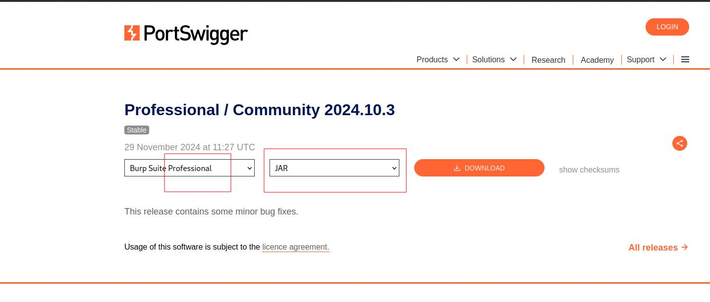
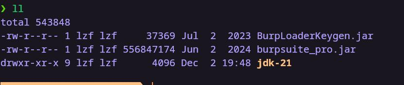
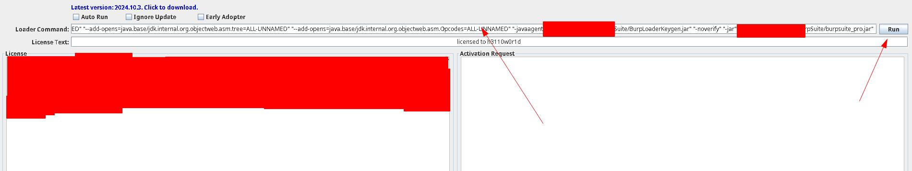

## 前言
本文将会从0开始演示在linux环境下的burpsuite开心版使用，以及添加桌面图标。如果你使用的是windows，请随机应变。
burpsuite版本:2024.10.3
## java环境搭建
为了方便，我们不配置环境变量了，直接将jdk解压下来，直接调用java程序即可
jdk下载[Java Downloads | Oracle 中国](https://www.oracle.com/cn/java/technologies/downloads/)，建议使用jdk21
## 物料准备
`BurpLoaderKeygen.jar`去github搜索吧，这里就不提供下载了。
`burpsuite`
[Burp Suite Release Notes](https://portswigger.net/burp/releases)在这里下载，要选专业版，jar包

把所有的文件放到一起。burpsuite的jar包下载完成后要重命名为`burpsuite_pro.jar`

## 正文开始
### 生成启动脚本
运行`BurpLoaderKeygen.jar`

运行后你会发现下面这个神奇的窗口，点击run你会发现，burpsuite神奇的启动了。

看到那长长的一串了么，复制下来，扔到shell脚本里去。下次执行shell脚本就可以啦。
### 生成桌面图标
编辑`burp.application`写入以下内容
```shell
[Desktop Entry]
Name=burp
Type=Application
Exec=/path/to/Burp_Suite_Pro_v2024.10.3/burp.sh
```
> Exec后的脚本要有执行权限，必须写绝对目录
最后把这个文件扔到`/usr/share/applications`中就可以了。
你的桌面上就会有一个burp了。
添加图标：去网上找一下burp的图标，下载下来。
编辑上面的`burp.application`，在最后一行加上`Icon=/path/to/burp/icon`