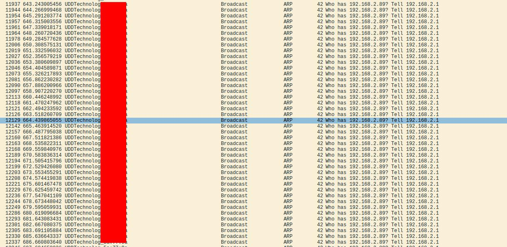
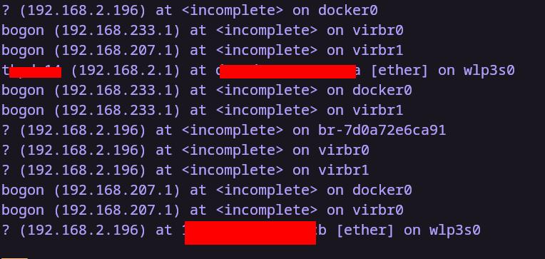
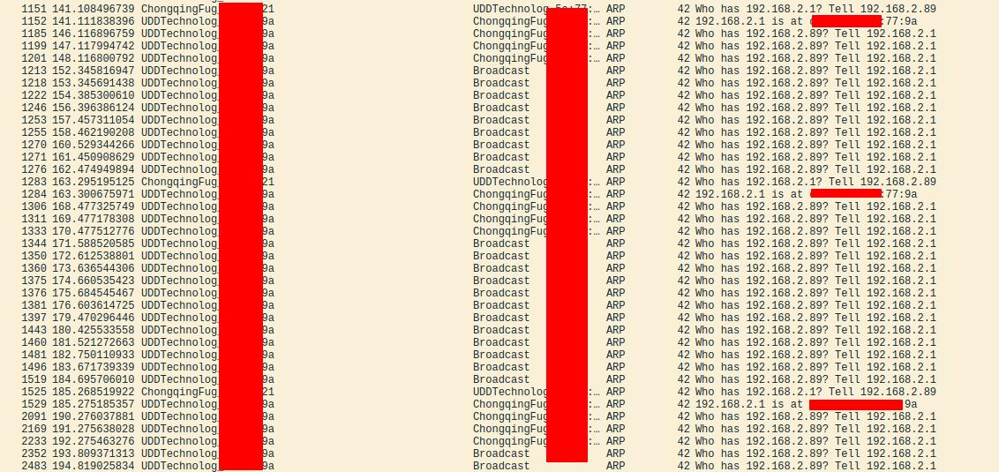
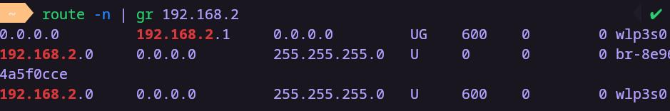
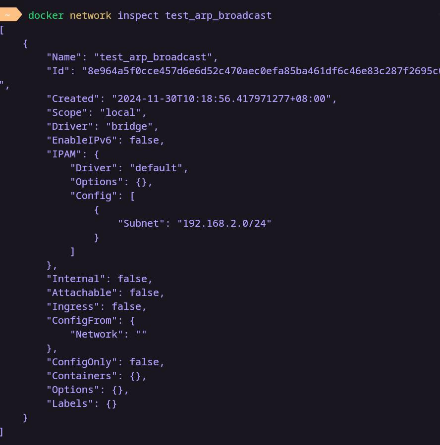

## 引子
具体症状：连接网络后几秒钟有网，后续丢包严重。清空路由表后会短暂恢复
开开心心滴打开电脑，发现俺的网络没得了。尝试解决。
首先俺先是修改了俺自己的ip地址。无果。
又尝试了各种方法，修改俺的mac地址，重启路由器，清空路由表，等等。无果。
俺百思不得其解，经历了为期一天的斗争，终于找到了罪魁祸首。
## 解决过程
没得网络，第一个可能是ip冲突。俺换到了dhcp，仍然没有网络。
### 掏出wireshark，初见端倪
俺打开了俺的wireshark，俺看到了很多arp请求，都是网关在找俺。有问题，起初俺以为是有人在干坏事。但经过多方排查发现，真的是网关在找俺。俺没有做回复

> 这里俺有一个极其愚蠢的简单方法。既然没人回应网关，作为正主的俺，俺自己手动回复一下不就好了。方法奏效但很蠢

### 分析arp表，蒙在鼓里
没有头绪，俺看了看俺的arp表，没有发现什么问题。

> 俺先剧透一下吧，看到docker0这个网卡没，他是`192.168.2.0`网段的哦，这就是问题所在
### 重新抓包分析规律，发现问题
俺将问题重现，重新抓包后，俺发现，他这还挺有规律的呢。下面是俺的猜测：
俺找网关，网关回复，网关找俺，俺没有回复，然后网关急了，他开始发广播了。俺的电脑发现没得网络(可能是某些服务要访问外网导致网络不通)，他也急了，俺知道网关在哪儿，俺得再去找找他，然后循环。
> 非专业人士，看个乐就好了

这，俺没遇到过啊。请ai出山吧。俺把俺的问题和发现的这一奇怪现象告诉了ai。
这ai还怪能的嘞，他叫俺看一看俺的网卡是不是配置错了，然后又让俺看看路由表是不是有啥问题。俺照做了，然后将俺的路由表发给他看了看。
### 聚焦路由表，揪出小坏蛋
路由表中发现有两个`192.168.2.0/24`的路由

这个优先级高的网卡是docker创建的，于是俺决定会一会他

被俺逮住了吧，docker的bridge网络指定的子网与当前网络冲突。把这网卡删了就解决了。
> 俺也不知道当时创建时为啥要指定subnet，而且偏偏指定了当前网段的subnet，按理说不指定也没有问题，乱加参数，变成小丑了🤡
## 思考
这次重启没有解决问题，需要进一步探索发现规律才能找到问题。一次奇妙的体验