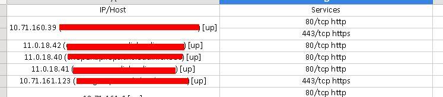
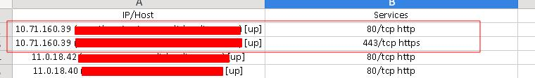

## 引子
上班经常用到excel，工作中遇到的一些繁琐的工作需要用到一些复杂的excel公式，俺记性比较差，整了一个表在这里，方便俺快速查询(复制粘贴)。
对于俺后面展示的场景，每个人有每个人的做法，在这里先叠甲：
俺水平一般，难免会出错
你可能有更好的思路，欢迎提供建议
## 快捷键
|快捷键|功能|
|---|---|
|`c-m`|合并单元格|
|`c-d`|批量复制|
## 常用公式
### 拼接字符
`A1&A2&"nb"`
### 去除左右空行与不可见字符
前者为去除空格，后者为去除不可见字符
``` excel
=TRIM(CLEAN(A1))
```
### excel做split
实际上在excel中做split很麻烦，我们有一个简化的场景：取某分隔符前或后的字符串
对于这个简化的场景仅需要`LEFT`或`MID`，同时强烈建议使用`TRIM`来删除空格
下面是一个对B5单元格进行取空格前/后的所有字符的场景
```excel
=LEFT(TRIM(B5),FIND(" ",TRIM(B5)))
=MID(B5, FIND(",", B5) + 1, LEN(B5))
```
对于复杂场景应使用到多个`FIND`
```excel
=MID(A1, FIND(",", A1, FIND(",", A1) + 1) + 1, LEN(A1))
```
### 某行是否满足需求
前提：你已经通过脚本判断了某行是否满足需求，行号的列表是需要你手动去做的
如果当前行号在此数组中则显示内容1，否则显示内容2，常用于通过脚本匹配某一条数据是否满足要求
```excel
=IF(ISNUMBER(MATCH(ROW(), {3,4,5,6,7,8,9,10,11,12,13,14,15,16,17,20,21,22,23,26,28,33,35,39}, 0)), "内容1", "")
```
### 多分支
常用于多列数据排列组合，依据给定条件格式化输出，配合`某行是否满足需求`有奇效
```excel
=IFS(
AND(A1="手机", B1="缺货"), "紧急补货",
AND(A1="手机", B1="充足"), "正常销售",
AND(A1="电脑", B1="缺货"), "联系供应商",
TRUE, "无需处理"  // 默认情况
)
```
> 对于某些任务可能使用python解析excel再去判断可能会更好(python文本处理很舒服)。实际情况是这个脚本可能不足够通用(俺写不出足够通用的脚本)。俺尽量将每个任务细化，一步一步地做，观察监督每个步骤，减少出现错误的可能。
## 结合实际场景
### 场景1：对nmap扫描出的ip做标记
**需求**
对nmap探活出的ip进行分析，将处于某个黑名单或是外网ip的地址标出
**思路及细节**
这个例子仅仅是为了展示思路，不要问为什么扫描的时候还要进行端口扫描，直接探活不好吗。这之类的问题。
**总体思路：**
将扫描结果转为xlsx，对ip的单元格进行文本处理，匹配黑名单和外网地址并记录行号，使用`某行是否满足需求`这个方案将后面的单元格标记
**细节分析：**
nmap扫描出的结果为xml，还有一些其他格式。仅需使用xml将其转换为xlsx。
转换完成应该是这样

这很奇怪，判断前要处理一下这个ip。转换后的excel多个端口对应一个ip，这在你复制的时候就会出现问题(合并过的单元格只有第一个单元格有数据，其他均为空行)。将ip这一列进行分割单元格，分割时将原本内容填充即可。
这是分割后的样子。

现在仅需要将单元格数据复制到文本中，使用python对文本进行解析：先提取出纯的ip(做几个split就好)，再对ip是否为黑名单或外网ip进行判断。根据ip在数组中的索引即可得出ip在excel中的行号。
这样会得到许多行号，聪明的你肯定知道了。最后使用`某行是否满足需求`这个公式即可标记出黑名单或外网ip的行。