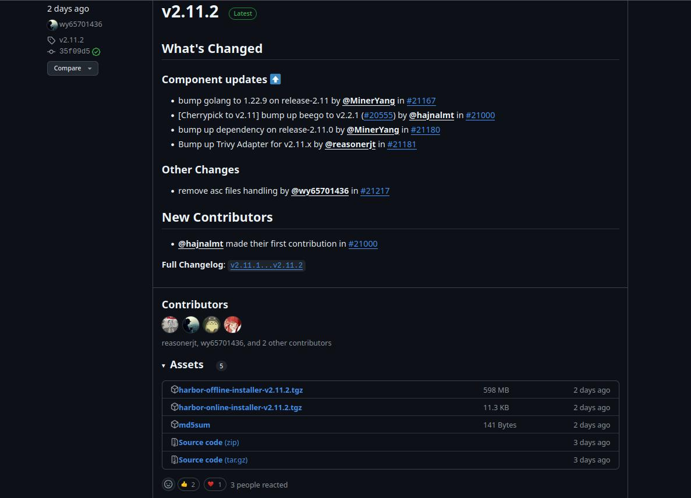
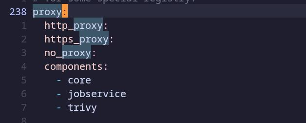

## 引子
多个主机每次拉取镜像的时候都需要访问dockerhub，每次都需要进行科学\*\*，配置科学\*\*时有些麻烦。索性自己搭建一个docker镜像仓库，自己个用。
## 代码下载
去到harbor的release页面下载。本文以离线版为例
[GitHub goharbor/harbor: An open source trusted cloud native registry project that stores, signs, and scans content.](https://github.com/goharbor/harbor)

解压出来 😋
## harbor配置以及docker-compose.yml生成
### harbor配置文件
在自定义配置之前，我们需要复制一份配置文件，在这基础上进行修改
```shell
cp harbor.yml.tmpl harbor.yml
```
> 小坑点，如果你的目录下没有`harbor.yml`，在下一步生成`docker-compose.yml`是会失败的
然后根据你的需求修改配置文件吧
> 注意: hostname是必须要修改的且不要修改为localhost或127.0.0.1
#### 让harbor使用代理
在`http_proxy`和`https_proxy`添加代理服务器即可

### 导入镜像并生成docker-compose.yml
```shell
# 这个脚本会帮你导入镜像并生成docker-compose.yml
./install.sh
```
静静等待其跑完，`docker-compose.yml`就躺在当前目录里了，狠狠地运行他吧 🥵
如果你已经导入了镜像，要重新生成`docker-compose.yml`，这时不需要使用`./install.sh`了，仅需使用`./prepare`。
## 运行
`docker-compose.yml`已经有了，请运行他吧
## 升级
每个版本的升级可能不同，请参考官方文档，这里不做介绍。不过还是要提醒一下，升级时请做好数据备份 😏
## 参考
[GitHub goharbor/harbor: An open source trusted cloud native registry project that stores, signs, and scans content.](https://github.com/goharbor/harbor)
[goharbor.io](https://goharbor.io/ )