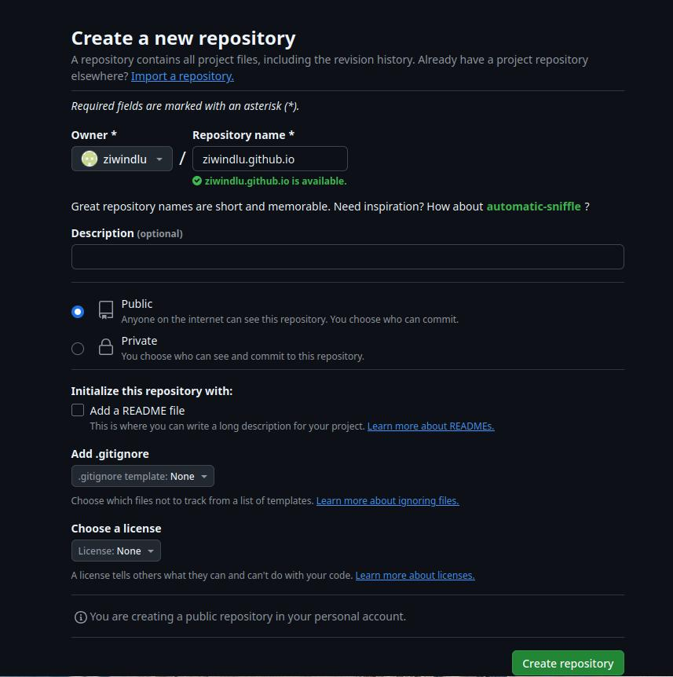
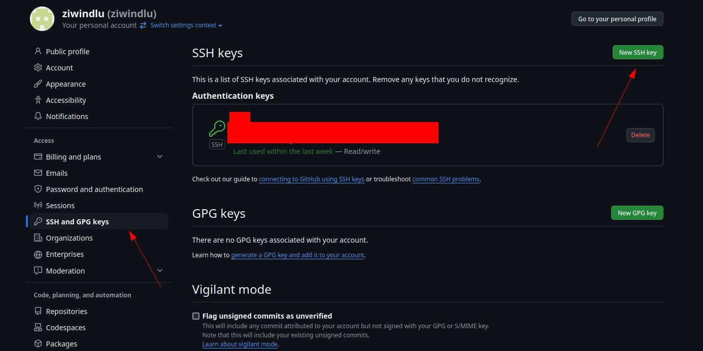

## 引子
大部分人的第一篇博客便是教人怎么搭建博客...
经历了备份失误，笔记软件迁移等一系列问题后，让我不得不重新从头整理自己的博客。本次更新添加了一些图片
## 软件安装
### 安装nodejs
安装hexo需要nodejs版本不低于10.13
去[nodejs官网](https://nodejs.org/en/download/)查看如何安装
检查是否正常运作
```shell
node -v
npm -v
```
如有类似以下回显说明安装成功
```shell
[xxx@localhost ~]$ node -v
v16.13.0
[xxx@localhost ~]$ npm -v
8.1.0
```
### 安装hexo
```shell
npm install -g hexo-cli
```
## 搭建站点
### hexo基本命令介绍
[hexo官方文档](https://hexo.io/zh-cn/docs/)
#### 新建一个站点
`hexo init [folder]`
如果没有设置 folder ，Hexo 默认在目前的文件夹建立网站
#### 新建一篇文章
`hexo new [layout] <title>`
[layout]可选，没有的话默认使用_config.yml中的default_layout
\<title\>必选，文章的名字
#### 生成静态文件
`hexo generate`可简写为`hexo g`
#### 启动服务
`hexo server`可简写为`hexo s`
### 搭建流程示例
新建一个hexo站点->编写文章->生成静态文件->启动服务
#### 新建站点
```shell
hexo init myBlog
```
#### 生成静态文件启动站点
`hexo g && hexo s`
将将，访问`localhost:4000`就可以看到你的站点啦
## github设置
### 创建新的仓库
注意仓库名最好为`githubUsername.github.io`，这样可以避免出现css找不到的问题。

记录仓库地址
`git@github.com:ziwindlu/ziwindlu.github.io.git`
### 配置ssh公钥

### 部署到github
#### 安装hexo-deployer-git
`npm install hexo-deployer-git --save`
#### 修改hexo配置文件
修改_config.yml
```_config.yml
deploy:
type: git
repository: git@github.com:ziwindlu/ziwindlu.github.io.git
branch: main
```
#### 将静态页面上传到github
`hexo clean && hexo g && hexo d`
## 参考
[文档 | Hexo](https://hexo.io/zh-cn/docs/)