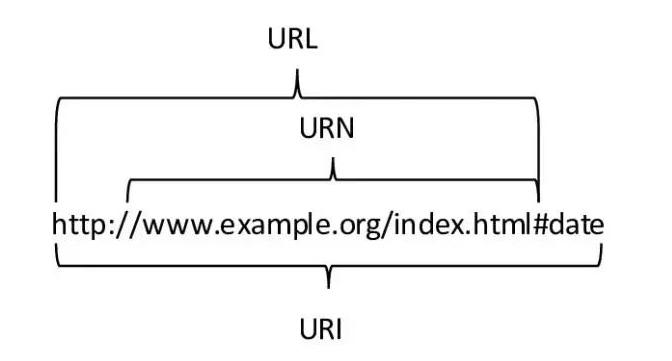

## url&&uri&&urn

### url编码
常见的编码
`%20` 空格
`%21` `!`
`%22` `"`
`%23` `#`
`%25` `%`
`%27` `'`
`%2b` `+`
`%3d` `=`
[HTML URL 编码参考手册 | 菜鸟教程](https://www.runoob.com/tags/html-urlencode.html)
## 请求头
| 请求头 | 含义 |
|---|---|
| User-Agent | 标识客户端发送请求的用户代理（User Agent），通常是浏览器或其他应用程序的标识。 |
| Accept | 指定客户端可接受的响应媒体类型。服务器可以根据该头部信息返回适合客户端的响应。 |
| Content-Type | 指定请求体的媒体类型。 |
| Authorization | 包含了用于进行身份验证的凭证信息。通常用于向服务器提供身份验证令牌或用户名密码。 |
| Cookie | 包含了之前由服务器通过Set-Cookie头发送的Cookie信息。 |
| Referer | 标识了发送请求的页面的URL地址。服务器可以根据该头部信息判断请求的来源。 |
| Content-Length | 请求体的字节长度。 |
| Host | 指定请求的目标服务器的主机名和端口号。 |
| If-Modified-Since | 指定一个日期时间，表示如果资源自指定日期时间之后未被修改，才执行请求的操作。用于缓存控制和条件请求。 |
| Cache-Control | 控制缓存行为，包含了一系列指令，如max-age、no-cache等。 |
| X-Requested-With | 标识请求是通过Ajax发送的。 |
## 请求方法
get、post、delete、option、update
### get与post的区别 #card #forward
id:: 67bddeec-75a0-49cf-bc1e-977cd9e1d76b
请求参数位置不同，get在请求行，post在请求体
请求参数大小不同，get请求参数有大小限制，post没有
get不安全，post安全
post有content-type请求头，如`x-www-from-urlencoded`
### 渗透测试常关注的请求头 #card #forward
id:: 67bddfab-ea61-4778-b98d-bfdc333846d3
篡改 `Host` 或 `X-Forwarded-For`。
如在 `User-Agent` 或 `Referer` 中注入 SQL/XSS 代码。
通过 `Cookie` 或 `Authorization` 劫持会话。
## 相应码
| 状态码 | 含义 | 说明 |
|---|---|---|
| 100 | Continue | 服务器已接收到请求的首部，客户端应继续发送请求主体部分 |
| 101 | Switching Protocols | 服务器已根据请求要求切换协议 |
| 200 | OK | 请求成功完成 |
| 201 | Created | 请求成功并创建了新资源 |
| 202 | Accepted | 请求已被接受，但处理尚未完成 |
| 203 | Non-Authoritative Information | 请求成功，但返回的信息来自第三方，非官方来源|
| 204 | No Content | 服务器成功处理了请求，但响应中不包含返回的实体内容。 |
| 205 | Reset Content | 请求成功完成，客户端应重置当前页面 |
| 206 | Partial Content | 客户端只请求资源的一部分，服务器成功地响应了该部分 |
| 300 | Multiple Choices | 请求的资源存在多个选择，用户或代理可以选择其一进行重定向 |
| 301 | Moved Permanently | 资源的URL已永久移动到新位置 |
| 302 | Found | 资源的URL已临时移动到新位置 |
| 303 | See Other | 对应当前请求的响应可以在另一个URL下找到 |
| 304 | Not Modified | 资源未修改，客户端可以使用缓存的版本 |
| 307 | Temporary Redirect | 对应当前请求的响应可以在另一个URL下找到，但请继续使用原始请求URL进行访问 |
| 308 | Permanent Redirect | 对应当前请求的响应可以在另一个URL下找到，客户端应使用新的URL进行访问 |
| 400 | Bad Request | 请求无效或无法被服务器理解 |
| 401 | Unauthorized | 请求需要身份验证 |
| 402 | Payment Required | 预留状态码，表示需要付款才能访问请求的资源 |
| 403 | Forbidden | 请求被服务器拒绝访问 |
| 404 | Not Found | 请求的资源不存在 |
| 405 | Method Not Allowed | 请求方法不被允许 |
| 406 | Not Acceptable | 服务器无法根据请求的内容特性完成请求 |
| 407 | Proxy Authentication Required | 请求要求代理身份验证 |
| 408 | Request Timeout | 服务器在等待请求时超时 |
| 409 | Conflict | 请求存在冲突，服务器无法处理 |
| 410 | Gone | 请求的资源已永久消失 |
| 411 | Length Required | 服务器要求在请求中包含Content-Length首部 |
| 412 | Precondition Failed | 请求条件失败，例如请求头中指定的一些前提条件未满足 |
| 413 | Payload Too Large | 请求实体过大，超出服务器的处理能力 |
| 414 | URI Too Long | 请求的URI过长，服务器无法处理 |
| 415 | Unsupported Media Type | 请求的媒体类型不受支持 |
| 416 | Range Not Satisfiable | 服务器无法满足请求中的Range头字段指定的范围 |
| 417 | Expectation Failed | 服务器无法满足Expect请求头字段指定的期望值 |
| 429 | Too Many Requests | 客户端在给定的时间内发送了太多请求 |
| 500 | Internal Server Error | 服务器内部错误 |
| 501 | Not Implemented | 服务器不支持当前请求的功能或未能实现 |
| 502 | Bad Gateway | 服务器作为网关或代理，从上游服务器接收到无效的响应 |
| 503 | Service Unavailable | 服务器暂时无法处理请求 |
| 504 | Gateway Timeout | 服务器作为网关或代理，未能及时从上游服务器接收到响应 |
| 505 | HTTP Version Not Supported | 服务器不支持请求中所用的HTTP协议版本 |
## 状态管理
### cookie #card #forward
id:: 67bddc60-82ee-4773-b1a0-db11ed46e0b8
存在于客户端的身份认证，每次在发送请求时请求中都会携带cookie。
**存在的安全隐患**
劫持、伪造
**特点**
大小受限，安全性较低，影响性能(每次请求都要携带)
### session #card #forward
id:: 67bddc63-8527-42a3-8171-b1e97a7ccad2
存在于服务器的身份认证。客户端会存储一个`session_id`用于鉴定session的有效性。
**存在的安全隐患**
劫持
**特点**
存在于服务器，消耗服务器资源，相对而言安全性较高
### session与cookie存在的安全隐患与加固 #card #forward
id:: 67bddcac-5e53-48fd-a9f2-50031bb011b2
#### cookie加固
强制使用https，防止cookie在传输时被窃取
设置httponly，让cookie避免被js解析导致出现xss漏洞
启用 SameSite 属性，限制第三方网站使用用户的 Cookie，防止 CSRF 攻击。
加密cookie，防止cookie被篡改
#### session加固
使用强随机生成的 Session ID，防止 Session ID 被预测或暴力破解。
限制 Session 的有效期，防止长时间未操作导致的风险。
#### session与cookie的区别 #card #forward
id:: 67bddcba-d066-4a96-b677-a76055bb089a
位置不同，session在服务端，cookie在客户端
长度不同，cookie有大小限制