## 引子
学习反编译需要用到ida，虽然aur里有`ida-free`，可惜功能不够，我们需要使用开心版。本文将手把手教你在linux下使用开心版idapro。
本身是很抗拒使用wine的，想一想后面要调试windows程序还需使用到wine，而且跟着教程做的时候，写教程的老哥推荐了bottles，尝试了一下发现非常好用。
目前存在的问题：
~~中文字体暂时没有解决，所以俺让你设置为英文~~
> 俺没有对bottles进行深入的探索，仅仅是能用，深入的配置还需读者自行学习
## 准备文件
idapro破解包
在这里：[爱盘 - 最新的在线破解工具包](https://down.52pojie.cn/Tools/Disassemblers/)
bottles
`sudo pacman -S bottles`
## 配置bottles
### 创建bottles
打开bottles会是这样的
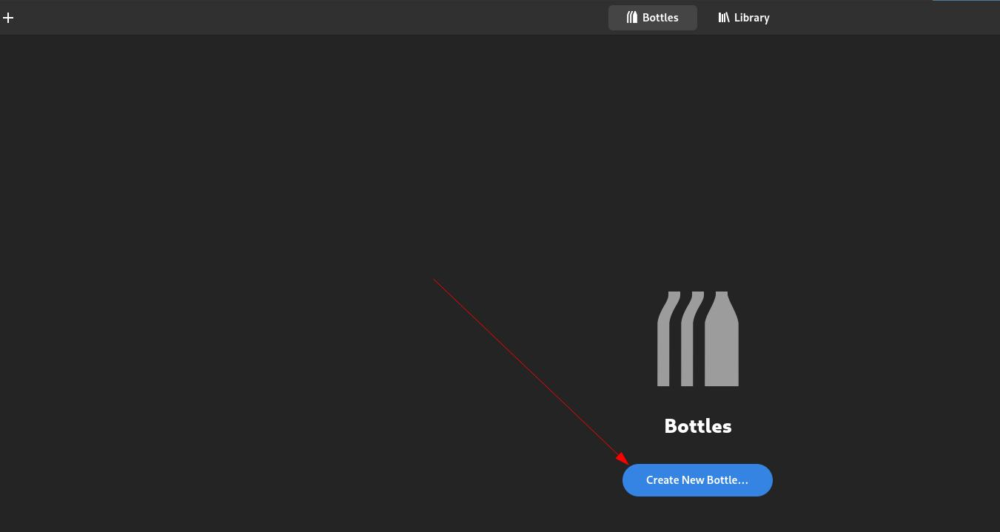
填写名字，其他的不用管
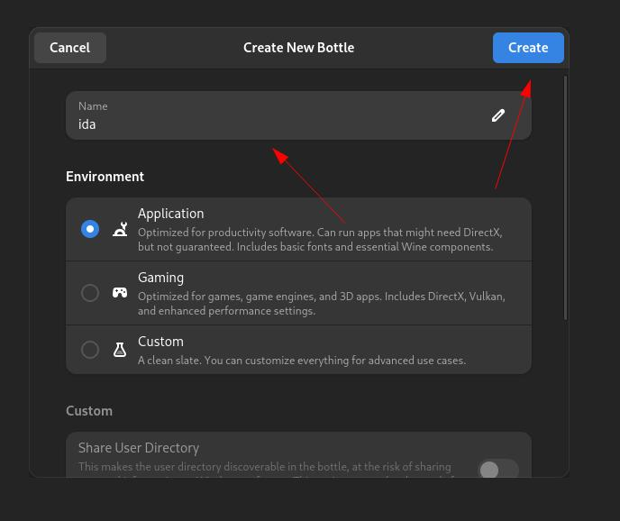
创建完成应该是这样
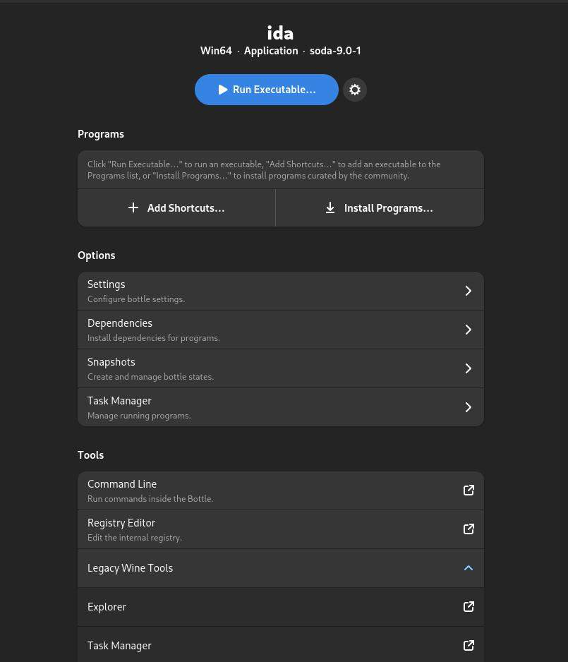
~~### 设置语言~~
如果你的桌面环境为中文，那么你需要在这里设置语言为英文
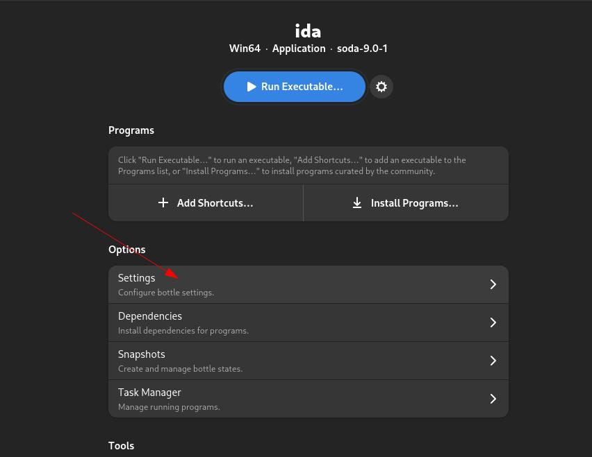
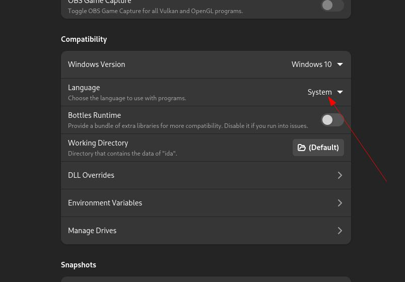
改成English
## 配置ida
### 解压ida并做简单处理
中文会报错，删除路径中的中文
```shell
unzip IDA_Pro_v8.3_Portable.zip -d ida 
cd ida
mv IDA_Pro_8.3_绿化工具.exe IDA_Pro_8.3.exe
```
### 初始化idapro
运行`IDA_Pro_8.3.exe`
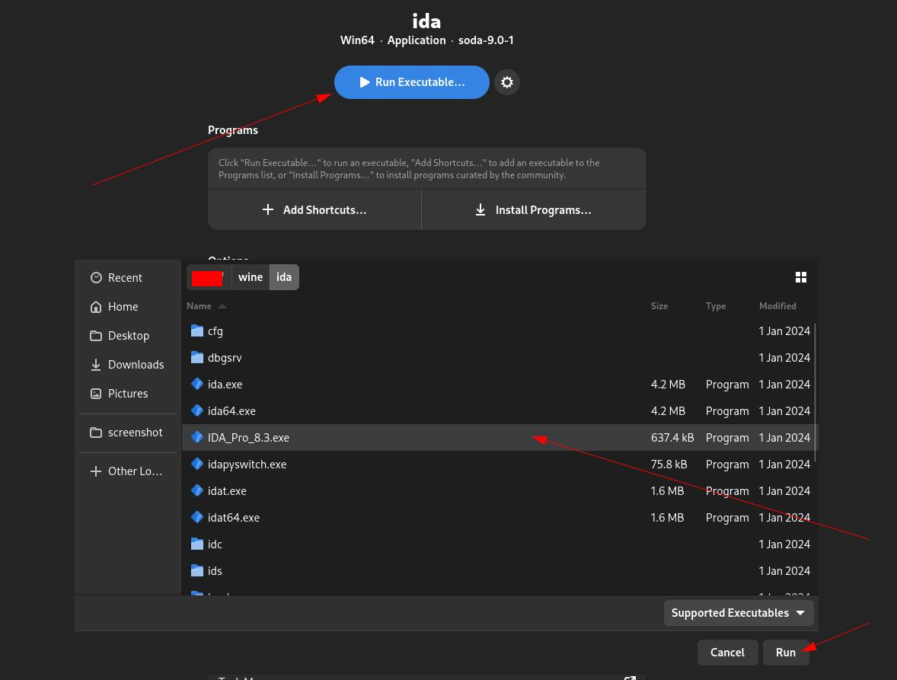
### 修改注册表
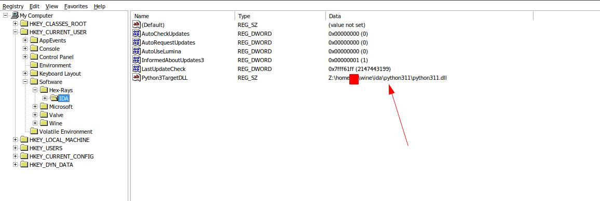
将标出的这个值修改为`Z:\home\your_username\wine\ida\python311\python3.dll`
> 将`python311.dll`修改为`python3.dll`
### 运行ida
将将，选中`ida.exe`就能愉快的运行啦
## 小技巧
### 设置快捷方式
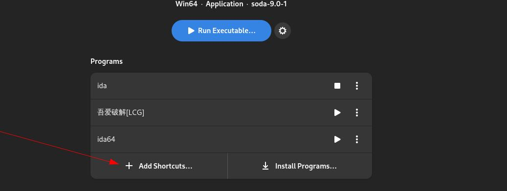
## 俺的配置
```shell
Arch: win64
CompatData: ''
Creation_Date: '2025-03-09 21:07:47.874197'
Custom_Path: false
DLL_Overrides: {}
DXVK: dxvk-2.5.2
Environment: Application
Environment_Variables: {}
External_Programs: {}
Installed_Dependencies:
arial32
times32
courie32
mono
gecko
andale32
arialb32
comic32
georgi32
impact32
tahoma32
trebuc32
verdan32
webdin32
cjkfonts
Language: zh_CN
LatencyFleX: latencyflex-v0.1.1
NVAPI: dxvk-nvapi-v0.8.0
Name: Reverse
Parameters:
custom_dpi: 96
decorated: true
discrete_gpu: false
dxvk: true
dxvk_nvapi: false
fixme_logs: false
fsr: false
fsr_quality_mode: none
fsr_sharpening_strength: 2
fullscreen_capture: false
gamemode: false
gamescope: false
gamescope_borderless: false
gamescope_fps: 0
gamescope_fps_no_focus: 0
gamescope_fullscreen: true
gamescope_game_height: 0
gamescope_game_width: 0
gamescope_scaling: false
gamescope_window_height: 0
gamescope_window_width: 0
latencyflex: false
mangohud: false
mangohud_display_on_game_start: true
mouse_warp: true
obsvkc: false
pulseaudio_latency: false
renderer: gl
sandbox: false
sync: wine
take_focus: false
use_be_runtime: true
use_eac_runtime: true
use_runtime: false
use_steam_runtime: false
versioning_automatic: false
versioning_compression: false
versioning_exclusion_patterns: false
virtual_desktop: false
virtual_desktop_res: 1280x720
vkbasalt: false
vkd3d: true
vmtouch: false
vmtouch_cache_cwd: false
Path: ida
Runner: soda-9.0-1
RunnerPath: ''
Sandbox:
share_net: false
share_sound: false
State: 0
Uninstallers: {}
Update_Date: '2025-03-10 15:43:44.955761'
VKD3D: vkd3d-proton-2.14.1
Versioning: false
Versioning_Exclusion_Patterns: []
Windows: win10
WorkingDir: ''
data: {}
run_in_terminal: false
session_arguments: ''
```
## 可能会遇到的问题
### 开局就打不开ida
没有修改注册表，请去修改注册表
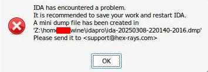
### py不能用
注册表里没有`Python3TargetDLL`，需运行`IDA_Pro_8.3.exe`
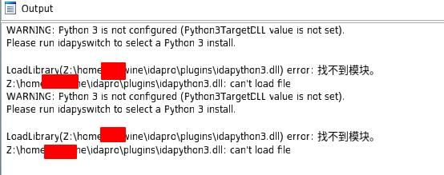
### 字符重叠在一起

需调高dpi解决
调高dpi
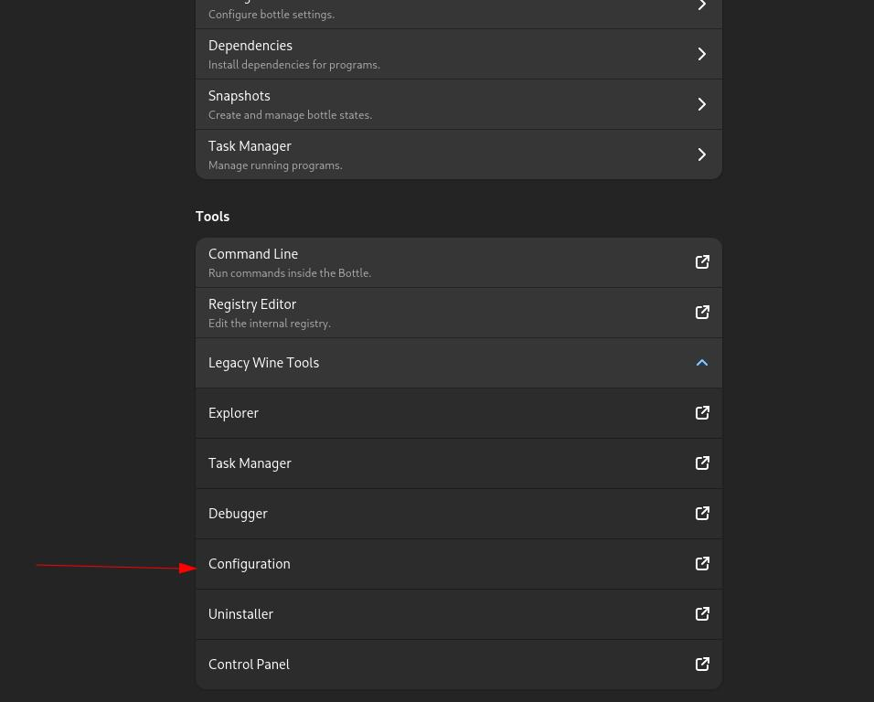
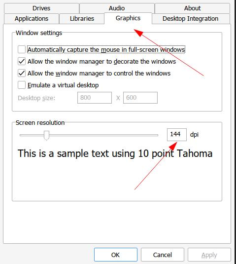
### 设置为中文
需要安装依赖`cjkfonts`
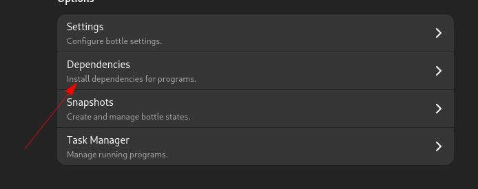
搜索并下载
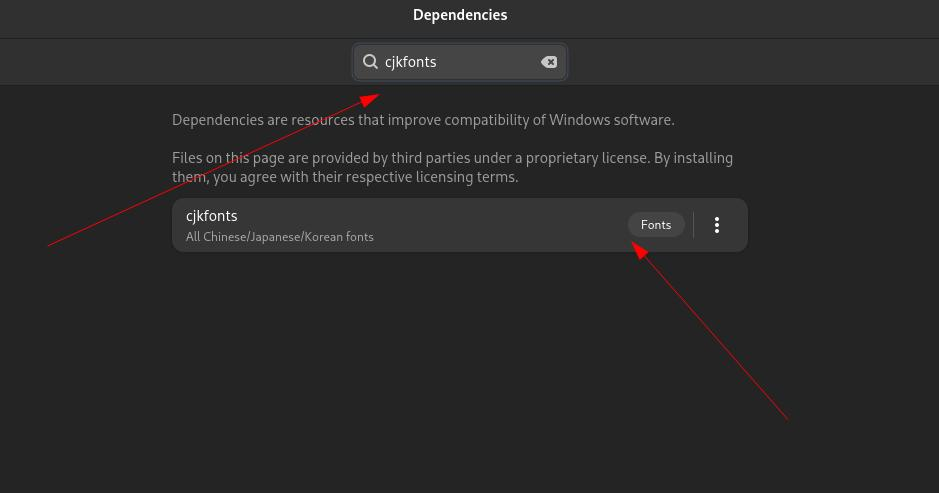
## 参考
[如何在Linux上舒适地运行IDA Pro并且正常使用脚本](https://frnks.top/2023/03/28/2023-03-28-%E5%A6%82%E4%BD%95%E5%9C%A8linux%E4%B8%8A%E8%BF%90%E8%A1%8Cida_pro%E5%B9%B6%E4%B8%94%E6%AD%A3%E5%B8%B8%E4%BD%BF%E7%94%A8%E8%84%9A%E6%9C%AC/)