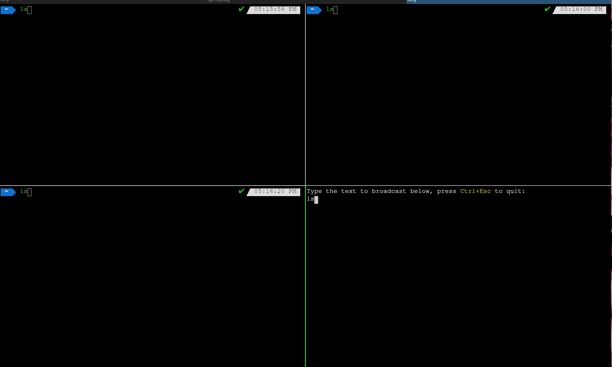

## 引子
一直以来都在使用xfce4的终端，偶然发现了tmux，才有了换终端的想法
经过一系列对比，最后选择了kitty
为什么选择kitty:
高度定制化
gpu渲染
linux,mac双端使用
shell集成
本文记录了一些kitty的配置、快捷键、使用方法、插件。
下面的快捷键大部分只是将`ctrl+shift`替换为了`alt`，使用`~`来代表相同项
配置在conf或config代码块中
功能太多暂时探索这么多
## 快捷键
### 经常用到的
复制粘贴`c-s-c`,`c-s-v`
### 屏幕滚动
| orgin shortcut  | my shortcut   | action                                     |
|-----------------|---------------|--------------------------------------------|
| `~`             | `mod+up`      | 向上一行                                   |
| `~`             | `mod+down`    | 向下一行                                   |
| `mod+page_up`   | `mod+u`       | 向上一页                                   |
| `mod+page_down` | `mod+d`       | 向下一页                                   |
| `mod+home`      | `mod+shift+u` | 移动到顶端                                 |
| `mod+end`       | `mod+shift+d` | 移动到结尾                                 |
| `~`             | `mod+z`       | 到上一个命令输入的地方                     |
| `~`             | `mod+x`       | 到下一个要输入命令的地方                   |
| `mod+h`             | `mod+shift+h`       | 使用less浏览历史(已经使用alias vimhis代替) |
| `~`             | `mod+g`       | 使用less浏览上一个命令的输出               |
### tab相关
| shortcut         | action            |
|------------------|-------------------|
| `mod-t`          | 新建tab           |
| `mod+q`          | 关闭tab           |
| `mod-right/left` | 移动tab           |
| `c-s-,/.`        | 将tab往前往后移动 |
| `mod+shift-t`    | 命名tab           |
| `mod+0-9`        | 跳转到对应的tab   |
### window相关
| shortcut                       | action                                                       |
|--------------------------------|--------------------------------------------------------------|
| `mod+enter`                    | 新建一个窗口                                                 |
| `mod+shift+enter`              | 新建一个窗口并复制环境变量                               |
| `mod+w`                        | 关闭窗口                                                     |
| `mod+r`                        | 调整窗口大小(比较反人类)                                     |
| `mod+[/]`                      | 窗口间移动(emmm,勉强能用)已经调整为hjkl                      |
| `mod+h/l/j/k`                  | 窗口移动like i3                                              |
| `mod+n`                        | 切换布局，kitty默认将所有布局都开启了详情请见`kitty layouts` |
| `mod+shift+up/down/left/right` | 调整窗口大小                                                 |
|`mod+s`|可视化交换窗口|
### 自定义配置
#### 鼠标右键选中命令输出
```conf
mouse_map right press ungrabbed mouse_select_command_output
```
## shell集成
### 打开shell集成
```conf
shell_integration enabled
```
### 特性以及用法
在pager中打开最后一个命令的输出 `mod+g`
跳转到上一个或下一个命令输入的地方 `mod+z,mod+x`
在pager中打开鼠标停留处的命令输出 `ctrl+shift+right_click`
新窗口复制当前窗口的环境变量 `mod+enter`
在kitty中编辑文件`edit-in-kitty`将远程的文件copy到本地使用本地的编辑器进行编辑
### 在子shell或docker中使用shell集成
```shell
kitten run-shell                                                                                                                                                                                                                                                                                                                                                                                                                                                                                                                                                                                                                                                                                                                                                                                          
```
## 插件
这里仅介绍了一些俺感兴趣的插件，和一些以后可能用到的插件
### 远程编辑
在本地编辑器编辑远程文件,再也不用给服务器配置`.vimrc`辣
`kitten edit-in-kitty file`运行这个命令后kitty会自动下载kitten二进制文件
### 文件传输
不使用`scp`进行快捷的文件传输
要求连接时都使用`kitten ssh`连接
远程到本地
```shell
# remote
kitten transfer some-file /path/on/local/computer
```
本地到远程
```shell
# remote
kitten transfer --direction=upload /path/on/local/computer remote-file
```
### 广播
设置广播快捷键
```config
map f2 launch --allow-remote-control kitty +kitten broadcast
```
使用

做并发任务有奇效
### 剪切板
kitty将内容复制到系统剪切板，俺使用了xclip无需用到该插件
### kitty-bar
使用gpu渲染的bar，俺用不到这个功能
## remote
目前俺对该功能的探索比较少，相关内容仅代表个人理解
### hello world
在同一个kitty进程中kitty可以向另一个kitty窗口发送指令之类的
来自官网的一个实例
Hello World
```shell
kitty @ launch --title Output --keep-focus cat
```
这将会开启一个新的窗口，我理解为打开了一个kitty客户端，并且运行了cat
```shell
kitty @ send-text --match cmdline:cat Hello, World
```
这会让kitty去找寻cmdline运行了cat的kitty远程客户端，并发送Hello, World，cat命令接收到Hello World将会输出
同样的你可以使用管道符将ls的输出放到Output中
```shell
ls | kitty @ send-text --match cmdline:cat --stdin
```
> 如果你发现你的kitty并不能使用远程，可能是配置问题，可去官网查询
### 参数
暂无
### 细粒度控制
暂无
## 启动会话
待探索
## 终端高亮字符
DONE 待编辑
## 一些问题
### 无法使用ctrl+left/right进行单词间移动
配置文件中加入以下内容
``` kitty.conf
map ctrl+left send_text all \x1b\x62
map ctrl+right send_text all \x1b\x66
```
## 参考
[kitty remote doc](https://sw.kovidgoyal.net/kitty/remote-control/)
[kitty layouts](https://sw.kovidgoyal.net/kitty/layouts)
[How to have Ctrl-Left and Ctrl-Right to jump one word](https://www.reddit.com/r/KittyTerminal/comments/llsmty/how_to_have_ctrlleft_and_ctrlright_to_jump_one/)