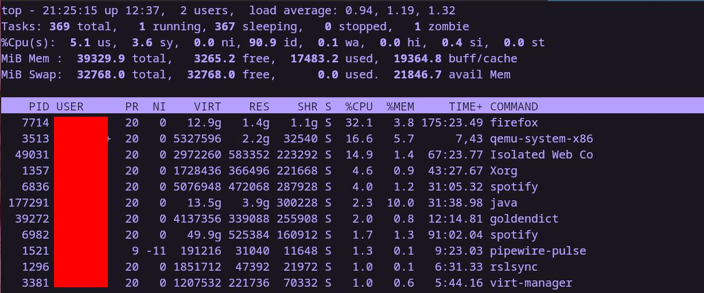
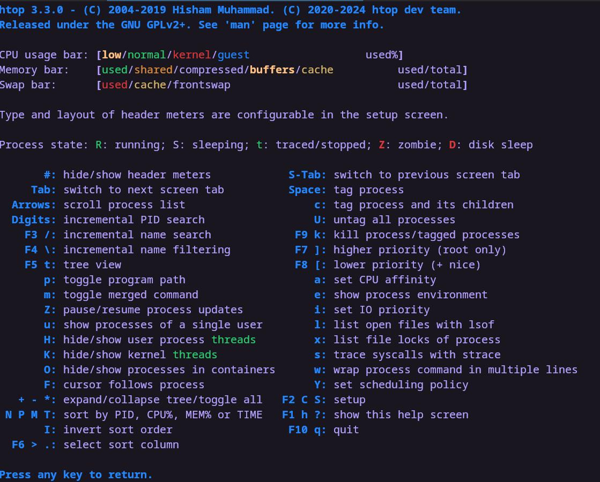
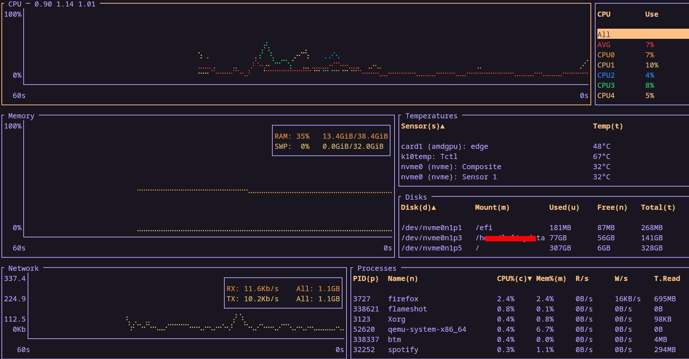

## 引子&why
linux中进程管理是非常重要的，俺觉得有必要来整理一些这些命令或是工具的使用。
为什么要学这么多工具呢？他们很多都是重复的。
对于主力系统，我会选择用着舒适的工具。
对于服务器，先尝试下载一个自己用着舒服的，实在下载不了才会选择使用系统默认自带的。
对于一些常用但俺用着不舒服的，仍然要去学习，这样不会让工具(面试)难住。
## 知识预备
这里会介绍一些linux中进程相关的词语(俺经常用的，后面可能会补充🤔)
这里以top为例

|keyword|translation|means|
|---|---|---|
|PR|优先级(Priority)|越小优先级越高|
|NI|nice值|越小优先级越高，与PR一起决定程序的调度|
|VIRT|虚拟内存(Virtual Memory Size)||
|RES|常驻内存(Resident Memory Size)|物理内存+已映射的共享库和文件|
|SHR|共享内存(Shared Memory)||
## top常用操作
|options|means|help_memory|
|---|---|---|
|`space`|刷新||
|`k`|杀死某个程序|kill|
|`u`|根据用户筛选|user|
|`P`|根据cpu排序|cpu|
|`M`|根据内存排序|memory|
|`T`|根据运行时间排序|time|
|`N`|根据pid排序|pid nomber?|
## htop

介绍的挺明白的了，操作和top类似，移动起来有些麻烦
## btm
btm的操作逻辑类似于vim
进入btm后你会发现有很多很多功能

**在功能区移动**`HJKL`或`WASD`
**打开帮助**`?`
**进程相关**
移动`jk`
顶部和底部`gg/G`
滚屏`c-u/c-d`
结束进程`dd`
查找进程`/`
排序`s`
## 参考
[Linux top 命令 | 菜鸟教程](https://www.runoob.com/linux/linux-comm-top.html)