## 引子
趁着国补整了个macmini。这玩意儿16g内存，用来跑大模型再适合不过了。看了一个up主的评测，跑qwen2.5的140亿参数的模型还是挺顺畅的。
## 下载lmstdio
去到官网下载即可[LM Studio Discover, download, and run local LLMs](https://lmstudio.ai/)
## 安装模型之手动安装
lmstdio自带了下载模型的功能。但是俺的不好用，俺选择了手动安装。
### 下载模型
去到这个网站[Hugging Face – The AI community building the future.](https://huggingface.co)
这里演示qwen2.5的模型，俺选择的是这个[Qwen/Qwen2.5-Coder-14B-Instruct-GGUF · Hugging Face](https://huggingface.co/Qwen/Qwen2.5-Coder-14B-Instruct-GGUF)
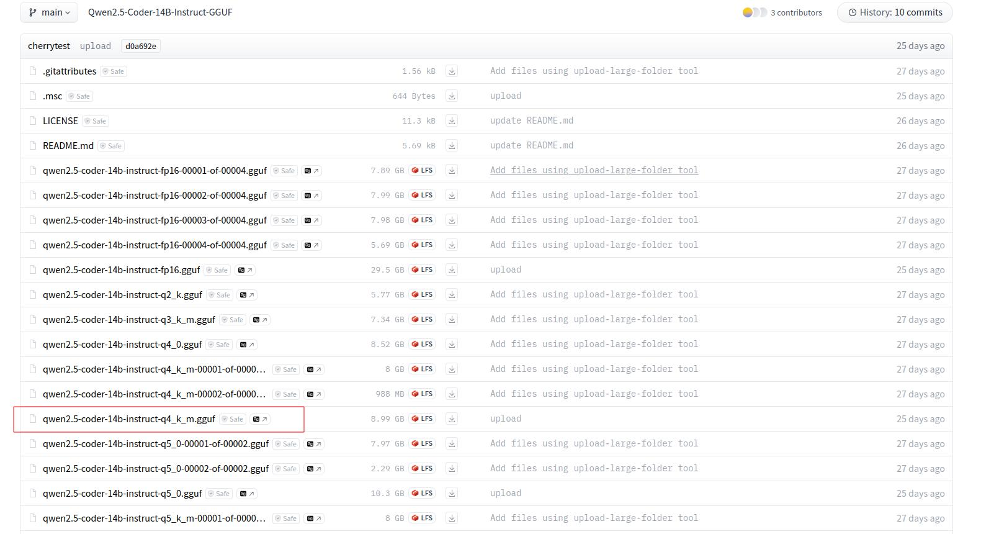
把他下载下来，右边有个下载按钮看到没，点击就行啦。
使用`aria2c`下载，多线程分段下载
```shell
aria2c -x 16 -s 16 -o filename url
```
### 给模型一个家
根据官方文档，模型应该这么放`作者/模型名字/模型`
所以俺的文件应该长这样:`Qwen/Qwen2.5-Coder-14B-Instruct-GGUF/qwen2.5-coder-14b-instruct-q4_k_m.gguf`
## 加载模型
修改模型目录
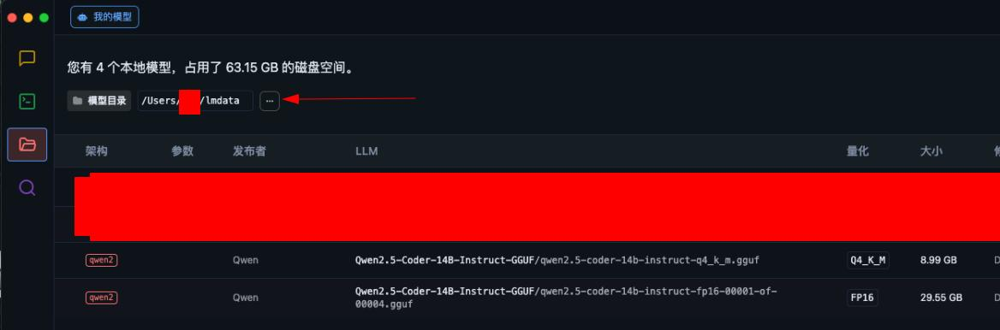
不出意外，你下载的模型会显示出来
点击加载模型，就可以愉快的使用啦
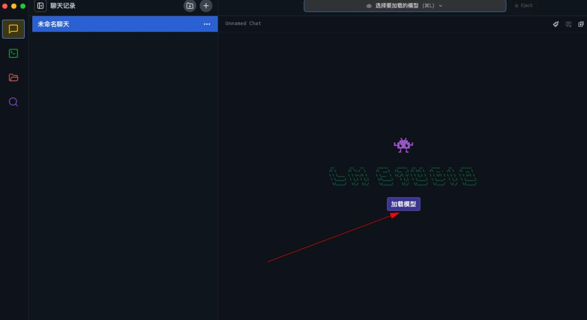
## 提示词
### lmstdio预设提示词
开启这个功能需要使用高级用户模式，右下角点击`Power User`即可变为高级用户模式
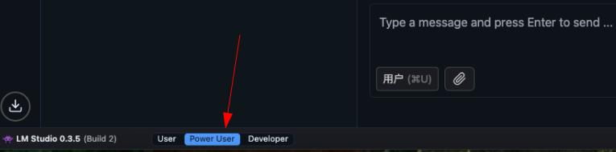
在右上角你就可以看到预设啦
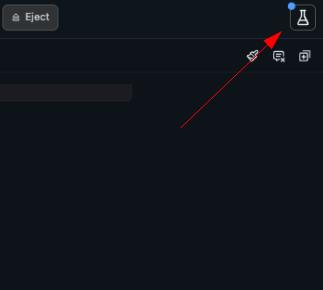
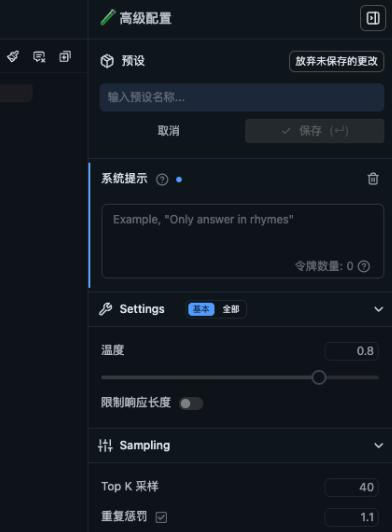
### 现成的提示词
[AiShort(ChatGPT Shortcut)-简单易用的 AI 快捷指令表，让生产力倍增！ | AiShort(ChatGPT Shortcut)-AI Prompt Management,Productivity Tool](https://www.aishort.top/)
## webui搭建
### 开启api
开启api需要使用开发者模式，右下角点击`developer`即可变为开发者模式
在左边找到终端的图标，进去点点配置
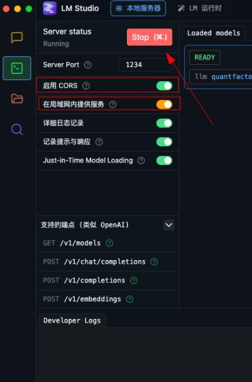
> 如果你要允许局域网内访问需要开启俺框住的这两个选项哦
### webui搭建
lmstdio支持类似于openai的api，俺使用了open webui来做webui
咱们不需要Ollama，只使用chatgptapi，用下面这个命令就好啦，key不用填
```shell
docker run -d -p 3000:8080 -e OPENAI_API_KEY=none -v open-webui:/app/backend/data --name open-webui --restart always ghcr.io/open-webui/open-webui:main
```
lmstdio不能用key，有点麻烦，后面要禁止1234端口被其他用户访问。
搭建完成后访问3000端口开始配置吧。
### webui添加模型
#### api配置
管理员设置->外部连接->配置openai api
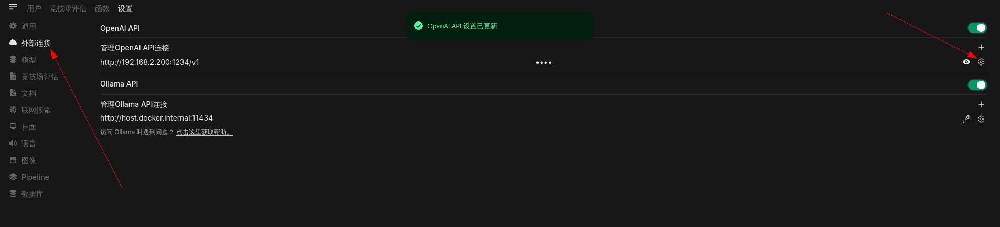
配置api
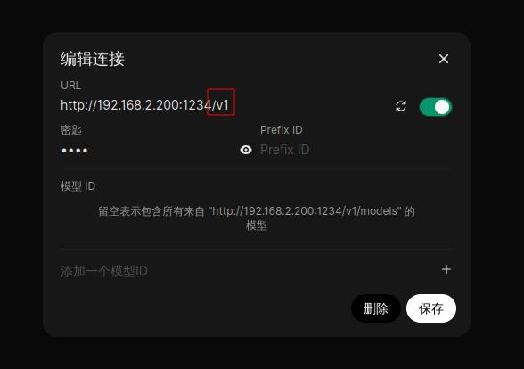
> 值得注意的是这个v1，密钥不用管
#### 模型配置
按理来说他会自动探索所有模型，但是俺这个他好像不能探测
去lmstdio中复制这个模型的id
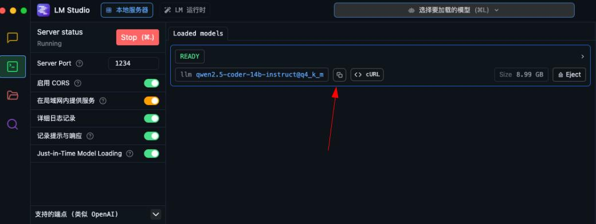
到上一步webui的api配置中添加模型id即可
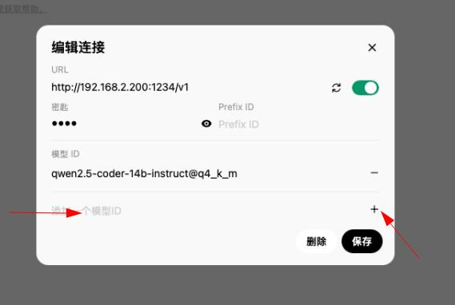
如图，记得保存
到这里你就可以愉快的使用啦
### 安全相关
禁止所有ip访问1234端口即可
```shell
# 创建规则文件
sudo nano /etc/pf-en1.conf
# 阻止所有流量访问 en1 的 1234 端口
block in quick on en1 proto tcp from any to any port 1234
# 验证规则文件
sudo pfctl -vnf /etc/pf-en1.conf
# 让配置文件生效
sudo pfctl -f /etc/pf-en1.conf
# 查看规则，确定是否生效
sudo pfctl -sr
```
## 参考
[LM Studio Discover, download, and run local LLMs](https://lmstudio.ai/)
[Hugging Face – The AI community building the future.](https://huggingface.co)
[🏡 Home | Open WebUI](https://docs.openwebui.com/)