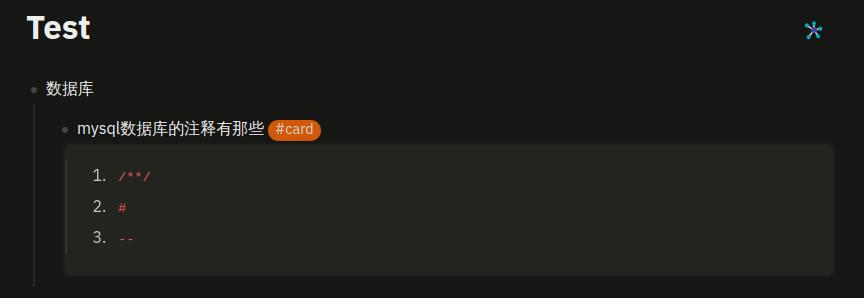
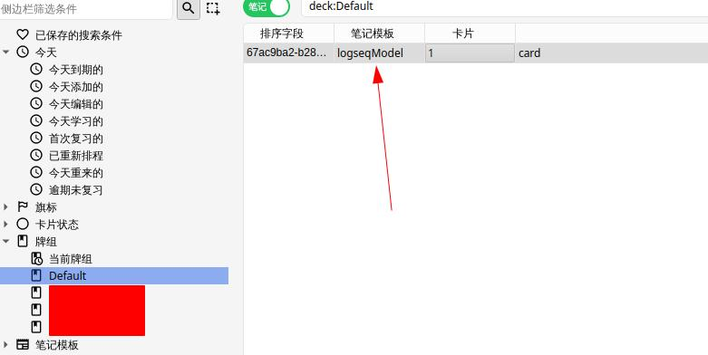
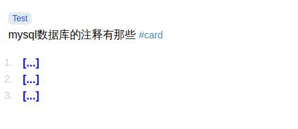
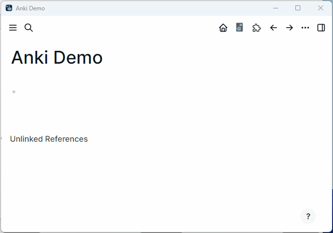
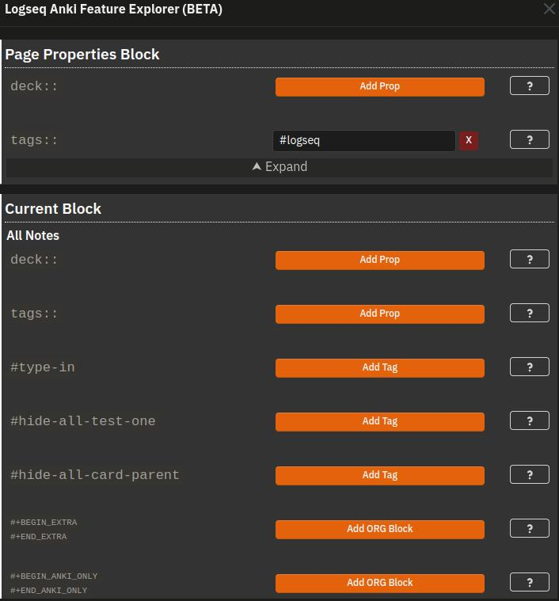
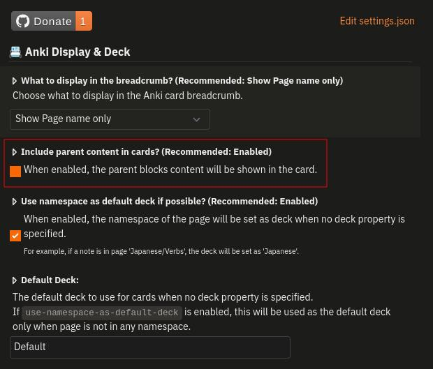

## 引子
之前写过一个自动同步anki的脚本，用起来不是很理想。寻找更好的代替方案。于是找到了`logseq-anki-sync`这个项目。这里浅浅记录一下，用作备忘。
## 安装
安装主要分两个步骤，logseq插件安装以及anki插件安装。
官方仓库中提供了安装视频，这里不做演示。
## 卡片编写及同步
我们在logseq中使用`#card`去标记记忆卡片。现在`#card`被用作anki同步的标识，插件会将被card标识的块以及子块作为卡片同步到anki。
一个实例：
logseq内容

点击进行同步

查看anki中内容
将将，你就会发现Default牌组中出现你的卡片啦

预览长这样

> 你的可能会包含父块的内容，我进行了配置，想要修改请参考配置章节
## 复杂卡片的编写
### 多行卡片的类型
一共分为以下几种类型
forward(默认类型)
incremental(随机隐藏一行)
reversed(隐藏问题)
bidirectional(incremental与reversed的结合)
实际上当你尝试了这些类型后，他们只是在anki中的text存在一些小差异。观察这些差异可以让你在编写Cloze卡片时更得心应手。
### 卡片组
请看vcr

对于这些卡片，多行卡片类型同样是适用的 只需在问题后添加类型即可
### Cloze卡片
这个俺用不到，
[Making cloze cards · debanjandhar12/logseq-anki-sync · Discussion #89 · GitHub](https://github.com/debanjandhar12/logseq-anki-sync/discussions/89)
### 使用官方提供的命令进行编写
使用`/Open Anki Feature Explorer`命令，鼠标点点点就行啦
不仅仅是写卡片 功能非常强大

## 指定deck
每次卡片生成在Default牌组中。你可能想去自定义卡片到那个牌组，等等。仅需指定deck即可。
请参考官方文档。
[Terminology &amp; Specifying Deck · debanjandhar12/logseq-anki-sync · Discussion #117 · GitHub](https://github.com/debanjandhar12/logseq-anki-sync/discussions/117)
同样`/Open Anki Feature Explorer`也可以帮助你完成
## 配置
### 禁止卡片显示父块内容
取消勾选这个选项

### 配置默认deck
看到上面那张图的Default了吗，改它
## 参考
[GitHub - debanjandhar12/logseq-anki-sync: An logseq to anki syncing plugin with superpowers - image occlusion, card direction, incremental cards, and a lot more.](https://github.com/debanjandhar12/logseq-anki-sync)