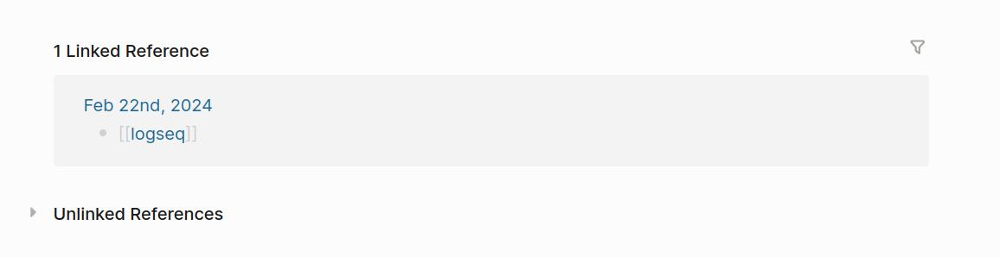
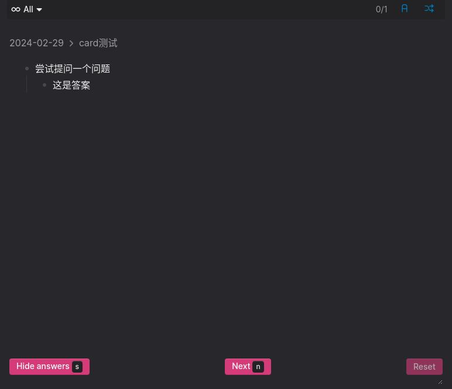
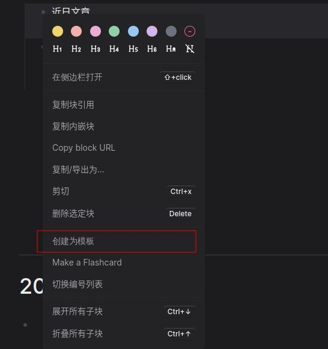
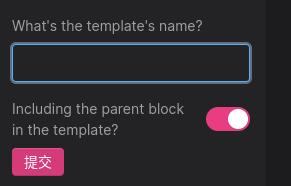

## 引子
最近尝试了很多双向链接的笔记软件，最后选择了logseq，因为它开源，用着放心。从纯vim转过来使用起来还是有点不习惯的
## 一些概念
块 每个点后面的东西都叫块，无序列表
tag跟在`#`后的是tag
文章使用`[[]]`创建文章
shift+click 在侧边栏打开
每篇文章下面的两个东西
第一个是被引用，第二个是未被引用

## todo
快捷方式`/todo`
选择日期快捷方式`/Date picker`
## card
写法

效果

## template
创建模板

给他起个名字就能用了

复选框可以在生成模板时是否保留父块
引用模板
`/template` + 模板名
参考[【logseq】日记自动加载模板设置](https://zhuanlan.zhihu.com/p/545442427)
## 插件
Get link title
快速获取链接的标题
Vim Shortcuts
vim快捷键，让logseq和vim一样
todo list
todo列表
Heatmap
类似于github的提交记录表，绿色格子的那个
Bullet Threading
让你更清晰的看到当前块的父块
TOC Generator
目录插件
## 同步方案
手动同步：
使用github等平台进行同步
自动同步
ResilioSync 同步
syncthing 同步
## 参考
[双链笔记软件推荐：Logseq 和它的五种用法 少数派](https://sspai.com/post/69503#!)
[免费开源双链笔记应用 Logseq 特点介绍_哔哩哔哩_bilibili](https://www.bilibili.com/video/BV1S3411i7Hs/?spm_id_from=333.788&vd_source=70e78dea06384e693b9aedb319a5589b)