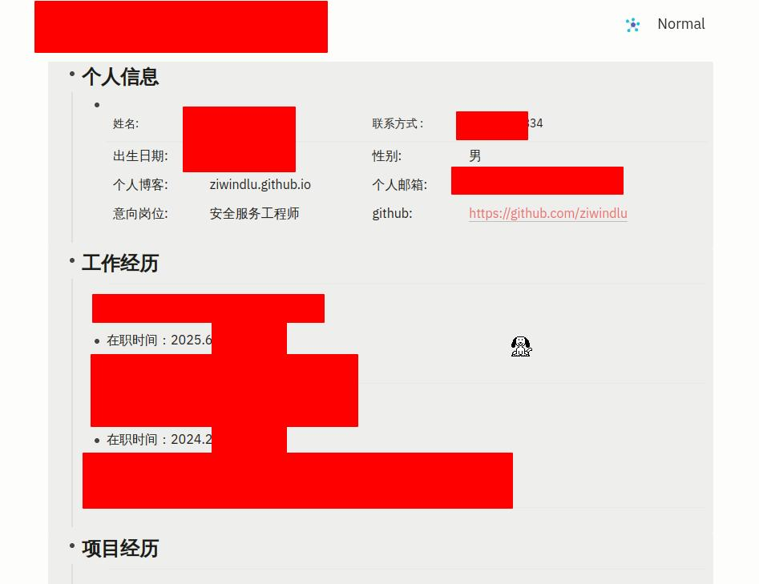
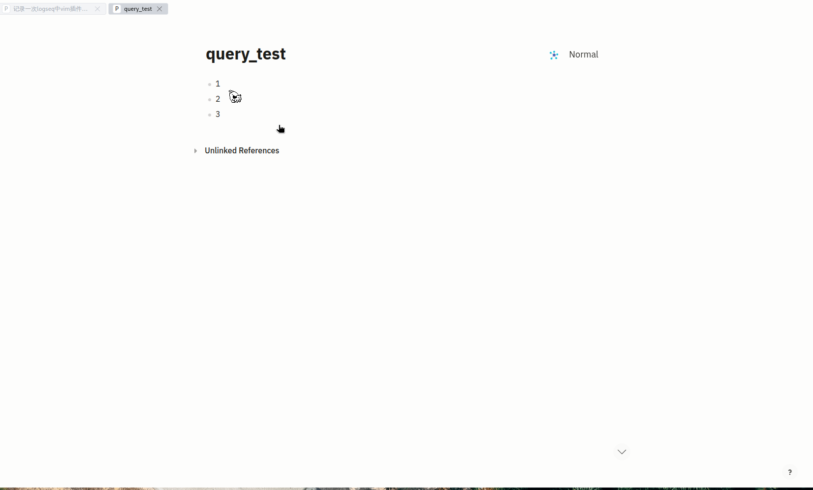
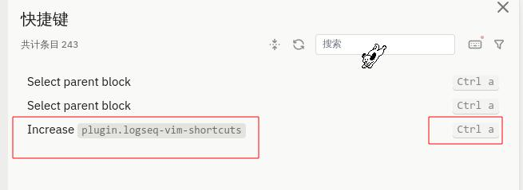

## 引子
这一切的一切还要从面试官打不通俺的电话说起，最开始俺还以为俺的小破手机又出毛病了呢。俺尝试了n个人的手机给俺打电话，都能打通。俺又想是不是苹果勿扰模式的问题？勿扰模式也应该有通话记录的啊。难道是电话黑名单？？俺尝试把俺的所有电话黑名单删除掉，静候佳音。
## 调整思路
事实是，俺仍然没有收到电话。百思不得其解，直至俺打开了俺的简历。看到简历上竟赫然写着**熟悉OWSP TOP11**、**熟悉log5j2**，扭头看了下电话那一栏，俺的电话号码竟然"被"加了1。原因找到了，俺错怪了俺的老伙计(iphone se 2020 64G 战损版)，是简历写错了，这是个悲伤的故事。
为什么数字会被加1呢？难道物理学真的不存在了？水滴为了阻止我找工作在偷偷陷害我？
但是计算机里0就是0，1就是1，他没有问题，绝对是我的问题。
## 谁动了俺的简历！
回归源头，俺回到了俺的logseq中，发现的确简历被莫名其妙的修改了，修改的很美，每一行的第一个数字都被加了1。

> 剧透一下，右上角的Normal模式，是他，他是罪魁祸首。
找了很久也没有找到是谁的问题。很巧啊，俺用vim的时候在可视模式下按了一下`c-a`(vim中数字自增的快捷键)，发现可视模式下选中的字符都增加了1，而不是光标处增加了1。这现象，和俺的简历竟然出奇的相似。于是乎俺杀到了logseq中进行测试。
{:height 460, :width 749}
为什么说Normal模式是罪魁祸首，logseq这vim插件只有按v或是`c-v`才能进入可视模式，Normal这几个字符严重影响了俺的判断。
## 总结
logseq中的vim插件快捷键`c-a`(数字自增)与全选快捷键冲突。导致使用`c-a`进行全选时文章中的数字也进行了自增。
有了这次奇葩的事件之后，以后和别人发文件都要再确认n次是否有问题了。吃一堑长一智。最后附快捷键冲突解决方案。

修改或删除这个条目