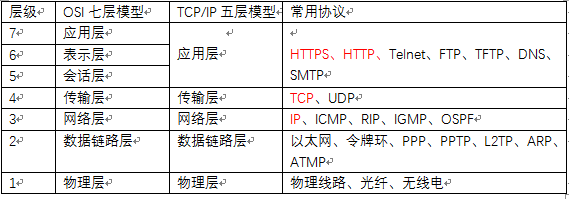

## OverView
osi七层模型与tcp #card #forward
id:: 67badb01-6df7-4ef0-a29e-c44875405e2e

### 各层常见的协议 #card #forward
id:: 67bdda8a-fa4c-4646-9978-a57000e0db92
#### 传输层常见协议
ARP、ICMP、IP
#### 网络层常见协议
TCP、UDP、OSPF
tcp与udp的区别 #card #forward
id:: 67badb22-f3ee-4f5a-8b3a-c4d459dd2bf5
快慢、是否可靠、系统开销、是否有连接
应用场景：
TCP：数据敏感型服务，http
UDP：速度敏感型服务，直播、电话
常见的服务及其端口号 #card #forward
id:: 67bdda8a-2ea9-4716-b1bd-7a90f66654c3
|协议|说明|端口号|
|---|---|---|
|FTP|文件传输协议|21,20|
|SFTP|基于ssh的文件传输协议|22|
|FTPS|支持SSL/TLS的文件传输协议|21/990|
|SMTP|发送邮件协议|25、587(TLS)|
| IMAP | 收取邮件协议 | 143 、993 (TLS) |
| POP3 | 收取邮件协议 | 110 、995 (TLS) |
| SSH | 安全远程登录协议 | 22 |
| Telnet | 非加密的远程登录协议 | 23 |
| RDP | 远程桌面协议| 3389 |
|VNC| 远程桌面 |5900|
| MySQL | MySQL 数据库访问协议 | 3306 |
| PostgreSQL | PostgreSQL 数据库访问协议 | 5432 |
| MongoDB | MongoDB 数据库协议 | 27017 |
| Redis | Redis 数据库协议 | 6379 |
| MsSQL|MicroSoft数据库协议|1433|
|Oracle| 甲骨文数据库协议|1521|
|HTTP|超文本传输协议|80|
| HTTPS | 加密的 HTTP 协议 | 443 |
| SMB | 用于共享文件、打印机 | 445 |
| NFS | 网络文件系统协议 | 2049 |
|weblogic|java中间件|7001|
|tomcat|java中间件|8080|
[dns协议](/posts/dns-protocol/)
[wireshark抓包实例](/posts/wireshark-capture/)
[route](/posts/route/)
vlan
[trunk](/posts/trunk/)
nat
链路聚合
VRRP
代理相关
[router](/posts/router/)
[switch](/posts/switch/)
[firewall](/posts/firewall/)
## LearningFiles
## Posts