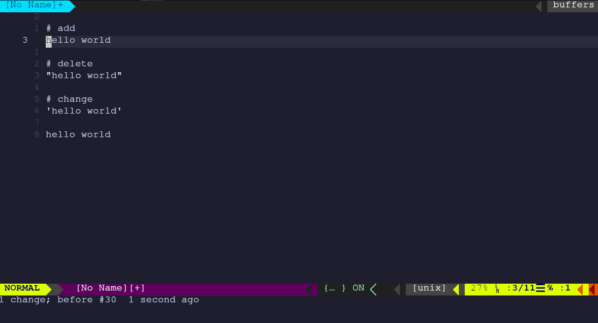
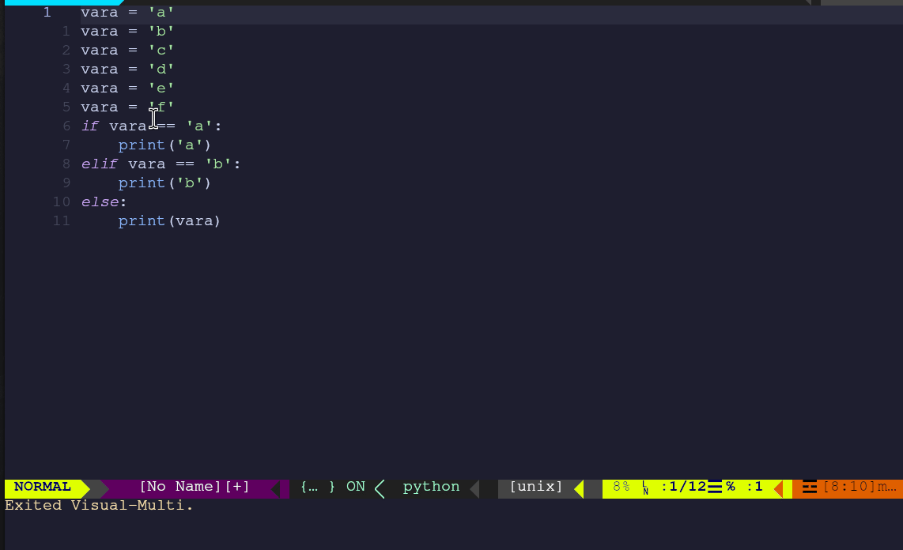
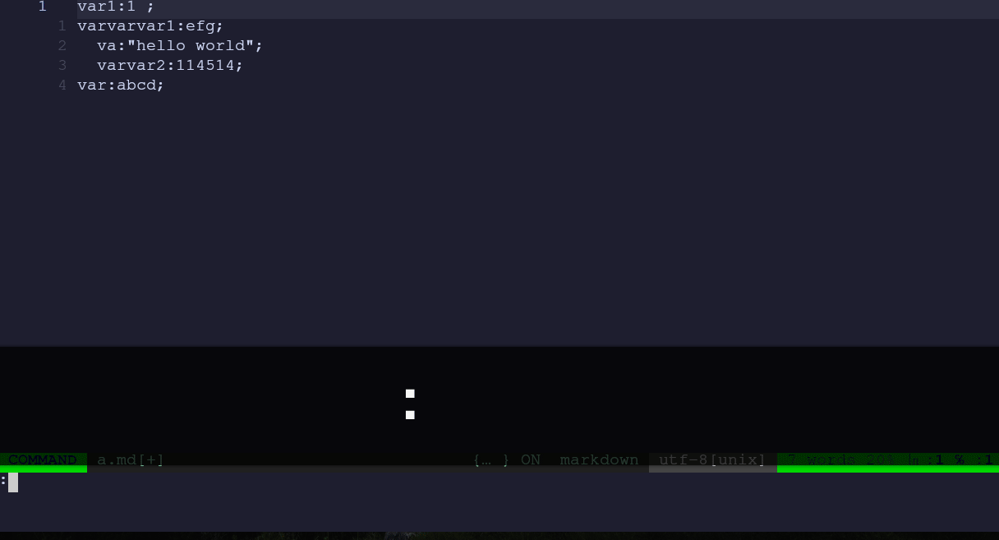

## 引子
积累了很多vim插件，记录一下，部分重量级的插件俺会单独写一篇文章，vim,nvim通用
## 编辑相关
### auto-pairs
智能括号，括号补全
[GitHub jiangmiao/auto-pairs: Vim plugin, insert or delete brackets, parens, quotes in pair](https://github.com/jiangmiao/auto-pairs)
#### 安装
```vimrc
Plug 'jiangmiao/auto-pairs'
```
#### 使用
直接用
### vim-surround
包裹插件
[GitHub tpope/vim-surround: surround.vim: Delete/change/add parentheses/quotes/XML-tags/much more with ease](https://github.com/tpope/vim-surround)
#### 安装
```vimrc
Plug 'tpope/vim-surround'
```
#### 使用
支持`ys[move]`这种操作

#### 配置
```vimrc
" 不使用插件定义的任何快捷键从而使用自己定义的
let g:surround_no_mappings = 1
" delete surround
nmap ds  <Plug>Dsurround
" change surround
nmap cs  <Plug>Csurround
nmap cS  <Plug>CSurround
nmap ys  <Plug>Ysurround
nmap yS  <Plug>YSurround
nmap yss <Plug>Yssurround
nmap ySs <Plug>YSsurround
" 提高容错
nmap ySS <Plug>YSsurround
xmap S   <Plug>VSurround
" 并按需要进行修改
"Dsurround 删除包裹符号
"Csurround 改变包裹符号
"Ysurround 用符号包裹起来字符
"Yssurround 用符号包裹起来一行
"其中S大写时表示包裹符号单独占一行
```
### vim-repeat
重复插件
在vim中`.`操作并不能重复某些插件的操作，使用了这个插件就可以啦
[GitHub tpope/vim-repeat: repeat.vim: enable repeating supported plugin maps with &quot;.&quot;](https://github.com/tpope/vim-repeat)
#### 安装
```vimrc
Plug 'tpope/vim-repeat'
```
#### 使用
就是`.`进行重复
支持
[surround.vim](https://github.com/tpope/vim-surround)
[speeddating.vim](https://github.com/tpope/vim-speeddating)
[unimpaired.vim](https://github.com/tpope/vim-unimpaired)
[vim-easyclip](https://github.com/svermeulen/vim-easyclip)
[vim-radical](https://github.com/glts/vim-radical)
#### 配置
可以自定义重复插件的操作，但是俺没看
### wildfire
快速选中块，配合surround非常爽
[GitHub gcmt/wildfire.vim: Smart selection of the closest text object](https://github.com/gcmt/wildfire.vim)
#### 安装
```vimrc
Plug 'gcmt/wildfire.vim'
```
#### 使用
默认快捷键是回车
#### 配置
有一些其他的高级配置，暂时用不到
### vim-visual-multi
多光标，快速重构一些小东西
[GitHub mg979/vim-visual-multi: Multiple cursors plugin for vim/neovim](https://github.com/mg979/vim-visual-multi)
#### 安装
```vimrc
Plug 'mg979/vim-visual-multi'
```
#### 使用
选择多光标
`ctrl+n`
光标间移动
`[/]`
取消当前光标并移动
`q/Q`

#### 配置
插件键位安排的很合理，没有进行自定义
### eazy-motions
快速移动插件。配合其他插件可以模糊搜索，但是俺用不到
[GitHub easymotion/vim-easymotion: Vim motions on speed!](https://github.com/easymotion/vim-easymotion)
#### 安装
```vimrc
Plug 'easymotion/vim-easymotion'
```
#### 使用
俺只使用跳转，所以俺就只介绍跳转的用法了
使用方法:vim移动操作前敲两个`<leader>`，当然这是俺的配置方式
官网的图，途中的`\`为leader,快捷键和俺的有不一样，俺只是拿他的图来展示一下
{:height 382, :width 656}
#### 配置
```vimrc
let g:EasyMotion_smartcase = 1
map <leader><leader>f <Plug>(easymotion-f)
map <leader><leader>F <Plug>(easymotion-bd-f)
map <leader><leader>t <Plug>(easymotion-t)
map <leader><leader>T <Plug>(easymotion-bd-t)
map <leader><leader>w <Plug>(easymotion-w)
map <leader><leader>W <Plug>(easymotion-bd-w)
map <leader><leader>b <Plug>(easymotion-b)
map <leader><leader>h <Plug>(easymotion-linebackward)
map <leader><leader>l <Plug>(easymotion-lineforward)
map <leader><leader>j <Plug>(easymotion-j)
map <leader><leader>J <Plug>(easymotion-bd-jk)
map <leader><leader>k <Plug>(easymotion-k)
map <leader><leader>K <Plug>(easymotion-bd-jk)
map <leader><leader>. <Plug>(easymotion-repeat)
```
### vim-table-mode
画表格很方便，还有对齐文本功能
[GitHub dhruvasagar/vim-table-mode: VIM Table Mode for instant table creation.](https://github.com/dhruvasagar/vim-table-mode)
#### 安装
```vimrc
Plug 'dhruvasagar/vim-table-mode'
```
#### 使用
支持将已有行通过指定分隔符转换为表格，详见`Tableize`
甚至支持表达式来进行计算表格中的数据，但是俺用不到
开启and关闭`<leader>tm`，助记table mode
#### 配置
不用配置，开箱即用
### tabular
让你更快速的格式化文本
[GitHub godlygeek/tabular: Vim script for text filtering and alignment](https://github.com/godlygeek/tabular)
#### 安装
```vimrc
Plug 'godlygeek/tabular'
```
#### 使用
`:Tabularize /param`
{:height 362, :width 656}
#### 配置
快捷键和coc-nvim冲突了，俺没有配置快捷键
## 美化相关
### airline
搭配了vim-airline-themes一起使用
[GitHub vim-airline/vim-airline: lean &amp; mean status/tabline for vim that&#39;s light as air](https://github.com/vim-airline/vim-airline)
[GitHub vim-airline/vim-airline-themes: A collection of themes for vim-airline](https://github.com/vim-airline/vim-airline-themes)
#### 安装
``vimrc
Plug 'vim-airline/vim-airline'
Plug 'vim-airline/vim-airline-themes'
```
#### 使用
开箱即用，不需要做配置
### catppuccin
[GitHub catppuccin/nvim: 🍨 Soothing pastel theme for (Neo)vim](https://github.com/catppuccin/nvim)
[GitHub catppuccin/vim: 🧋 Soothing pastel theme for Vim](https://github.com/catppuccin/vim)
主题，配色挺好看
#### 安装
详见使用
#### 使用
开箱即用，但是vim和nvim一起使用同一个配置文件时装时可以这样
```vimrc
if has("nvim")
Plug 'catppuccin/nvim', { 'as': 'catppuccin' }
else
Plug 'catppuccin/vim', { 'as': 'catppuccin' }
endif
```
### vim-startify
[GitHub mhinz/vim-startify: :link: The fancy start screen for Vim.](https://github.com/mhinz/vim-startify)
启动页面，进入vim再也不是光秃秃的了
开箱即用，不用配置
#### 安装
```vimrc
Plug 'mhinz/vim-startify'
```
## 代码相关
俺平时使用vim写shell，插件没有整很多，这些就够用了，当然这一部分还在写
代码补全
### coc-nvim
代码查错
### ale
#### 安装
```vimrc
Plug 'w0rp/ale'
```
#### 配置
代码注释
```shell
" Set this setting in vimrc if you want to fix files automatically on save.
" This is off by default.
let g:ale_fix_on_save = 1
let g:ale_sign_error = '>>'
let g:ale_sign_warning = '--'
" 保存时候再进行语法提示
let g:ale_lint_on_text_changed = 0
let g:ale_lint_on_save = 1
```
## markdown相关
### markdown-preview
markdown预览
#### 安装
```vimrc
" 仅在mardkwon文件下生效
Plug 'iamcco/markdown-preview.vim', { 'for': 'markdown' }
```
#### 使用
使用配置的映射使用即可
#### 配置
```vimrc
nmap <silent> <F8> <Plug>MarkdownPreview
imap <silent> <F8> <Plug>MarkdownPreview
nmap <silent> <F9> <Plug>StopMarkdownPreview
imap <silent> <F9> <Plug>StopMarkdownPreview
" 指定浏览器路径
let g:mkdp_path_to_chrome = "/bin/firefox"
let g:mkdp_auto_close = 1
" 允许当作服务器
let g:mkdp_open_to_the_world  =  0
"指定预览主题，默认Githube
let g:mkdp_markdown_css=''
```
### 辅助插件
这类插件大都开箱即用，无快捷键，这里只介绍一下如何安装
```vimrc
"markdown 列表插件
Plug 'dkarter/bullets.vim', { 'for': 'markdown' }
"markdown-preview math支持
Plug 'iamcco/mathjax-support-for-mkdp', { 'for': 'markdown' }
" markdwon 语法高亮等
Plug 'plasticboy/vim-markdown', { 'for': 'markdown' }
```
### goyo
让你在没有干扰的环境下书写markdown,俺现在写东西都用logseq了，俺就不介绍了
#### 安装
```vimrc
Plug 'junegunn/goyo.vim', { 'for': 'markdown' }
```
#### 使用
`:goyo`
## 可能会遇到的问题
### nvim没有python支持
没有支持就安装啦
```shell
sudo pacman -S python-pynvim
```
## 参考
大部分参考了github,github链接这里就不再一一列出了
[vim](https://wklken.me/tags/vim)