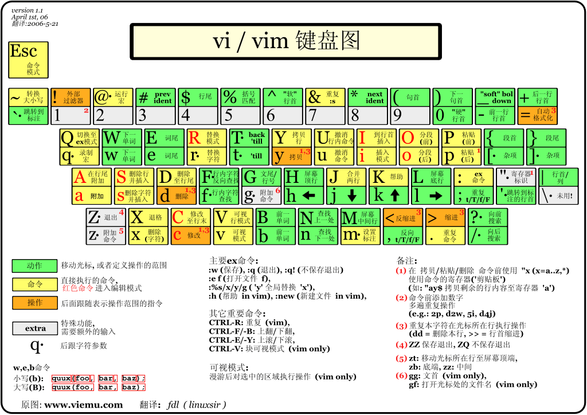

## 一张图记住vim快捷键

## vim的几种模式
普通模式
插入模式
可视模式
搜索模式
命令模式
替换模式
增强模式
### 普通模式
此模式中你可以进行跳转、修改文本内容等操作，当然最重要的的还是在此模式下进入其他模式XD
在任何模式下按`<ESC><ESC>`即可进入普通模式
在此模式下可以进入其他模式
`i`,`INSERT`进入插入模式
`v`,`<S-V>`,`<C-V>`可分别进入可视模式，可视行模式，可视块模式
`/`,`?`进入搜索模式
`:`进入命令模式
`R`进入替换模式
`Q`进入增强模式
> `/`和`?`均为搜索，前者为向后搜索，后者为向前搜索。搜索后，`n`向下一个搜索结果跳转，`N`向前一个搜索结果跳转
### 插入模式
此模式下可以插入文本内容
### 可视模式
此模式下可以对文本进行范围修改
### 命令模式
此模式可以执行各种命令，`:!command`可执行外部命令
**一些简单命令的介绍**
`wirte fileName`将文件保存为fileName，如果没有fileName，则仅保存。可简写为`w fileName`
`quit`  退出vim，`quit!`为强制退出，即不保存退出。可简写为`q`
`edit fileName`  编辑fileName的文件。
`help`  获取帮助，可简写为`h`
`.`  重复上一次操作
`[range]s/old/new/[option]`将old替换为new
`[range]`为范围，`x,y`代表从第x行到第y行
特别的：`.`为当前行
`[option]`为选项，`/g`表示全部替换；`/c`表示需要确认；`/p`表示替换结果逐行显示
如要组合使用，应这样写`/cgp`，并非这样`/g/c`
### 替换模式
插入模式下按`INSERT`可进入替换模式
此模式下可将已输入的内容替换为将要输入的内容
> example:
> 将*wrod*改为*word*
> 仅需将光标跳到*wrod*上,进入**替换模式**来重新打一遍*word*即可
## 在vim中移动
### 常规移动
`j`;`k`;`h`;`l`或`<UP>`;`<DOWN>`;`<LEFT>`;`<RIGHT>`
### 滚屏
单行
`<C-E>` `<C-Y>`
半屏
`<C-U>` `<C-D>`
整屏
`<C-F>` `<C-B>`
### 单词间
`w`跳到下一个单词的后
`e`调到单词最后一个字母
`b`前一个单词的首字母
### 行中
`0`行首
`$`行尾
`f{char}`快速跳转到当前光标到下一个`char`出现的光标
`F{char}`快速跳转到当前光标到前一个`char`出现的光标
### 段落间
`}`跳转到下一个空行，即下一段喽
`{`跳转到上一个空行
### 文件中
`]]`;`G`跳到文件底部
`[[`;`gg`跳到文件顶部
`m{a-zA-Z}`把当前光标位置设置标记
`'{a-zA-Z}`跳到标记处
`''`;\`\`跳到跳转前的位置
**相关命令:**
`:marks`  查看已设置的标记
`:delmarks <marks>`  删除`marks`标记
`:delmarks!`  删除所有标记
## 在vim中进行改动
`:read <file>`  插入文件，将文件内容插入到光标所在位置
example:
将外部命令的返回值插入到所编辑文件中
:read !ls
`I`跳到当前行的最前面并进入插入模式
`a`在当前光标后进入插入模式
`A`跳到当前行的最后面并进入插入模式
`x`删除光标所在字符
`d[move]`删除(delate)
example:
dd \#删除当前行
d5w \#删除后5个单词
`c[move]`修改(change)
example:
`cc`删除当前行所有内容并进入插入模式
`c$`删除当前行所在光标后所有内容并进入插入模式
`r`将当前光标内容替换为将要输入的内容
## 打造属于你自己的vim，配置vimrc
每个人的vim都是独一无二的，动手打造属于你自己的vim吧
## vim插件推荐
**文件管理**
preservim/NERDTree
**vim主题**
tomasr/molokai
**代码注释**
scrooloose/nerdcommenter
**代码查错**
w0rp/ale
**自动括号**
jiangmiao/auto-pairs
**surround插件**
tpope/vim-surround
**回车选中块**
gcmt/wildfire.vim
**vim中文文档**
yianwillis/vimcdoc
**代码补全**
neoclide/coc.nvim
**markdown-preview**
iamcco/markdown-preview.vim
**markdown画表插件**
dhruvasagar/vim-table-mode
**markdown列表插件**
dkarter/bullets.vim
## vim使用技巧
### vim中高效操作
`[次数]+[范围]+[操作]+[动作]`
example:
`20dj`意为将`dj`重复20次
### 自动格式化
让vim给你自动排列
`==`排列当前行
`=`是一个动作，后面可以加动作，当然前面也可以跟范围
example:
`=gg`从当前行排列到第一行
`=G`从当前行排列到最后一行
### 保存某范围内容到某个文件
`lin1,lin2 wirte filename`
example:
`100-50,100+50 w filename`
范围是可以使用表达式的
### 录制宏
`q[寄存器名]`录制,以后的操作可以录制下来,方便重复使用
`@[寄存器名]`使用宏
### 折叠
让vim帮你折叠一些行，方便查看内容