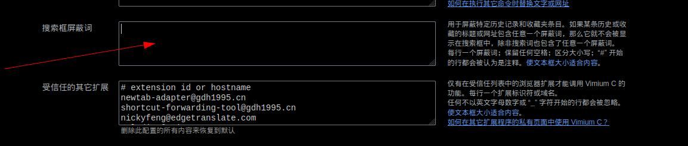
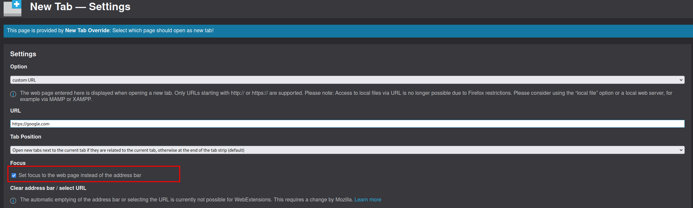

## 引子
浏览网页时我那蹩脚的鼠标操作，令人窒息。找到了这个浏览器插件，让俺丢掉鼠标(bushi)，拥抱键盘
俺仍然记忆了一些常用的浏览器快捷键(firefox)，一方面防止在没插件的电脑上使用变呆瓜，另一方面插件无法支持浏览器系统页面，比如设置之类的，防止摸瞎。
## 移动
|vimiumc快捷键|浏览器快捷键|含义|
|---|---|---|
|u|page up|向上滚半屏|
|d|page down|向下滚半屏|
|k|up|向上滚动|
|j|down|向下滚动|
|gg||滚动到最顶部|
|G||滚动到最底部|
|h|left|向左滚动|
|l|right|向右滚动|
|zH||滚动到最左边|
|zL||滚动到最右边|
## tab操作
|vimiumc快捷键|浏览器快捷键|含义|
|---|---|---|
|t|`c-t`|新建tab|
|x|`c-w`|关闭tab|
|X|`c-s-t`|恢复tab|
|T||在tab中导航|
|K|`c-tab`|跳转到下一个tab|
|J|`c-s-tab`|跳转到前一个tab|
## 页面内搜索
|vimiumc快捷键|浏览器快捷键|含义|
|---|---|---|
|`/`|`c-f`|搜索|
|可视模式与光标模式下`f`,`?`||正相反向搜索|
|n||下一个搜索结果|
|N||上一个搜索结果|
### 使用正则匹配
`/abc.e\r`
## 按钮和链接的点击
|vimiumc快捷键|浏览器快捷键|含义|
|---|---|---|
|f||点击链接或按钮|
|F||新建tab点击链接或按钮|
|`a-f`||新建tab连续点击链接或按钮|
## 向前向后
|vimiumc快捷键|浏览器快捷键|含义|
|---|---|---|
|H|`a-left`|向前|
|L|`a-right`|向后|
## 搜索框
|vimiumc快捷键|浏览器快捷键|含义|
|---|---|---|
|`o`,`O`||通用的搜索框|
|`b`,`B`||书签栏中搜索|
|`ge`,`gE`||编辑当前的url|
### 通过文件夹查找书签
使用搜索框时搜索`/folder/ xxx`会仅搜索`folder`下的书签
### 查找时过滤掉某些关键词的结果，防止小秘密被发现
设置里在这儿

## 实用的快捷键
|vimiumc快捷键|浏览器快捷键|含义|
|---|---|---|
|`]]`||下一页|
|`[[`||上一页|
|`yi`||复制图片|
|`yy`||复制当前链接|
|`r`|`f5`|刷新页面|
## 可视模式与光标模式
使用`v`进入可视模式，该模式下按`c`进入光标模式。
可视模式下可使用`y`进行复制，使用`p`或`P`进行快速搜索
可视模式下使用`h`,`j`,`k`,`l`,`w`,`e`进行移动
## 小技巧
#### 浏览器新建tab后聚焦的位置是地址栏，我想要新建后聚焦到网页
当浏览器聚焦到地址栏时，无法使用插件
这时需要借助另一个插件`New Tab Override`，只需略施小计，即可让你的新建标签页乖乖听话

### 强制刷新
设置R为强制刷新
```apl
map R reload hard
```
## 参考
[Home · gdh1995/vimium-c Wiki · GitHub](https://github.com/gdh1995/vimium-c/wiki)