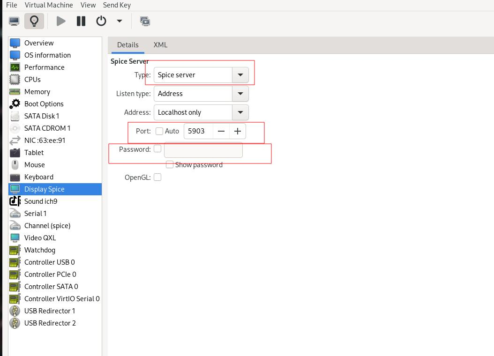
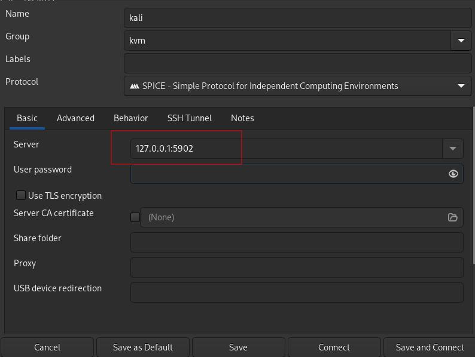

## 引子
在使用virtualbox时，vbox打开的虚拟机窗口无法便捷得最小化和展开。于是俺用了remmina，在每台vbox虚拟机的系统中开启rdp或是vnc。后面越发约感觉鸡肋，每次安装虚拟机后都要重新安装一下远程桌面服务。这时俺想到之前使用的virt-manager可以使用spice直接连接，而且这是虚拟化软件提供的，并非操作系统提供的。一是无需对虚拟机安装多余的软件，二是即便虚拟机网络不通，也可以方便的管理。
本文会展示一些关键的配置和一些注意事项。
## 正文
### virt-manager配置spice连接

password可选，如果想要暴露连接可以将address改为”All interfaces“
### 配置remmina连接

仅需填入ip+端口号。这里的ip为宿主机的ip并非客户机的ip
### 安装spice增强
**windows**
下载链接在这里找[spice-space download](https://www.spice-space.org/download.html)
**linux**
debian:
```cmd
# 一般来说linux客户机安装后这个包是默认被安装的
sudo apt install qemu-guest-agent
sudo apt install spice-vdagent
```
## 存在的问题
### 使用xfce桌面环境的客户机无法自动调整屏幕大小
目前xfce暂时没有办法自动调整屏幕大小，如有需求可以参考下面这个链接或者使用其他桌面环境，比如gnome。
[GitHub seife/spice-autorandr: Automatically adjust the client window resolution in Linux KVM guests using the SPICE driver](https://github.com/seife/spice-autorandr)
## 参考
[spice-space download](https://www.spice-space.org/download.html)
[Virt-manager ArchWiki](https://wiki.archlinux.org/title/Virt-manager)