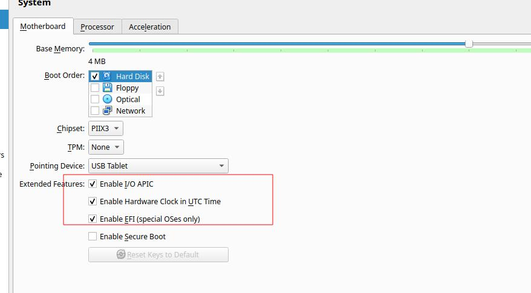
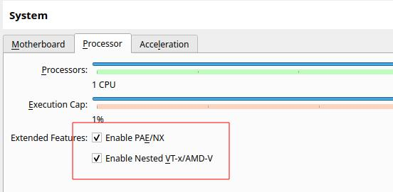
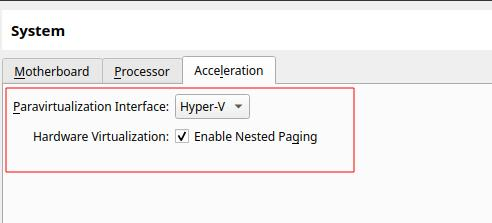
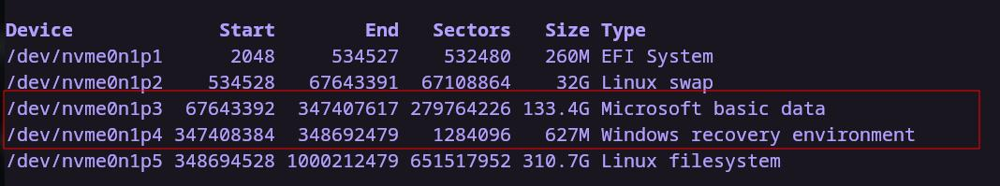
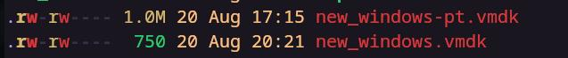
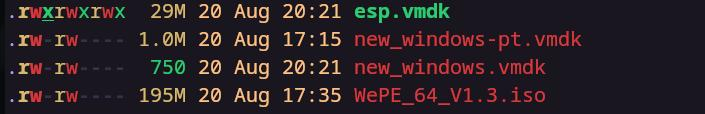
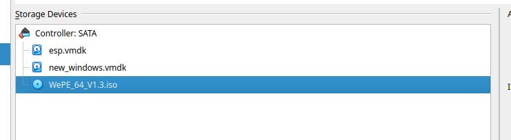
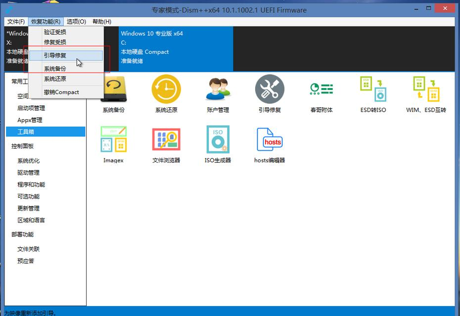
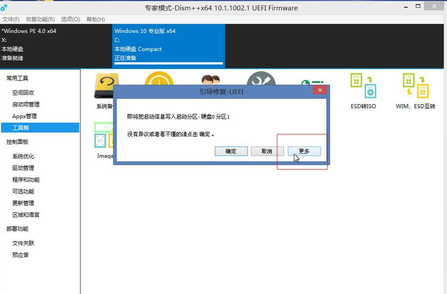
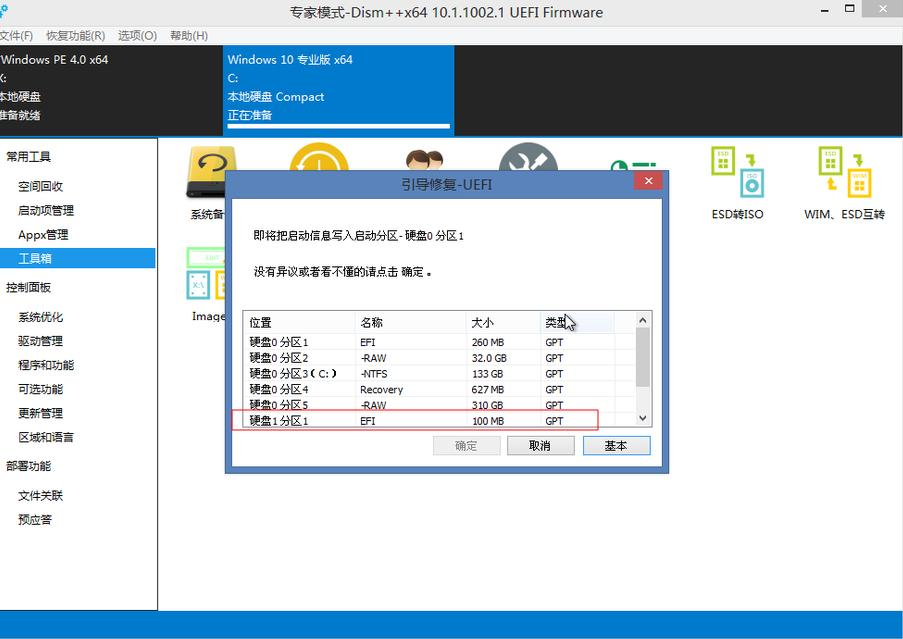

## 引子
在mac下使用`parallels desktop`这个软件，他可以识别本地硬盘里面的windows。就不用每次都切换系统了，非常好用。俺在linux下也想这样干。
## 正文
### 创建一个虚拟机
根据wiki描述创建

### 需要准备的东西
windows原版镜像或pe镜像，本文选择使用wepe镜像，使用windows原版镜像的小伙伴可以跟着wiki一步一步走。
windows虚拟硬盘
一个新的efi虚拟磁盘
### windows虚拟硬盘制备
#### 硬盘访问权限问题
俺选择了一个简单但安全性较低的方法，将用户加入disk组和vboxusers组
`usermod -aG disk,vboxusers $USER`
可以参照wiki使用udev来做更细粒度的控制
#### 制备windows虚拟硬盘
`VBoxManage internalcommands createrawvmdk -filename "WINDOWS_VMDK_PATH" -rawdisk WINDOWS_DISK -partitions WINDOWS_RESERVED_PARTITION_NUMBER,WINDOWS_BASIC_DATA_PARTITION_NUMBER -relative`
变量解释：
`WINDOWS_VMDK_PATH`制备的vmdk文件路径
`WINDOWS_DISK`windows所在的硬盘(非某个分区)，长得应该这样`/dev/sda`
`WINDOWS_RESERVED_PARTITION_NUMBER`
`WINDOWS_BASIC_DATA_PARTITION_NUMBER`windows恢复分区编号和数据硬盘编号

对于俺这块硬盘这两个编号应该为4和3
> 请注意区分编号顺序
对于俺这块硬盘制备虚拟硬盘的这个命令应该为
`VBoxManage internalcommands createrawvmdk -filename "/path/to/file/new_windows.vmdk" -rawdisk /dev/nvme0n1 -partitions 4,3 -relative`
制作完成你应该会得到这两个文件。`-pt`结尾的这个文件用不到，请忽视它

#### 制备efi硬盘
VBoxManage createmedium disk --filename VM_FOLDER/esp.vmdk --size 512 --format VMDK`
最后你应该得到这么多文件

注意更改文件所有者和权限
> 不要在意efi硬盘为权限什么是777....
### 为虚拟机添加硬盘

注意efi与windows硬盘的启动顺序
### 修复efi分区
强烈建议先备份一下原硬盘的efi分区
`dd if=/dev/sdaX of=xx.iso`
进入pe后，首先要把efi硬盘改为gpt格式，然后使用分区工具为其创建一个esp分区，并格式化
我们使用dism++进行修复，这里手把手教学(纯命令行修复也行，cmd下斜杠打自闭了，俺不用)
第一步打开dism++然后选择你的windows硬盘打开会话
第二步点恢复功能

第三步点击更多

第四步选择你创建的efi分区

最后确定即可
> 千万不要选错了！
最后重启就行啦
## 可能会遇到的问题
### 腾讯系游戏无法正常游玩
登陆lol时提示不支持虚拟机。emmmm，应该有解决方案，但是俺搜到的解决方案都是使用vm去搞的。俺电脑也没独显，性能估计也跟不上，俺就放弃了。
## 后续
windows自动更新了，切换到windows时蓝屏。
## 参考
[VirtualBox  Arch Linux 中文维基](https://wiki.archlinuxcn.org/wiki/VirtualBox#Run_a_native_Windows_installation_inside_VirtualBox)