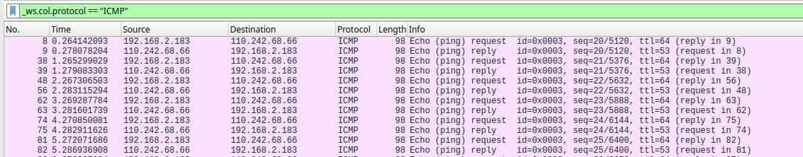
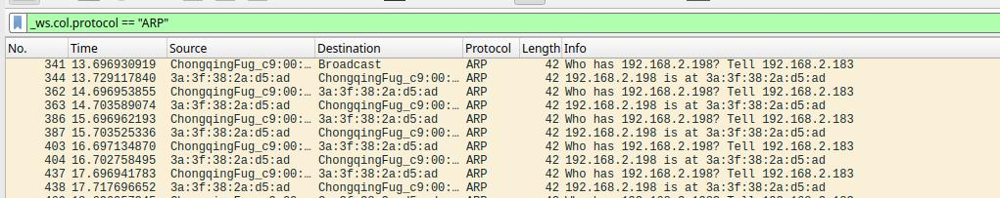
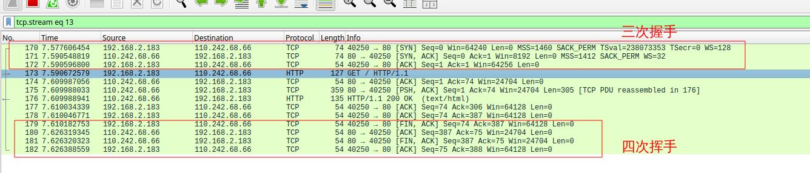
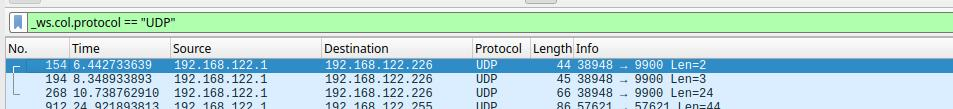
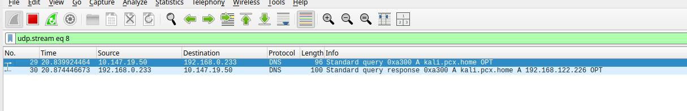

## wireshark抓包之ICMP
整个icmp包，`ping baidu.com`

## wireshark抓包之ARP 
要构造出arp包，我们可以手动进行arp请求。我们使用`arping 192.168.2.198`。
或是删除arp表等待arp广播

## wireshark抓包之TCP
浅浅构造一个http包，来观察TCP，`curl baidu.com`

### 三次握手 #card #forward
id:: 67a6bca0-06a8-45ed-aad9-0d8ef77877f1
c:我来了哦SYN 😃
s:我知道了，你来吧SYN,ACK 😁
c:我真的来了哦SYN 🥵
### 四次挥手 #card #forward
id:: 67a6bca0-dfe7-4196-ad6b-d58ae60dd43c
c:我要走了哦，好想你FIN,ACK 😢
s:你走吧SYN 🤔
s: 你走吧，拜拜了您内FIN,ACK 🤡
c: 我走了SYN 😭
### wireshark抓包之UDP
使用nc的udp模式构造udp包

### wireshark抓包之DNS
向dns服务器发送dns请求`dig kali.pcx.home`
