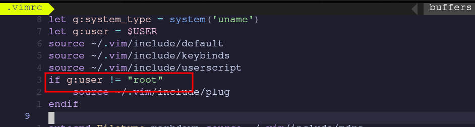

## 引子
配置文件管理起来非常麻烦，在之前写过一个shell脚本来管理配置文件，仅仅做了简单的复制粘贴，虽然用上了git，仍然感觉不够优雅，遂有此笔记
## yadm的使用
使用起来与git相同`yadm init/push/pull/add/commit`
### 新用户创建一个仓库
使用`yadm init`创建一个仓库
### 克隆已有的仓库
`yadm clone`
yadm的仓库存储在`~/.local/share/yadm/repo.git/`
## 基本用法
### 另类文件
可能存在差异的文件
#### 用法
在文件名后添加`file##<condition>[,<condition>,…]`
yadm会根据`condition`自动生成生成该文件的软连接
#### 举例
使用`yadm alt`会生成软连接
```shell
application_display_rule.conf -> application_display_rule.conf##hostname.gee
application_display_rule.conf##default
application_display_rule.conf##hostname.gee
autostart.conf -> autostart.conf##hostname.gee
autostart.conf##cursor
autostart.conf##hostname.gee
autostart.conf##hostname.tkpde14
```
#### 可用参数
|参数名|描述|用法|
|---|---|---|
|arch,a|架构|`##arch.x86_64`|
|class,c|在yadm中配置的类|`##class.classname`|
|default|默认的|`##default`|
|distro,d|发行版，`lsb_release ‑si`的值||
|distro_family,f|发行版系列,使用的是`/etc/os-release`中的`ID`属性|`##distro_family.rhel fedora`|
|extension,e|无任何影响，可以理解为注释|`##extension.unuse`|
|hostname,h|主机名hostname|`##hostname.xxx`|
|os,o|系统类型 使用`uname -s`中的值|`##os.Linux`|
|template,t|模板|`##template.templateType`|
|user,u|用户名|`##user.username`|
### 类
类可以作用于另类文件用作判断。
#### 设置类
`yadm config local.class classname`
删除/修改-> 使用方法和`git config`相同
### bootstrap
yadm在克隆成功后会主动运行这个程序，默认位置在`~/.config/yadm/bootstrap`，需要有可执行权限。
可以做安装软件，初始化某些应用之类的操作
#### 手动运行
` yadm bootstrap `
### 模板
模板会让你在不同机器中使用不同的内容，避免在配置文件中频繁使用`include`之类加载其他配置文件的方法
#### 一个直观的例子

使用类template后无需书写这个`if`加载启动vim时会快一丢丢
#### 用法
变量
变量需要使用大括号和空格包裹，例如`{{ var }}`
使用yadm内置变量
`yadm.var`
var: `arch,class,classes,distro,distro_family,hostname,os,source,user`
特别的变量`source`该变量为当前模板的文件名
使用环境变量
`env.VAR`
判断
```conf

# root user not use vimplug

source ~/.vim/include/plug

```
> 注意这里的判断仅支持`==`，支持嵌套
包含
可在模板中包含其他文件
```conf

```
#### 模板类型
俺使用默认的，需要系统有`awk`命令
其他类型详见[Templates yadm](https://yadm.io/docs/templates#)
### 钩子函数
钩子函数是在执行yadm命令前后做的额外操作
规范
执行前后钩子函数应命名为`pre_xxx`、`post_xxx`
钩子函数应存放在`.config/yadm/hooks`目录下
> 定义了执行前钩子函数应保证返回值为0,否则yadm认为钩子执行失败导致yadm命令将不会被执行
## 参考
[使用 YADM 整理你的 dotfiles 少数派](https://sspai.com/post/66894#!)
[Yet Another Dotfiles Manager yadm](https://yadm.io)