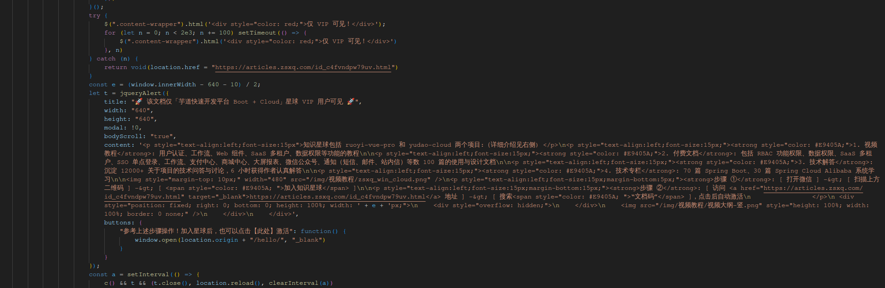
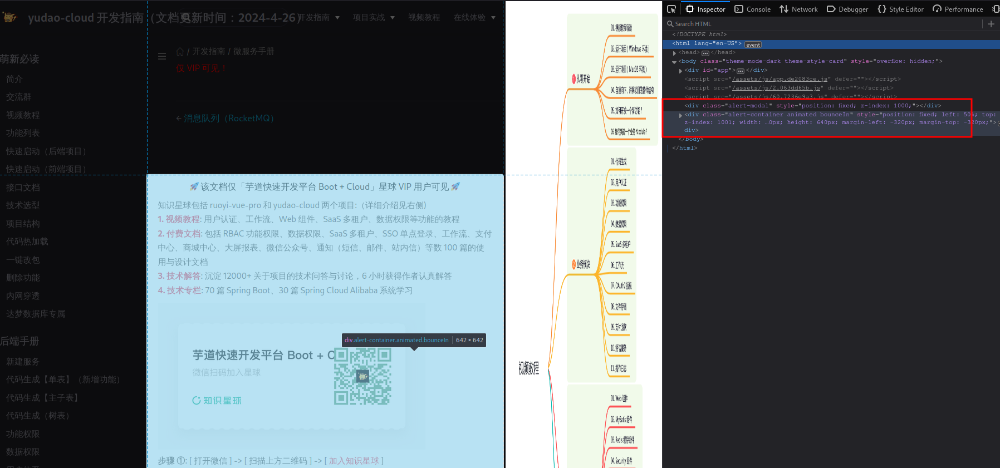
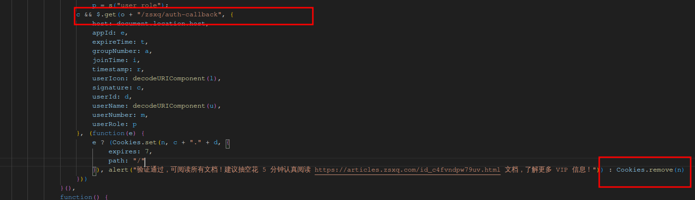
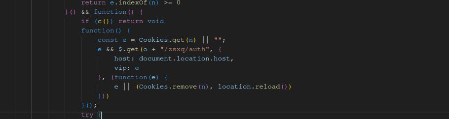
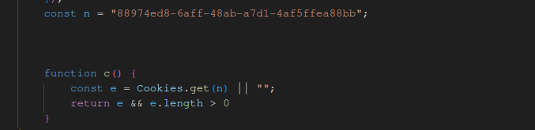

## 引子
看文档时，每次都弹框不让看。在刷新页面时偶然发现了，文档是先加载出来，然后对已有的文档进行覆盖，然后弹窗。俺第一开始想到的是对文档进行爬取，直接访问`robots.txt`发现没有访问到，于是俺就放弃了爬取，转而使用油猴脚本进行跳过。经过多次尝试最终完成跳过脚本，方案3为最终解。
> 声明： 本文内容仅供学习，无不良引导，如有侵权请我请联系删除
## 方案1:轮询修改body类，移除弹框
### 恢复文档(阻止修改)
查看源码发现js对.content-wrapper进行了覆盖

只需在这个js加载前将ccontent-wrapper的类名改为其他的
### 移除弹窗
俺发现了这两个坏蛋dom节点

这俩dom节点俺决定直接循环移除
### 代码编写
修改某类的类名
```js
// 获取所有具有类名为 '.abc' 的元素
const elements = document.querySelectorAll('.abc');
// 遍历每个元素并修改类名
elements.forEach(element => {
element.classList.remove('abc');  // 移除旧的类名
element.classList.add('bcd');     // 添加新的类名
});
```
移除dom节点
```js
// 获取节点
const elements = document.querySelectorAll(".className");
// 遍历移除
elements.forEach(element => element.remove());
```
循环调用
```jsx
let timerId; // 用于存储 setTimeout 返回的定时器 ID
function startLoop() {
// 执行您想要循环执行的操作
console.log("Loop iteration");
// 检查满足结束条件的条件
if (/* 满足结束条件 */) {
console.log("Loop ended");
return; // 结束循环
}
// 设置下一次循环调用的延迟时间
timerId = setTimeout(startLoop, 1000);
}
// 开始循环调用
startLoop();
```
### 问题和不足
修改了主要内容的类后，无法进行滚动
俺没有找到一个合适的条件去终止循环调用
需要考虑的东西:
修改类名的时机
跳转后的修改类名
判断弹窗已被关闭的条件，弹窗在js加载后会有延迟才能弹出
跳转后的弹窗关闭
## 方案2：模拟已校验用户，劫持校验请求
### 校验源码查看



`c()`是获取token，查看是否有其值的方法
校验的大概步骤是
先调用`/zsxq/auth-callback`这个接口来重置当前token，重置完成后，获取当前token，判断是否存在存在，没有token会重置主页内容，弹窗。有token会继续调用`/zsxq/auth`接口进一步鉴权，接口会返回true或false。鉴权失败刷新页面并删除token。
最简单的方法是，开局设置一个token,随便设置，让他去校验，我们劫持`/zsxq/auth`这个方法让其永远返回true，就结束了
### 代码
[ajax劫持库ajaxHooker-油猴中文网](https://bbs.tampermonkey.net.cn/thread-3284-1-1.html)
设置拦截器
```js
ajaxHooker.filter([
// 这些东西要按照实际来设置，俺直接拷贝的参考文档
{type: 'xhr', url: 'www.example.com', method: 'GET', async: true},
{url: /^http/},
]);
```
拦截代码编写
```js
ajaxHooker.hook(request => {
// 这个还是要进行细粒度控制滴
if (request.url === 'xxx') {
request.response = res => {
console.log(res);
// 返回改成true
res.responseText += 'test';
};
}
});
```
异步请求写法
```jsx
ajaxHooker.hook(async request => {
request.data = await modifyData(request.data);
request.response = async res => {
res.responseText = await modifyResponse(res.responseText);
};
});
```
### 问题
理想很美好，可是俺尝试了多次无果，发现压根没有请求出去emmm
## 方案3：模拟已校验用户，劫持导致请求失效的方法
通过方案2的失败，俺决定另辟蹊径，劫持某些方法。俺手动塞进去一个token进去的时候,token会被校验，然后页面被刷新，于是俺决定从此出发，劫持刷新页面的函数，发送get请求的函数，删除cookie的函数。这样他就不会进行请求，更不会删除token和刷新页面了。这样还避免了被跟踪，一举两得
### 代码
这代码可以直接粘到油猴中使用
```jsx
(function() {
const randomString = Math.random().toString(36).substring(2);
document.cookie = "88974ed8-6aff-48ab-a7d1-4af5ffea88bb=" + randomString;
$.get= null;
Cookies.remove = null;
location.reload = null;
})();
```
### 总结
暂时没有发现问题，用起来非常舒服
简单暴力，非常优美
## 参考
[ajax劫持库ajaxHooker-油猴中文网](https://bbs.tampermonkey.net.cn/thread-3284-1-1.html)
[消息队列（RabbitMQ） | yudao-cloud 开发指南](https://cloud.iocoder.cn/message-queue/rabbitmq/#_2-1-message-%E6%B6%88%E6%81%AF)